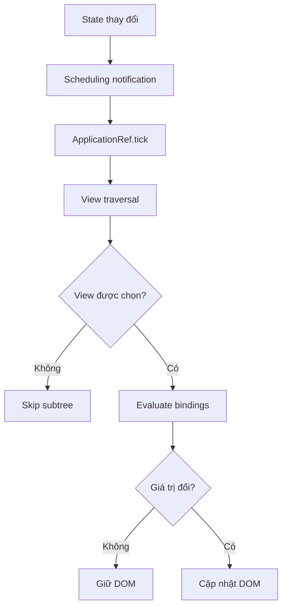
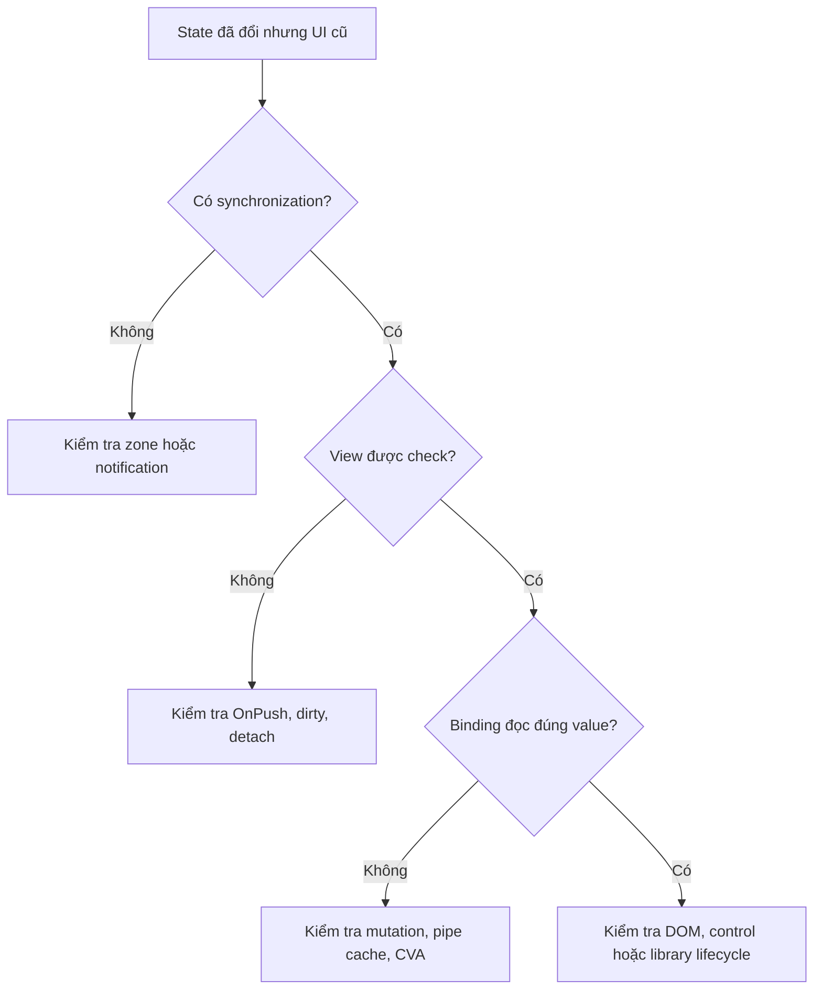

# Change Detection trong Angular

State của component được lưu trong memory của JavaScript. Khi một property thay đổi, phép gán chỉ cập nhật state này.

Browser không biết property đó đang được sử dụng ở đâu trong template. Vì vậy DOM không tự thay đổi theo state mới.

**Change Detection** là cơ chế Angular đọc lại các binding trong template, so sánh kết quả với lần kiểm tra trước và cập nhật những vị trí DOM có giá trị thay đổi.

> **Phạm vi phiên bản:** Mục 1–12 mô tả runtime của project hiện tại: Angular 17.3, Zone.js 0.14.3 và Change Detection dựa trên `NgZone`. Mục 13 trình bày Signal và zoneless như hướng tiến hóa của Angular, không dùng chúng để diễn giải ngược runtime đang chạy.

Tình huống xuyên suốt là một màn nhập chỉ số:

```text
IndicatorPageComponent
├── IndicatorFormComponent       ← nhập giá trị bằng control ng-zorro
├── RiskSummaryComponent         ← hiển thị điểm rủi ro dẫn xuất
└── IndicatorTableComponent      ← hiển thị nhiều IndicatorRowComponent
```

Một lượt Change Detection đi qua các bước từ khi state thay đổi đến khi DOM được đồng bộ:



---

## 1. Cơ chế Change Detection

State của component và DOM tồn tại ở hai nơi khác nhau. Sau một lượt Change Detection, mỗi binding được kiểm tra phải phản ánh giá trị mới nhất từ component.

> 1. Vì sao state và DOM cần được đồng bộ?
> 2. Quan hệ giữa state và DOM được khai báo ở đâu?
> 3. Một lượt Change Detection thực thi quan hệ đó theo luồng nào?
> 4. Angular vẫn thực hiện công việc gì khi DOM không cần thay đổi?

### 1.1. State trong memory và DOM

Trong JavaScript thuần, application phải tự nối state với DOM:

```html
<input id="indicator-value" type="number" value="80" />
<p id="risk-score">80</p>
```

```js
const input = document.getElementById('indicator-value');
const output = document.getElementById('risk-score');
const model = { giaTri: 80 };

input.addEventListener('input', event => {
  model.giaTri = Number(event.target.value);
  output.textContent = String(model.giaTri);
});
```

Nếu bỏ dòng gán `output.textContent`, `model.giaTri` vẫn đổi trong memory nhưng giao diện giữ giá trị cũ. `model` và DOM là hai vùng trạng thái độc lập — thay đổi một bên không tạo ra thao tác ghi ở bên còn lại.

Application đang tự thực hiện bốn trách nhiệm:

- Nhận event từ browser.
- Cập nhật source of truth trong memory.
- Tính giá trị cần hiển thị.
- Ghi kết quả vào đúng DOM node.

Cách imperative này hoạt động với một field. Khi cùng state xuất hiện ở text, class, summary và component con, mọi vị trí phải được cập nhật nhất quán. Bỏ sót một thao tác DOM tạo ra giao diện chứa cả giá trị cũ lẫn giá trị mới.

Angular chuyển trách nhiệm tìm và cập nhật DOM khỏi event handler. Template khai báo quan hệ state–DOM một lần:

```ts
@Component({
  selector: 'app-indicator-form',
  template: `
    <input
      type="number"
      [value]="model.giaTri"
      (input)="updateGiaTri($event)" />
    <p>Điểm rủi ro: {{ model.giaTri }}</p>
  `
})
export class IndicatorFormComponent {
  model = { giaTri: 80 };

  updateGiaTri(event: Event): void {
    const input = event.target as HTMLInputElement;
    this.model.giaTri = Number(input.value);
  }
}
```

`updateGiaTri()` giờ chỉ cập nhật source of truth. Nó không tìm `<p>`, không biết có bao nhiêu nơi đang hiển thị `model.giaTri` và không tự ghi DOM.

Browser không hiểu `{{ model.giaTri }}`. Angular compiler phải biến quan hệ khai báo đó thành công việc runtime có thể thực thi. Đơn vị công việc này là binding.

### 1.2. Binding trong template

**Binding** là biểu thức nối dữ liệu hoặc hành vi của component với một vị trí trong template. Compiler biết expression cần đọc và đích cần cập nhật, nhưng binding không tự chạy ngay khi một property JavaScript bị gán.

Mỗi binding có hai phía:

| Phía | Ví dụ | Vai trò |
|---|---|---|
| Nguồn | `model.giaTri` | Giá trị Angular đọc từ component context |
| Đích | Text node, element property hoặc component input | Vị trí nhận kết quả khi giá trị đổi |

Các loại binding phổ biến khác nhau ở đích hoặc hướng dữ liệu:

| Loại binding | Cú pháp | Vai trò |
|---|---|---|
| Interpolation | `{{ model.giaTri }}` | Tạo giá trị cho text node |
| Property binding | `[class.warning]="model.giaTri > 100"` | Tạo giá trị cho property, class hoặc style |
| Component input | `[model]="model"` | Truyền giá trị xuống component con |
| Event binding | `(input)="updateGiaTri($event)"` | Nhận đầu vào và bắt đầu state transition |

```html
<input
  [value]="model.giaTri"
  (input)="updateGiaTri($event)" />
<span [class.warning]="model.giaTri > 100">
  {{ model.giaTri }}
</span>
<app-risk-summary [model]="model" />
```

Event binding có hướng ngược lại: browser → component. Nó gọi handler và thường bắt đầu state transition, nhưng bản thân listener không phải giá trị được so sánh với lần trước.

Interpolation, property binding và component input có hướng component → view. Angular đọc lại expression của chúng khi view được kiểm tra. Đây không phải subscription riêng cho từng property — một phép gán `model.giaTri = 95` không phát notification cho từng binding đang đọc field đó.

> **Lưu ý:** Template expression có thể là method call hoặc getter. Angular sẽ thực thi expression mỗi lần binding được evaluate, vì vậy expression nên thuần và nhẹ.

Danh sách binding mới chỉ xác định **cần đồng bộ cái gì**. Angular vẫn phải quyết định khi nào bắt đầu, view nào được đi qua và binding nào thực sự đổi giá trị.

### 1.3. Luồng Change Detection

Khi người dùng nhập `95`, state không đi thẳng từ event handler xuống DOM. Nó đi qua ba quyết định độc lập:

```text
input event
→ updateGiaTri() đổi model.giaTri từ 80 thành 95

Scheduling
→ Angular nhận notification khi event handler hoàn tất
→ ApplicationRef.tick() bắt đầu

Traversal
→ Angular đi từ root view xuống cây view
→ strategy và trạng thái view cho phép kiểm tra IndicatorFormComponent

Binding và DOM
→ Angular evaluate {{ model.giaTri }} thành 95
→ so sánh với kết quả 80 của lần kiểm tra trước
→ hai giá trị khác nhau
→ text node được cập nhật thành 95
```

Event handler chỉ hoàn thành bước thay đổi state. Scheduling notification không mang theo thông tin “`model.giaTri` đã đổi” và cũng không chỉ định DOM node cần cập nhật. Nó chỉ tạo cơ hội để Angular bắt đầu một lượt đồng bộ.

Khi tick bắt đầu, Angular cũng không mặc định execute mọi template. Traversal quyết định view nào được kiểm tra. Chỉ sau khi tới `IndicatorFormComponent`, Angular mới đọc `model.giaTri`, so sánh kết quả và quyết định có ghi DOM hay không.

Pipeline này có ba tầng độc lập:

| Tầng | Câu hỏi | Kết quả |
|---|---|---|
| Scheduling | Khi nào bắt đầu synchronization? | Có hoặc không có tick |
| Traversal | Tick kiểm tra view nào? | Check hoặc skip subtree |
| Binding và DOM | Binding nào đổi? | Giữ nguyên hoặc cập nhật DOM |

Cùng một triệu chứng “UI vẫn cũ” có thể xuất phát từ nhiều tầng:

| Quan sát | Bước đã xảy ra | Bước cần kiểm tra tiếp |
|---|---|---|
| State đổi nhưng không có tick | State transition | Scheduling notification |
| Có tick nhưng component không chạy `ngDoCheck` | Global synchronization | Traversal và dirty state |
| Component được kiểm tra nhưng derived value cũ | View check | Input identity hoặc computation cache |
| Binding đã có giá trị mới nhưng control vẫn hiển thị cũ | Binding evaluation | DOM, CVA hoặc third-party control lifecycle |

Vì vậy gọi `detectChanges()` ngay khi UI stale có thể che triệu chứng mà không sửa boundary bị thiếu. Chẩn đoán phải dừng tại bước đầu tiên chưa xảy ra.

### 1.4. Tick, view check và DOM update

Luồng ở mục 1.3 chứa ba loại công việc có thể xảy ra độc lập. Phân biệt chúng ngăn kết luận sai rằng một tick luôn kiểm tra mọi view hoặc một view check luôn sửa DOM.

Ba khái niệm không đồng nghĩa:

| Khái niệm | Định nghĩa |
|---|---|
| Tick | Một lượt global synchronization bắt đầu từ root view |
| View check | Template của một view thực sự được thực thi trong global hoặc local traversal |
| DOM update | Thao tác ghi xuống DOM khi kết quả binding thay đổi |

Ba trường hợp sau minh họa sự khác nhau:

```text
Trường hợp A
Global tick chạy
→ 100 view được kiểm tra
→ mọi binding giữ nguyên
→ 0 DOM update

Trường hợp B
Global tick chạy
→ table OnPush không có notification
→ toàn bộ table subtree bị skip

Trường hợp C
detectChanges() được gọi trên một row
→ row và descendants được kiểm tra cục bộ
→ không cần bắt đầu từ root view
```

Một tick có thể kiểm tra nhiều view nhưng không sửa DOM. Một `OnPush` view có thể bị skip dù global tick vẫn chạy ở nhánh khác. Ngược lại, local traversal có thể cập nhật một view mà không tạo global tick.

**Dirty** cũng không đồng nghĩa với DOM chắc chắn thay đổi:

```text
Dirty
≠ state chắc chắn đổi
≠ binding chắc chắn đổi
≠ DOM chắc chắn update

Dirty chỉ có nghĩa:
view không được skip trong synchronization phù hợp.
```

Dirty state chỉ thay đổi quyết định traversal. Angular vẫn phải evaluate binding để biết state hiển thị có thực sự đổi hay không, và DOM chỉ được ghi khi phép so sánh phát hiện giá trị mới.

Có view cần refresh vẫn chưa đủ. Nếu không có synchronization tiếp theo, dirty flag chưa được đọc. Câu hỏi đầu tiên còn bỏ ngỏ là Angular 17.3 nhận scheduling notification từ đâu để bắt đầu tick.

---

## 2. Scheduling và global tick

Angular 17.3 trong project dùng Zone.js và `NgZone` để biến các async boundary thành cơ hội synchronization. Cơ chế này không quan sát từng property. Nó quan sát thời điểm code có khả năng vừa thay đổi state.

### 2.1. State change không tự lập lịch render

Câu lệnh sau chỉ đổi memory:

```ts
this.total = 100;
```

Angular không intercept mọi phép gán JavaScript. Framework cũng không thể thay đổi ngữ nghĩa của các phép gán thông thường để mỗi dòng `this.total = ...` tự tìm template và yêu cầu render.

Điều này tạo ra hai công việc độc lập:

```text
Công việc 1 — cập nhật state
this.total = 100

Công việc 2 — lập lịch đồng bộ view
Angular bắt đầu một lượt Change Detection phù hợp
```

Công việc 1 có thể xảy ra mà công việc 2 không xảy ra. Khi đó component instance đã giữ `100`, còn DOM vẫn hiển thị kết quả binding cũ.

Trong application thực tế, state thường đổi bên trong một callback thay vì ở một dòng code hoàn toàn tách biệt:

| Nguồn | Callback chứa state transition |
|---|---|
| DOM event | Handler của `click`, `input`, `keydown` |
| Timer | Callback của `setTimeout`, `setInterval` |
| Promise | `.then()` hoặc phần tiếp tục sau `await` |
| HTTP | Observer nhận response từ `HttpClient` |
| Browser frame | Callback của `requestAnimationFrame` |

Zone.js patch các API này để quan sát thời điểm callback được đăng ký và thực thi. Nó không biết callback có sửa state hay không. Một callback chỉ ghi log và một callback thay đổi mười binding đều tạo cùng loại tín hiệu: **một async task trong zone vừa hoàn tất**.

Tín hiệu rộng này giải quyết câu hỏi “khi nào state có thể vừa đổi”, nhưng chưa phân biệt callback nào thuộc application boundary của Angular. `NgZone` tạo ranh giới đó.

### 2.2. Zone.js và `NgZone`

Zone.js giữ một **execution context** qua async boundary. Callback được đăng ký trong zone nào sẽ được thực thi lại trong zone đó, kể cả khi callback chạy sau nhiều giây và call stack ban đầu không còn tồn tại.

Angular dùng `NgZone` để giữ hai execution context:

- **Inner zone** — code thuộc application boundary và có thể tạo lifecycle signal cho Angular.
- **Outer zone** — code vẫn chạy bình thường trong JavaScript nhưng không tự kích hoạt global Change Detection qua `NgZone`.

Hai zone không quyết định callback có được thực thi hay không. Chúng chỉ thay đổi việc Angular có được thông báo về lifecycle của callback đó hay không.

Angular expose boundary này qua hai API:

| Boundary | API | Hệ quả |
|---|---|---|
| Inner Angular zone | `ngZone.run()` | Callback có thể tạo scheduling notification |
| Outer zone | `ngZone.runOutsideAngular()` | Callback không tự tạo global tick từ `NgZone` |

Ví dụ một timer trong Angular zone:

```ts
setTimeout(() => {
  this.total = 100;
}, 1000);
```

Luồng hành vi:

```text
setTimeout callback chạy trong Angular zone
→ this.total đổi
→ microtask queue rỗng
→ NgZone phát onMicrotaskEmpty
→ ApplicationRef.tick()
→ binding được kiểm tra
```

Cùng timer ở ngoài zone:

```ts
this.ngZone.runOutsideAngular(() => {
  setTimeout(() => {
    this.total = 100;
  }, 1000);
});
```

`total` vẫn đổi trong memory. `runOutsideAngular()` không đóng băng component và không chặn JavaScript. Nó chỉ làm callback timer tiếp tục ở outer zone, nên callback đó không tự tạo global tick qua `NgZone`.

Async work được tạo bên trong outer zone cũng tiếp tục mang outer-zone context:

```ts
this.ngZone.runOutsideAngular(() => {
  requestAnimationFrame(() => {
    Promise.resolve().then(() => {
      // rAF callback và Promise continuation đều ở outer zone.
      this.sampleCount++;
    });
  });
});
```

Nếu một phần kết quả cần hiển thị, chỉ đoạn state transition liên quan đến UI quay lại inner zone:

```ts
this.ngZone.run(() => {
  this.total = 100;
});
```

Cách này giữ workload tần suất cao ở ngoài Angular, nhưng vẫn tạo scheduling signal khi state hiển thị thực sự đổi.

Inner zone xác định callback nào có thể báo cho Angular, nhưng chưa xác định **thời điểm nào trong async chain** đủ ổn định để chạy Change Detection. Tick ngay sau từng microtask có thể làm Angular quan sát state trung gian. Mốc phù hợp đến từ thứ tự xử lý task và microtask của event loop.

### 2.3. VM turn, macrotask và microtask

`NgZone` cần chờ state trong lượt JavaScript hiện tại tương đối ổn định. Event loop cung cấp mốc đó.

Một timer, click hoặc network callback bắt đầu một lượt thực thi. Trong lượt này, code đồng bộ có thể enqueue thêm Promise continuation. Các microtask được xử lý hết trước khi browser chuyển sang task kế tiếp.

| Khái niệm | Vai trò |
|---|---|
| VM turn | Một lượt JavaScript được event loop lấy ra để chạy |
| Macrotask | Click, timer, XHR callback và các task lớn khác |
| Microtask | `Promise.then`, `async` continuation và `queueMicrotask` |

Ví dụ sau vừa minh họa thứ tự event loop, vừa cho thấy state có thể thay đổi qua nhiều bước trong cùng một lượt:

```ts
this.status = 'starting';
console.log('A');

setTimeout(() => {
  this.status = 'timer completed';
  console.log('B - macrotask');
}, 0);

Promise.resolve().then(() => {
  this.status = 'promise completed';
  console.log('C - microtask');
});

console.log('D');
```

Code đồng bộ chạy trước, microtask chạy sau call stack hiện tại, rồi timer mới được lấy từ macrotask queue:

```text
A
D
C - microtask
B - macrotask
```

Tại cuối code đồng bộ, `status` mới là `starting`. Sau microtask, nó thành `promise completed`. Nếu Angular check view trước khi microtask queue rỗng, giao diện có thể quan sát giá trị trung gian rồi phải check lại ngay sau đó.

Khi microtask queue rỗng, mọi Promise continuation đã được enqueue trong lượt hiện tại đã hoàn tất. Đây là mốc `NgZone` dùng để cho phép Angular đồng bộ view. Timer vẫn là một macrotask riêng, nên khi timer chạy sau đó, nó tạo một lượt mới và có thể dẫn tới một tick khác.

`NgZone` biến các mốc của event loop thành event framework có thể quan sát: bắt đầu bận, microtask đã hết và toàn bộ lượt đã ổn định.

### 2.4. Vòng đời `NgZone`

`NgZone` phát các tín hiệu mô tả một VM turn:

| Event | Thời điểm | Ý nghĩa |
|---|---|---|
| `onUnstable` | Code bắt đầu chạy trong Angular zone | Zone bắt đầu bận |
| `onMicrotaskEmpty` | Microtask queue hiện tại rỗng | Angular có thể gọi `ApplicationRef.tick()` |
| `onStable` | Zone không còn pending work trong lượt hiện tại | VM turn đã ổn định |
| `onError` | Lỗi đi qua Angular zone | Chuyển lỗi tới error handling |

Một lượt đơn giản thường đi qua thứ tự sau:

```text
Callback bắt đầu chạy trong Angular zone
→ onUnstable
→ handler đồng bộ chạy
→ Promise continuation trong lượt hiện tại chạy
→ microtask queue rỗng
→ onMicrotaskEmpty
→ ApplicationRef.tick()
→ không còn pending microtask trong lượt
→ onStable
```

`onUnstable` chỉ phát khi zone chuyển từ stable sang unstable, không phải trước mọi dòng code. `onStable` chỉ phát sau khi Angular zone không còn microtask đang chờ và lượt hiện tại thực sự ổn định.

`onMicrotaskEmpty` là tín hiệu Angular dùng để gọi tick. Trong chính tick đó, lifecycle hook hoặc framework code có thể enqueue thêm microtask. Queue lại trở nên không rỗng, rồi rỗng thêm lần nữa. Vì vậy cùng một VM turn có thể có nhiều lần `onMicrotaskEmpty`.

> **Lưu ý:** Angular không đợi `onStable` mới gọi Change Detection. `onStable` mô tả trạng thái của zone sau cùng, còn `onMicrotaskEmpty` là mốc có thể kích hoạt `ApplicationRef.tick()`.

Điều này cũng giải thích vì sao không có công thức “một HTTP request bằng đúng một tick”. Một request có thể liên quan đến network callback, interceptor, Observable operator và Promise continuation. Mỗi async completion có thể tạo một lần zone chuyển trạng thái riêng.

`forkJoin` chỉ bảo đảm subscriber nhận một emission khi tất cả source hoàn tất. Nó giảm số lần application gán aggregate state, nhưng không gộp lifecycle của mọi network callback thành một task duy nhất.

Số callback, số event `NgZone`, số global tick và số lần template expression chạy là bốn đại lượng khác nhau:

| Đại lượng | Có thể lớn hơn vì |
|---|---|
| Async callback | Một luồng nghiệp vụ gồm nhiều timer, request hoặc Promise continuation |
| `onMicrotaskEmpty` | Microtask mới được enqueue trong cùng VM turn |
| `ApplicationRef.tick()` | Nhiều zone turn hoặc lời gọi tick thủ công |
| Template expression | Một tick kiểm tra nhiều view và development mode có lượt xác minh phụ |

Muốn kết luận scheduling có gây chi phí hay không, từng đại lượng phải được quan sát riêng.

### 2.5. Quan sát scheduling

Có thể quan sát event `NgZone` trong môi trường học hoặc debug:

```ts
@Injectable({ providedIn: 'root' })
export class ZoneDebugService {
  constructor(ngZone: NgZone) {
    ngZone.onUnstable.subscribe(() => console.log('[NgZone] unstable'));
    ngZone.onMicrotaskEmpty.subscribe(() => console.log('[NgZone] microtask empty'));
    ngZone.onStable.subscribe(() => console.log('[NgZone] stable'));
  }
}
```

Để đếm global tick, instrument `ApplicationRef.tick()` riêng. Không đưa instrumentation này vào production:

```ts
constructor(appRef: ApplicationRef) {
  if (isDevMode()) {
    const originalTick = appRef.tick.bind(appRef);
    let count = 0;

    appRef.tick = () => {
      console.log('[CD tick]', ++count);
      originalTick();
    };
  }
}
```

Khi thực hiện một thao tác, log có thể có dạng:

```text
[NgZone] unstable
[NgZone] microtask empty
[CD tick] 1
[NgZone] stable
```

Kết quả này chứng minh một zone turn đã dẫn tới một global tick. Nếu có hai dòng `microtask empty` nhưng chỉ một hoặc hai tick, cần đọc đúng log thực tế thay vì suy ra từ số callback nghiệp vụ.

Mỗi công cụ trả lời một câu hỏi khác nhau:

| Phép đo | Kết luận hợp lệ | Không chứng minh được |
|---|---|---|
| Event `NgZone` | Zone chuyển trạng thái khi nào | View nào được kiểm tra |
| `ApplicationRef.tick()` | Có bao nhiêu global tick | Binding hoặc DOM nào đổi |
| Angular DevTools | Tick kiểm tra component nào và tốn bao lâu | Browser layout hoặc paint chi tiết |
| Chrome Performance | Scripting, layout và paint tốn bao nhiêu thời gian | `OnPush` view bị skip vì trigger nào |

Để đo một vấn đề, cần ghi rõ thao tác tái hiện và khoảng thời gian quan sát. Log toàn bộ thời gian application chạy sẽ trộn startup, router, FPS meter, timer và interaction vào cùng một kết quả.

> **Lưu ý:** Việc thay thế `ApplicationRef.tick()` trong ví dụ chỉ dành cho học và debug local. Production nên dùng profiler và telemetry được thiết kế riêng, không monkey-patch runtime method.

Scheduling đến đây đã được xác định. Một tick đã bắt đầu nhưng vẫn chưa biết traversal sẽ đi qua toàn bộ cây hay dừng ở một subtree.

---

## 3. View traversal với `Default` và `OnPush`

Global tick chỉ cho biết Angular bắt đầu duyệt từ root view. Nó không có nghĩa mọi component instance bắt buộc phải execute template.

Change Detection strategy quyết định traversal có thể dừng ở boundary nào:

- `Default` kiểm tra view mỗi khi global traversal đi tới view đó.
- `OnPush` cho phép Angular skip cả subtree khi không có notification liên quan.

Hai strategy không thay đổi cách binding được so sánh sau khi view đã được chọn. Khác biệt nằm ở điều kiện để Angular **đi vào view**.

### 3.1. `Default` strategy

Nếu component không khai báo `changeDetection`, Angular dùng `Default`:

```ts
@Component({
  selector: 'app-indicator-form',
  templateUrl: './indicator-form.component.html'
})
export class IndicatorFormComponent {}
```

Khi global traversal tới một `Default` view, Angular thực thi update phase của view đó. Strategy không cần bằng chứng rằng input hoặc local state vừa đổi.

Object mutation vì thế vẫn được nhìn thấy nếu một tick xảy ra:

```ts
this.model.giaTri = 95;
```

```html
{{ model.giaTri }}
```

Luồng runtime:

```text
Một nguồn scheduling tạo global tick
→ traversal tới IndicatorFormComponent
→ strategy Default không chặn view check
→ binding đọc model.giaTri = 95
→ kết quả cũ là 80
→ DOM được cập nhật thành 95
```

`Default` không phát hiện mutation tại thời điểm phép gán. Mutation chỉ được nhìn thấy vì một tick khác đã làm traversal quay lại view và binding được đọc lại.

Điểm mạnh của strategy này là tương thích tự nhiên với mutable state. Điểm đổi lại là traversal không biết event hiện tại có liên quan đến view hay không. Một event trong form có thể kéo table `Default` với 500 row vào cùng tick dù dữ liệu table không đổi.

`Default` phù hợp khi:

- Component có ít binding.
- Collection nhỏ hoặc đã phân trang.
- Template expression nhẹ.
- Phép đo chưa cho thấy traversal rộng là bottleneck.

Khi cây lớn, cần một boundary cho phép Angular skip subtree không có notification mới.

### 3.2. `OnPush` strategy

`OnPush` đặt boundary tại root của subtree:

```ts
@Component({
  selector: 'app-indicator-row',
  templateUrl: './indicator-row.component.html',
  changeDetection: ChangeDetectionStrategy.OnPush
})
export class IndicatorRowComponent {
  @Input() row!: IndicatorRow;
}
```

Một `OnPush` subtree có thể bị bỏ qua nếu Angular không nhận được lý do cần refresh nó. Khi skip root view, Angular cũng không đi sâu vào descendants của subtree đó.

```text
Global traversal tới IndicatorTableComponent (OnPush)
→ không có input mới
→ không có event trong subtree
→ view không dirty
→ skip table view
→ không evaluate row bindings bên dưới
```

`OnPush` không phải deep comparison. Angular không duyệt từng property để tìm mutation. Strategy cũng không làm expression trong view nhẹ hơn — nếu view được chọn, update phase vẫn chạy như bình thường.

Lợi ích chỉ xuất hiện khi component boundary trùng với boundary thay đổi của state. Nếu một component lớn vừa chứa form vừa chứa table, event của form vẫn làm chính view lớn đó được kiểm tra.

Vì traversal có thể dừng tại boundary, correctness phụ thuộc vào state transition có tạo đúng trigger hay không. Các trigger cần được đặt cạnh nhau trước khi phân tích từng trường hợp.

### 3.3. Dirty state và trigger matrix

`OnPush` trở nên dễ dự đoán khi mọi trigger được đặt trong một decision table:

| Thay đổi | View `OnPush` được kiểm tra? | Cơ chế |
|---|---:|---|
| Parent truyền primitive mới | Có | Input changed |
| Parent truyền object reference mới | Có | Input identity changed |
| Parent mutate object cũ | Không nhất thiết | Input identity giữ nguyên |
| Event xảy ra trong subtree | Có | Listener đánh dấu đường traversal |
| Event ở sibling `OnPush` độc lập | Không | Subtree không có notification |
| `AsyncPipe` nhận emission | Có ở synchronization phù hợp | Pipe đánh dấu view |
| `markForCheck()` | Có ở synchronization sau | Dirty marking |
| `detectChanges()` | Có ngay | Local traversal |
| Signal được đọc trong template thay đổi | Có ở synchronization phù hợp | Reactive consumer marked |
| View đã `detach()` | Không qua global traversal | View tách khỏi tree |

Các API và cơ chế async trong bảng được định nghĩa ở mục 6. Tại đây cần phân biệt **notification**, **dirty state** và **view refresh**:

```text
Notification xảy ra
→ Angular đánh dấu view hoặc đường traversal liên quan
→ synchronization phù hợp bắt đầu
→ traversal không skip view
→ binding mới được evaluate
→ DOM chỉ update nếu binding đổi
```

> **Dirty không có nghĩa DOM chắc chắn đổi. Dirty chỉ có nghĩa view không được skip khi traversal phù hợp xảy ra.**

Dirty flag còn không tự bảo đảm một global tick sẽ xuất hiện trong mọi cấu hình. Ở project zone-based hiện tại, một scheduling source phù hợp vẫn phải làm Angular bắt đầu synchronization. `detectChanges()` là trường hợp khác vì nó chủ động chạy local traversal ngay.

Bảng trigger cho biết notification có tồn tại, nhưng chưa cho biết notification đó mở nhánh nào. Với event, câu trả lời phụ thuộc vào vị trí listener trong cây view.

### 3.4. Vị trí event trong cây

#### Event ngoài subtree `OnPush`

Cây sau đặt event trong form, nằm ngoài boundary của table `OnPush`:

```text
IndicatorPageComponent (Default)
├── IndicatorFormComponent (Default) ← event
└── IndicatorTableComponent (OnPush) ← skip
    └── IndicatorRowComponent (OnPush)
```

Event làm Angular có cơ hội bắt đầu tick, nhưng event không thuộc table subtree. Nếu table không có input mới và không dirty, traversal dừng tại `IndicatorTableComponent`. Không row nào bên dưới được kiểm tra.

#### Event tại root của subtree `OnPush`

Cây sau đặt listener tại chính root view của table `OnPush`:

```text
IndicatorPageComponent (Default)
└── IndicatorTableComponent (OnPush) ← event
    ├── IndicatorRowComponent (OnPush)
    └── IndicatorRowComponent (OnPush)
```

Table view được kiểm tra vì listener nằm trong chính view đó. Angular có thể tiếp tục traversal descendants, nhưng mỗi row `OnPush` độc lập vẫn được quyết định theo input và dirty state của row. Event tại table không đồng nghĩa mọi row phải execute template.

#### Event trong descendant của ancestor `OnPush`

Cây sau đặt event trong row, phía dưới một ancestor table cũng dùng `OnPush`:

```text
IndicatorPageComponent (Default)
└── IndicatorTableComponent (OnPush)
    └── IndicatorRowComponent (OnPush) ← event
```

Row chứa listener phải được kiểm tra. Để root traversal tới được row, Angular giữ đường ancestor qua `IndicatorTableComponent`. Table và row nằm trên đường event được kiểm tra, nhưng sibling row không liên quan vẫn có thể bị skip.

Ba tình huống có cùng một global tick nhưng phạm vi view được kiểm tra khác nhau. Chẩn đoán `OnPush` phải xác định event thuộc subtree nào, view nào chứa listener và ancestor nào dẫn tới view đó.

Event giải thích notification phát sinh từ interaction. Với data đi từ parent xuống child, Angular không có event để dựa vào — input identity trở thành bằng chứng cho một state transition mới.

### 3.5. Input identity

Parent template evaluate input binding trong mỗi lần parent được kiểm tra. Angular so sánh kết quả binding mới với kết quả đã lưu trước đó. Với primitive, thay đổi giá trị tạo input mới. Với object hoặc array, phép so sánh dựa trên identity chứ không duyệt sâu nội dung.

Mutation thay đổi object nhưng giữ identity:

```ts
// Nội dung đổi, reference của row giữ nguyên.
this.row.name = 'Tên mới';
```

```text
Parent được kiểm tra
→ [row] evaluate thành cùng object reference
→ Angular không ghi input mới cho child
→ ngOnChanges của child không chạy vì input này
→ child OnPush không nhận input notification mới
```

Điều này không có nghĩa child chắc chắn luôn hiển thị cũ. Nếu event nằm trong chính child, một ancestor được mark hoặc local traversal chạy, child vẫn có thể được kiểm tra và đọc property đã mutate. Vấn đề là mutation không còn là notification đáng tin cậy tại input boundary.

State transition qua boundary nên tạo reference mới:

```ts
this.row = {
  ...this.row,
  name: 'Tên mới'
};
```

```text
Parent được kiểm tra
→ [row] evaluate thành reference mới
→ Angular ghi input mới vào child
→ child nhận input notification
→ child OnPush được kiểm tra trong traversal này
```

Với collection, chỉ item thay đổi cần object mới. Các item còn lại giữ reference để row tương ứng tiếp tục được skip:

```ts
this.rows = this.rows.map(row =>
  row.id === changedId
    ? { ...row, name: 'Tên mới' }
    : row
);
```

Immutable update không bắt buộc với mọi state cục bộ. Một primitive hoặc object chỉ được dùng trong chính component có thể cập nhật theo cách đơn giản nhất. Reference mới cần thiết khi dữ liệu đi qua boundary phụ thuộc identity như `@Input`, pure pipe hoặc memoized selector.

Input mới giúp Angular chọn đúng subtree, nhưng không làm giảm công việc bên trong subtree sau khi nó đã được chọn. Giới hạn này xác định chính xác phạm vi tối ưu của `OnPush`.

### 3.6. Phạm vi tối ưu của `OnPush`

`OnPush` chỉ tối ưu **chiều rộng traversal**:

```text
Default
→ tick có thể kiểm tra toàn bộ 500 row

OnPush với input ổn định
→ table boundary được xét
→ các row không có notification được skip
```

Giả sử chỉ row `id = 42` được thay bằng object mới:

```text
500 row hiện có
→ 1 row nhận input reference mới
→ 499 row giữ reference cũ
→ row 42 được kiểm tra
→ phần lớn sibling row có thể được skip
```

Mức giảm thực tế phụ thuộc component boundary. Nếu toàn bộ 500 dòng vẫn được render trong template của một component table duy nhất, `OnPush` chỉ có thể skip hoặc check cả table view. Muốn skip từng row, mỗi row phải là một view/component boundary độc lập.

Nếu một row `OnPush` đã được kiểm tra, mọi binding trong row vẫn chạy:

```html
<td>{{ calculateRiskScore(row) }}</td>
<td>{{ formatWarning(row) }}</td>
```

```text
Row được chọn
→ calculateRiskScore(row) chạy
→ formatWarning(row) chạy
→ kết quả từng binding được so sánh
→ DOM chỉ update tại binding đổi
```

`OnPush` không cache computation, không giảm số binding trong view và không giảm số DOM node đang tồn tại. Nó chỉ tránh thực hiện toàn bộ công việc đó ở những subtree không có notification.

Muốn hiểu vì sao method vẫn chạy và vì sao dirty chưa chắc cập nhật DOM, cần nhìn vào công việc Angular thực hiện sau khi traversal đã chọn một view.

---

## 4. Một view check thực sự làm gì?

Traversal chỉ quyết định view nào được chọn. Khi Angular tới một component view, framework phải đồng bộ cả contract của component chứ không chỉ đọc một interpolation.

Một lượt kiểm tra có thể bao gồm:

- Ghi input mới từ parent vào child.
- Chạy lifecycle hook phù hợp với lần khởi tạo hoặc lần kiểm tra hiện tại.
- Thực thi update instructions của template.
- Đi qua projected content, embedded view và child component view.
- Ghi DOM ở những binding có kết quả mới.

Các bước này giải thích vì sao `ngDoCheck()` có thể chạy dù DOM không đổi, và vì sao một side effect trong lifecycle có thể làm state thay đổi sau khi binding đã được đọc.

### 4.1. Mô hình một lượt kiểm tra

Mô hình sau giản lược chi tiết instruction nội bộ nhưng giữ các mốc application có thể quan sát:

```text
Angular tới component view
→ parent input binding được evaluate
→ input mới được ghi vào child nếu giá trị đổi
→ ngOnChanges chạy khi có input change
→ ngOnInit chạy ở lần khởi tạo đầu tiên
→ ngDoCheck chạy cho lượt kiểm tra hiện tại
→ template bindings được evaluate
→ projected content và child views được traversal
→ content/view checked hooks chạy
→ DOM đã được cập nhật tại các binding đổi
```

Creation pass và update pass không hoàn toàn giống nhau. Lần đầu view được tạo còn phải tạo DOM node, directive instance và child view. Các lần sau chủ yếu thực thi update instructions và lifecycle hook lặp lại.

Angular đi qua cây theo thứ tự traversal. Framework không quay ngược lại parent chỉ vì child vừa sửa một field mà parent đã đọc. State được dùng trong một lượt check vì thế cần ổn định theo thứ tự này.

Các lifecycle hook là những mốc application có thể quan sát trong lượt kiểm tra này. Vì chúng chạy ở các vị trí khác nhau, một phép đổi state có thể hợp lệ ở hook này nhưng làm binding đã được kiểm tra thay đổi ở hook khác.

### 4.2. Lifecycle trong Change Detection

Lifecycle hook không tự tạo một phase render riêng. Chúng được gọi tại các mốc đã xác định trong quá trình Angular kiểm tra view.

| Hook | Khi nào chạy | Điều có thể kết luận |
|---|---|---|
| `ngOnChanges` | Một hoặc nhiều input được ghi giá trị mới | Child đã nhận input change mà Angular quan sát được |
| `ngOnInit` | Sau khi input ban đầu được khởi tạo, trước khi view hoàn tất lần check đầu | Component đang ở lần khởi tạo đầu tiên |
| `ngDoCheck` | Mỗi lần component thực sự được kiểm tra | Traversal đã tới component |
| `ngAfterContentChecked` | Projected content của component đã được kiểm tra | Content subtree đã hoàn tất lượt hiện tại |
| `ngAfterViewChecked` | Component view và child views đã được kiểm tra | View subtree đã hoàn tất lượt hiện tại |

Ví dụ row component ghi log:

```ts
ngOnChanges(): void {
  console.log('input changed', this.row.id);
}

ngDoCheck(): void {
  console.count(`row checked ${this.row.id}`);
}
```

Ba tình huống cho kết quả khác nhau:

```text
Parent truyền row reference mới
→ ngOnChanges chạy
→ ngDoCheck chạy

Event trong row, input giữ nguyên
→ ngOnChanges không chạy
→ ngDoCheck vẫn chạy

Tick skip row OnPush
→ ngOnChanges không chạy
→ ngDoCheck không chạy
```

`ngDoCheck()` tăng không chứng minh DOM đã render lại. Nó chỉ chứng minh Angular đã tới component và bắt đầu check. `ngOnChanges()` không chạy cũng không chứng minh component bị skip — component có thể được kiểm tra vì event hoặc dirty marking mà không có input mới.

Rủi ro xuất hiện khi hook đổi state sau khi binding liên quan đã được kiểm tra. Development mode chạy thêm lượt xác minh để phát hiện trạng thái không ổn định đó.

### 4.3. Kiểm tra tính ổn định trong development mode

Development mode chạy thêm lượt `checkNoChanges` sau normal Change Detection. Lượt này không nhằm cập nhật DOM lần hai. Nó xác nhận kết quả binding vừa tính không đổi ngay trong cùng synchronization:

```text
Normal pass
→ binding statusText trả "Đang xử lý"
→ Angular lưu kết quả và cập nhật DOM

Một hook phía sau đổi state liên quan
→ statusText giờ trả "Hoàn tất"

checkNoChanges pass
→ cùng binding trả kết quả khác
→ Angular báo ExpressionChangedAfterItHasBeenCheckedError
```

Failure window xuất hiện khi code thay đổi state **sau vị trí mà Angular đã đọc state đó**, nhưng vẫn trong cùng traversal. Ví dụ child cập nhật ngược parent trong `ngAfterViewInit`, hoặc getter có side effect làm lần đọc sau trả kết quả khác.

Lỗi chỉ xuất hiện trong development mode vì production bỏ lượt xác minh phụ. Điều đó không làm data flow trở nên đúng trong production — giao diện vẫn có thể hiển thị trạng thái trung gian cho tới tick sau.

Không sửa lỗi bằng `detectChanges()` theo phản xạ. Lời gọi này có thể tạo thêm traversal và làm lỗi biến mất, nhưng che nguyên nhân state thay đổi sai thời điểm. Cần xác định:

- State có thể tính trước khi traversal bắt đầu không?
- Child có đang cập nhật ngược parent trong cùng lượt không?
- Getter, pipe hoặc lifecycle hook có side effect không?
- Thay đổi đó có nên xảy ra trong một event hoặc async boundary riêng không?

> **Quy tắc:** Template expression và lifecycle hook dùng để quan sát state nên không âm thầm sửa state mà binding khác đang phụ thuộc.

Lượt xác minh phụ còn cho thấy một điều khác: Angular có thể evaluate binding nhiều lần mà DOM vẫn không đổi. Vì vậy số lần expression chạy và số lần DOM update phải được tính thành hai loại chi phí riêng.

### 4.4. Check cost và DOM update cost

Một view check luôn có thể phát sinh **check cost**. DOM update chỉ phát sinh khi binding đổi:

```text
Check cost
= lifecycle hooks
+ template expression evaluation
+ pipe hoặc getter execution
+ comparison với kết quả cũ

DOM update cost
= ghi text, property, class hoặc style
+ layout và paint có thể phát sinh trong browser
```

Ví dụ:

```html
<td>{{ calculateRiskScore(row) }}</td>
```

Nếu row được kiểm tra 100 lần, `calculateRiskScore(row)` có thể chạy 100 lần dù cùng trả về `42`. Angular vẫn phải gọi method trước khi biết kết quả không đổi. Khi comparison thấy `42 === 42`, DOM update được bỏ qua nhưng check cost đã phát sinh.

Với 500 row và ba method tương tự:

```text
500 row × 3 method = 1.500 lời gọi cho một lượt check toàn table
```

Development mode có thể evaluate expression thêm lượt xác minh, nên console count có thể cao hơn công thức đơn giản. Expression count không phải tick count, và tick count cũng không cho biết DOM update count.

Có ba hướng xử lý khác nhau:

| Chi phí | Cơ chế |
|---|---|
| View không liên quan vẫn được kiểm tra | `OnPush` và component boundary |
| View cần check nhưng phép tính lặp lại | Pure pipe, `computed()` hoặc ViewModel |
| Binding đổi ít nhưng DOM tree quá lớn | `track`, virtual scroll hoặc pagination |

Bây giờ pipeline đã rõ từ scheduling tới công việc trong một view. Phần còn lại của correctness phụ thuộc vào identity và cache của dữ liệu được truyền qua binding.

---

## 5. Object identity, pure pipe và collection identity

Từ JavaScript, cả ba cơ chế đều có vẻ dựa trên “object có đổi hay không”. Nhưng chúng dùng identity cho ba quyết định hoàn toàn khác nhau:

- Child view có nhận input notification không?
- Derived computation có chạy lại không?
- Item mới tương ứng với row view và DOM node cũ nào?

Nhầm ba quyết định này dẫn tới các kết luận sai như “có `trackBy` thì row không bị check” hoặc “dùng `OnPush` thì pure pipe luôn đúng”.

### 5.1. Ba loại identity

| Identity | Quyết định | Khi identity sai |
|---|---|---|
| Component input | `OnPush` view có notification mới hay không | Child có thể bị skip |
| Pure pipe argument | `transform()` có chạy lại hay không | Derived value có thể giữ cache cũ |
| Collection item | View/DOM cũ tương ứng item mới nào | Row có thể bị destroy và tạo lại |

Cùng một immutable update có thể tạo input notification cho đúng row thay đổi, đồng thời giữ reference của các row còn lại:

```ts
this.rows = this.rows.map(row =>
  row.id === changedId
    ? { ...row, giaTri: 95 }
    : row
);
```

Kết quả của update này tác động khác nhau ở ba tầng:

```text
Array rows có reference mới
→ table nhận collection mới

Row changedId có object reference mới
→ row OnPush đó nhận input notification

Các row còn lại giữ reference
→ sibling row có thể được skip

trackBy(row.id) giữ business identity
→ DOM/component instance của cùng bản ghi được tái sử dụng
```

Input identity chỉ quyết định `OnPush` traversal. Khi view đã được chọn, một phép tính dẫn xuất vẫn cần biết có thể dùng lại kết quả cũ hay phải chạy lại. Pure pipe áp dụng identity ở tầng computation này.

### 5.2. Pure pipe

Method trong template chạy mỗi lần view được kiểm tra. Angular không biết method đó có thuần hay có thể tái sử dụng kết quả cũ.

Pure pipe tạo một contract rõ hơn: cùng argument thì kết quả không đổi và `transform()` không có side effect. Angular có thể bỏ qua lời gọi `transform()` khi mọi argument giữ nguyên theo comparison của binding.

```ts
@Pipe({
  name: 'riskLevel',
  pure: true
})
export class RiskLevelPipe implements PipeTransform {
  transform(row: IndicatorRow): string {
    return calculateRisk(row);
  }
}
```

```html
<td>{{ row | riskLevel }}</td>
```

Runtime trace với object input:

```text
Lần đầu view được check
→ argument row có reference A
→ transform(A) chạy
→ kết quả được cache

Lần sau view được check, row vẫn là reference A
→ transform() bị bỏ qua
→ kết quả cache được dùng lại

Parent truyền reference B
→ argument identity đổi
→ transform(B) chạy lại
```

| Input | Pipe chạy lại? |
|---|---:|
| Primitive đổi giá trị | Có |
| Object hoặc array đổi reference | Có |
| Object bị mutate nhưng giữ reference | Không |
| Một argument phụ của pipe đổi | Có |

Mutation làm pure pipe giữ cache cũ không phải vì Angular không check view. View có thể đã được check, nhưng pipe instruction thấy argument identity cũ và không gọi `transform()`.

Pure pipe phù hợp với phép tính thuần dành cho hiển thị. API call, side effect hoặc business rule phụ thuộc state ngoài argument phải nằm ở service, selector hoặc ViewModel.

Cache computation chỉ có tác dụng sau khi Angular đã đi vào view. Vì vậy pure pipe và `OnPush` bổ sung cho nhau thay vì thay thế nhau.

### 5.3. `OnPush` và pure pipe

Hai cơ chế giảm chi phí ở hai tầng:

```text
OnPush
→ giảm số view được kiểm tra

Pure pipe
→ khi view đã được kiểm tra, giảm số lần computation chạy lại
```

Pure pipe không cứu một tree `Default` bị traversal quá rộng. `OnPush` không cứu một method nặng trong row đang xử lý event.

Hai cơ chế trên giảm check cost, nhưng collection update còn có thể destroy và tạo lại row view dù binding computation đã nhẹ. Angular cần một identity thứ ba để ghép business item mới với view và DOM cũ.

### 5.4. `trackBy` trong `*ngFor`

Khi collection thay đổi, Angular phải thực hiện một phép đối chiếu riêng với từng item:

```text
Item mới này có phải bản ghi mà row view cũ đang hiển thị không?
```

Nếu ghép đúng, Angular có thể giữ component instance, local state, focus và DOM node. Nếu ghép sai, row cũ bị destroy và row mới được tạo dù business record vẫn là một bản ghi.

`NgFor` mặc định dùng object identity:

```html
<tr *ngFor="let row of rows">
  <td>{{ row.name }}</td>
</tr>
```

Nếu API trả object mới cho toàn bộ list, business record vẫn có cùng `id` nhưng object identity đã đổi:

```ts
this.rows = apiRows.map(row => ({ ...row }));
```

Cung cấp business identity bằng `trackBy`:

```html
<tr *ngFor="let row of rows; trackBy: trackById">
  <td>{{ row.name }}</td>
</tr>
```

```ts
trackById(_index: number, row: IndicatorRow): number {
  return row.id;
}
```

Angular có thể giữ row component và DOM node tương ứng với `id`, rồi chỉ cập nhật binding cần thiết.

```text
API trả object mới { id: 42, name: 'B' }
→ trackBy trả 42
→ Angular tìm thấy row view đang track 42
→ giữ component instance và DOM node
→ ghi input object mới vào row
→ row binding được kiểm tra và cập nhật
```

`trackBy` không ngăn row được check. Trong trace trên, row vẫn nhận object mới và update binding. Cơ chế chỉ ngăn destroy/create không cần thiết.

Track key phải ổn định và duy nhất trong collection. Dùng index cho list có insert, delete hoặc reorder có thể làm local state và DOM được ghép nhầm business item.

Control flow `@for` giữ nguyên identity contract này nhưng đưa biểu thức theo dõi trực tiếp vào cú pháp template.

### 5.5. `track` trong `@for`

Control flow mới biểu diễn cùng contract trực tiếp:

```html
@for (row of rows; track row.id) {
  <app-indicator-row [row]="row" />
}
```

`trackBy` và `track` không giảm tick frequency, không làm method nhẹ hơn và không thay `OnPush`. Chúng giảm churn của collection view và DOM.

Dữ liệu đồng bộ đã có input và collection identity. Dữ liệu async cần một notification gắn emission với view lifecycle, trước khi cân nhắc API thủ công.

---

## 6. Dữ liệu async và `ChangeDetectorRef`

Data flow khai báo là đường mặc định. `AsyncPipe` nối Observable với view lifecycle. `ChangeDetectorRef` chỉ cần khi boundary không thể biểu diễn đầy đủ bằng input, event, pipe hoặc Signal.

### 6.1. `AsyncPipe` với `OnPush`

Observable tạo ra một trường hợp mà input identity không thể tự mô tả dữ liệu mới:

```text
Parent truyền price$ vào child
→ reference của price$ giữ nguyên
→ price$ emit 80, 95, 110 theo thời gian
```

Nếu child chỉ dựa vào input reference, ba emission không tạo ba input change. Dữ liệu mới nằm **bên trong stream**, không nằm ở identity của chính Observable.

`AsyncPipe` nối stream emission với view lifecycle. Pipe thực hiện bốn trách nhiệm:

1. Subscribe vào Observable hoặc chờ Promise.
2. Lưu giá trị mới nhất để template đọc.
3. Đánh dấu view khi có giá trị mới.
4. Hủy subscription khi view bị destroy hoặc khi template chuyển sang source mới.

```ts
@Component({
  selector: 'app-risk-summary',
  template: `<span>{{ riskScore$ | async }}</span>`,
  changeDetection: ChangeDetectionStrategy.OnPush
})
export class RiskSummaryComponent {
  riskScore$ = this.riskService.riskScore$;

  constructor(private riskService: RiskService) {}
}
```

Runtime trace khi stream emit:

```text
riskScore$ emit 95
→ AsyncPipe lưu 95 làm latest value
→ AsyncPipe đánh dấu view chứa pipe
→ synchronization phù hợp đi tới view
→ template đọc latest value = 95
→ binding so sánh với kết quả cũ
→ DOM update nếu giá trị đổi
```

`AsyncPipe` không tự biến mọi emission thành DOM update. Emission chỉ làm view trở thành ứng viên cần kiểm tra. Binding comparison vẫn quyết định có ghi DOM hay không.

Component không cần giữ `Subscription`, triển khai `OnDestroy` hoặc tự gọi `markForCheck()`. Subscription lifecycle gắn với view lifecycle, nên destroy embedded view cũng hủy subscription tương ứng.

Declarative subscription vẫn có một identity riêng: mỗi instance `AsyncPipe` sở hữu một subscription. Vì vậy cùng một Observable không nên được pipe lặp lại chỉ để đọc nhiều field.

Mỗi `| async` tạo một subscription. Alias một lần khi cần đọc nhiều field:

```html
@if (summary$ | async; as summary) {
  <span>{{ summary.riskScore }}</span>
  <span>{{ summary.assessmentText }}</span>
}
```

`AsyncPipe` bao phủ Observable và Promise trong template. Một số integration vẫn cập nhật state qua callback imperative, manual subscription hoặc view đã tách khỏi tree. Những boundary đó cần API điều khiển view trực tiếp.

### 6.2. Nhóm API `ChangeDetectorRef`

`ChangeDetectorRef` là handle tới Change Detection boundary của view hiện tại. API này không thay thế data flow. Nó can thiệp vào traversal khi Angular không thể suy ra đầy đủ từ input, listener, `AsyncPipe` hoặc Signal.

Các method giải quyết ba nhu cầu khác nhau:

- **Đánh dấu** để view tham gia global traversal sau.
- **Kiểm tra ngay** một local subtree.
- **Thay đổi membership** của view trong global tree.

| API | Trách nhiệm |
|---|---|
| `markForCheck()` | Đánh dấu view để global traversal sau không skip |
| `detectChanges()` | Chạy local traversal ngay tại view và descendants |
| `detach()` | Loại view khỏi global traversal |
| `reattach()` | Gắn view lại vào global traversal |
| `checkNoChanges()` | Kiểm tra không có binding đổi, chủ yếu dành cho framework/test |

Nhóm API chia thành hai hướng. `markForCheck()` nối view trở lại nhịp global synchronization, còn `detectChanges()` chủ động bắt đầu local traversal.

### 6.3. `markForCheck()`

`markForCheck()` giải quyết câu hỏi “global traversal sau có được phép skip view này không?”. Nó không trả lời “global traversal sau xảy ra khi nào?”.

```ts
this.riskService.riskScore$.subscribe(riskScore => {
  this.riskScore = riskScore;
  this.cdr.markForCheck();
});
```

Luồng:

```text
markForCheck()
→ đánh dấu view dirty
→ giữ đường ancestor cần traversal
→ không evaluate binding tại dòng gọi
→ chờ synchronization tiếp theo
→ global traversal tới view
```

Angular còn giữ đường ancestor cần thiết. Nếu chỉ row được dirty nhưng table ancestor `OnPush` vẫn bị skip, root traversal không thể tới row.

```text
IndicatorPageComponent
└── IndicatorTableComponent (OnPush)
    └── IndicatorRowComponent (OnPush) ← markForCheck()

markForCheck()
→ row dirty
→ đường ancestor được giữ để traversal đi qua table
→ sibling subtree không tự trở thành dirty
```

API này phù hợp với manual subscription hoặc integration imperative khi một nguồn khác vẫn tạo scheduling phù hợp.

> **Lưu ý:** Trong mô hình zone-based của project, đánh dấu view không phải cam kết rằng callback ngoài zone sẽ tự tạo global tick. Nếu callback ở outer zone, cần re-enter đúng boundary hoặc bảo đảm một scheduling source khác sẽ xảy ra.

Nếu không thể hoặc không muốn chờ global synchronization, dirty marking chưa đủ. Local traversal phải bắt đầu ngay tại view cần refresh.

### 6.4. `detectChanges()`

`detectChanges()` bỏ qua bước chờ global scheduler và bắt đầu một lượt kiểm tra cục bộ từ view hiện tại:

```ts
this.latestValue = this.indicatorService.readLatestValue();
this.cdr.detectChanges();
```

```text
detectChanges()
→ bắt đầu tại view hiện tại
→ kiểm tra view và descendants
→ không biến ancestor hoặc sibling thành local subtree
```

Local traversal vẫn thực hiện lifecycle, binding evaluation và descendant traversal của subtree. Nó không chỉ cập nhật đúng field vừa gán.

```text
IndicatorRowComponent gọi detectChanges()
→ row view được kiểm tra
→ mọi binding trong row được evaluate
→ child views của row được traversal
→ DOM update tại binding đổi
→ table ancestor và sibling row không thuộc local traversal này
```

Không dùng API này như cách mặc định để “làm UI refresh”. Nhiều lời gọi rời rạc làm render schedule khó đo lường, có thể lặp check với global tick kế tiếp và thường che lỗi data flow.

Local traversal trở thành lựa chọn có chủ đích khi view đã bị loại khỏi global tree. `detach()` tạo chính boundary này và buộc application sở hữu nhịp refresh.

### 6.5. `detach()` và `reattach()`

`detach()` thay đổi việc view có thuộc global Change Detection tree hay không. View instance và DOM không bị destroy. Angular chỉ bỏ qua view đó khi `ApplicationRef.tick()` duyệt cây.

Một view detached không tham gia global traversal, kể cả khi dirty:

```ts
ngOnInit(): void {
  this.cdr.detach();

  interval(5000).subscribe(() => {
    this.rows = this.service.getLatestRows();
    this.cdr.detectChanges();
  });
}
```

Trong ví dụ, service có thể nhận dữ liệu liên tục nhưng table chỉ rebuild snapshot mỗi năm giây. `detectChanges()` vẫn hoạt động trên detached view vì nó là local traversal được gọi trực tiếp.

`detach()` phù hợp khi nhịp UI có thể chậm hơn nhịp dữ liệu, ví dụ chart lớn hoặc dashboard snapshot. Cơ chế này đổi automatic traversal lấy trách nhiệm lập lịch thủ công.

Trách nhiệm mới gồm:

- Quyết định khi nào gọi `detectChanges()`.
- Hủy timer hoặc subscription khi component destroy.
- `reattach()` khi view cần quay lại nhịp global.
- Bảo đảm UI không giữ snapshot cũ lâu hơn yêu cầu nghiệp vụ.

```ts
pause(): void {
  this.cdr.detach();
}

resume(): void {
  this.cdr.reattach();
  this.cdr.markForCheck();
}
```

Ba API có thể cùng làm giao diện thay đổi nhưng giải quyết ba nhu cầu khác nhau: dirty marking cho global traversal, local refresh cho view hiện tại và quyền kiểm soát thủ công với detached view. Chọn API phải bắt đầu từ boundary bị thiếu.

### 6.6. Decision matrix

> **Quy tắc chẩn đoán:** Không hỏi “`markForCheck()` hay `detectChanges()`?” trước. Hãy hỏi “Vì sao state change này không tạo notification đúng?”

| Nguyên nhân | Hướng xử lý |
|---|---|
| Input mutation | Tạo reference mới tại input boundary |
| Observable trong template | Dùng `AsyncPipe` |
| Manual subscription trong `OnPush` component | `markForCheck()` sau khi cập nhật state |
| Callback ngoài Angular zone cần UI update | Re-enter zone hoặc thiết kế notification phù hợp |
| View detached cần refresh ngay | `detectChanges()` |
| View detached cần quay lại tự động | `reattach()` rồi `markForCheck()` |
| Không rõ nguyên nhân | Đo scheduling và traversal trước, không thêm API thủ công |

Forms là boundary thực tế nơi event, mutable model, CVA và `OnPush` gặp nhau. Control ng-zorro làm rõ cách các cơ chế này phối hợp qua Angular Forms.

---

## 7. Forms, CVA và ng-zorro

Control ng-zorro không ghi trực tiếp vào form model của application. Nó triển khai **ControlValueAccessor** (CVA) để làm adapter giữa API riêng của control và Angular Forms.

CVA có hai hướng dữ liệu độc lập:

| Hướng | Callback/API | Trách nhiệm |
|---|---|---|
| Control → form model | Hàm được đăng ký qua `registerOnChange()` | Báo giá trị mới do người dùng nhập |
| Form model → control | `writeValue()` | Ghi giá trị từ parent form vào UI của control |
| Interaction → touched state | Hàm được đăng ký qua `registerOnTouched()` | Báo control đã được tương tác |

Một lần nhập vì thế không chỉ đổi field. Nó đi qua DOM event, control component, CVA callback, form model, scheduling và traversal. Ngược lại, reset hoặc patch form đi theo chiều `writeValue()` mà không cần event từ control.

### 7.1. Luồng `ngModel`

Một lần người dùng thay đổi `nz-input-number` đi qua control, CVA, form model rồi mới tới Change Detection:

```text
nz-input-number nhận DOM event
→ CVA gọi callback đã đăng ký bởi ngModel
→ ngModel cập nhật model.giaTri
→ event hoàn tất trong Angular zone
→ global tick bắt đầu
→ strategy quyết định view được kiểm tra
→ binding đổi thì DOM được cập nhật
```

Trong chiều người dùng nhập, event nằm trong chính form subtree. Listener tạo notification cho view chứa control, nên `OnPush` không làm form ngừng cập nhật.

```text
Người dùng đổi nz-input-number
→ control phát giá trị mới
→ CVA gọi onChange
→ ngModel cập nhật model.giaTri
→ event thuộc form subtree
→ form OnPush được kiểm tra
→ binding đọc model.giaTri mới
```

Điều này giải thích một hiểu nhầm phổ biến: chuyển form sang `OnPush` không tự giảm chi phí của chính thao tác nhập. Form vẫn phải được kiểm tra vì event phát sinh bên trong nó.

| Thao tác | Form `Default` | Form `OnPush` |
|---|---|---|
| Nhập trong form | Form được kiểm tra | Form vẫn được kiểm tra |
| Event ở sibling độc lập | Form được kiểm tra | Form có thể bị skip |
| Method trong form template | Chạy mỗi lần form được kiểm tra | Vẫn chạy mỗi lần form được kiểm tra |

`OnPush` chỉ tạo giá trị khi form, summary và table là các subtree độc lập. Nếu cả ba vẫn nằm trong một template, event nhập liệu vẫn kéo toàn bộ công việc của template đó vào view check.

### 7.2. Component boundary cho form

Tách form, summary và table thành ba subtree độc lập cho phép mỗi nhánh nhận notification theo lifecycle riêng:

```text
IndicatorPageComponent
├── IndicatorFormComponent (OnPush)   ← event nhập liệu
├── RiskSummaryComponent (OnPush)
└── IndicatorTableComponent (OnPush)
```

Boundary được tách theo ba lifecycle khác nhau:

- Form thay đổi theo interaction của người dùng.
- Summary thay đổi khi form model identity đổi.
- Table thay đổi theo collection riêng.

Form không sở hữu source of truth. Nó nhận model và phát intent kèm object mới:

```ts
@Input() model!: IndicatorFormValue;
@Output() modelChange = new EventEmitter<IndicatorFormValue>();

updateGiaTri(giaTri: number): void {
  this.modelChange.emit({ ...this.model, giaTri });
}
```

Page giữ source of truth:

```ts
formModel: IndicatorFormValue = INITIAL_FORM_VALUE;

onModelChange(model: IndicatorFormValue): void {
  this.formModel = model;
}
```

Luồng identity:

```text
ngModelChange
→ form emit object mới
→ page thay formModel reference
→ form và summary nhận input identity mới
→ table giữ input cũ nên có thể bị skip
```

Luồng này tạo hai hiệu quả:

```text
Form event
→ form được check vì chứa event
→ page nhận modelChange và tạo source of truth mới
→ summary nhận input mới nên được check
→ table giữ rows cũ nên được skip
```

Không tách mỗi input thành component chỉ để có thêm `OnPush`. Nhiều component nhỏ nhưng luôn đổi cùng lúc không giảm traversal đáng kể, trong khi làm data flow và form contract phức tạp hơn. Boundary chỉ có ích khi nhánh có input, interaction và tần suất thay đổi đủ độc lập.

Tách boundary chưa bảo đảm child nhận notification mới. Nếu form mutate object đang truyền xuống, component đã được tách nhưng input identity vẫn giữ nguyên.

### 7.3. Object mutation và derived value

Two-way binding sau tương đương với việc đọc một property và gán ngược vào chính property đó khi control phát giá trị:

```html
<nz-input-number [(ngModel)]="model.giaTri"></nz-input-number>
```

Nó mutate `model.giaTri` nhưng giữ object reference của `model`. Interpolation trực tiếp trong form vẫn cập nhật vì event làm form view được kiểm tra. Hai consumer khác có thể giữ kết quả cũ:

- Child `OnPush` không nhận input identity mới.
- Pure pipe nhận cùng object argument nên giữ cache.

```text
ngModel mutate model.giaTri
→ form được kiểm tra do event
→ [model] giữ cùng reference
→ summary OnPush có thể bị skip
→ pure pipe có thể giữ cache cũ
```

Chuyển mutation thành immutable update tại identity boundary:

```html
<nz-input-number
  [ngModel]="model.giaTri"
  (ngModelChange)="updateGiaTri($event)">
</nz-input-number>
```

```ts
updateGiaTri(giaTri: number): void {
  this.model = { ...this.model, giaTri };
}
```

Immutable update bảo vệ identity contract giữa form và các consumer. Custom control còn có một contract khác: Angular Forms phải đọc và ghi giá trị thông qua CVA, kể cả khi thay đổi không bắt đầu từ event bên trong control.

### 7.4. Custom CVA với `OnPush`

Control ng-zorro đã triển khai CVA. Rủi ro thường nằm ở wrapper do application tự viết:

```ts
@Component({
  selector: 'app-status-select',
  template: `
    <nz-select
      [ngModel]="value"
      (ngModelChange)="selectValue($event)">
    </nz-select>
  `,
  changeDetection: ChangeDetectionStrategy.OnPush,
  providers: [{
    provide: NG_VALUE_ACCESSOR,
    useExisting: forwardRef(() => StatusSelectComponent),
    multi: true
  }]
})
export class StatusSelectComponent implements ControlValueAccessor {
  value = '';
  private onChange = (_value: string) => {};
  private onTouched = () => {};

  constructor(private cdr: ChangeDetectorRef) {}

  writeValue(value: string): void {
    this.value = value;
    this.cdr.markForCheck();
  }

  registerOnChange(fn: (value: string) => void): void {
    this.onChange = fn;
  }

  registerOnTouched(fn: () => void): void {
    this.onTouched = fn;
  }

  selectValue(value: string): void {
    this.value = value;
    this.onChange(value);
    this.onTouched();
  }
}
```

Hai method quan trọng nằm ở hai hướng khác nhau:

```text
Người dùng chọn giá trị
→ selectValue()
→ local value đổi
→ onChange(value) báo parent form
→ event trong subtree đã làm view có notification

Parent gọi setValue/patchValue/reset
→ Angular Forms gọi writeValue(value)
→ local value đổi mà không cần event trong wrapper
→ markForCheck() làm wrapper OnPush không bị skip
```

`selectValue()` không cần gọi `markForCheck()` chỉ để phản ánh event hiện tại vì listener nằm trong subtree. `writeValue()` có thể được gọi từ bên ngoài wrapper, nên view cần được đánh dấu sau khi local state đổi.

CVA còn phải xử lý disabled state qua `setDisabledState()` nếu control hỗ trợ disable. Thiếu method này không phải lỗi Change Detection, nhưng UI có thể không phản ánh trạng thái của parent form.

UI stale trong form vì thế không mặc định là lỗi Change Detection. Nó có thể nằm ở CVA callback, input identity, component boundary hoặc validation lifecycle. Các triệu chứng cần được map về đúng boundary trước khi thêm API thủ công.

### 7.5. Ma trận chẩn đoán form

| Triệu chứng | Boundary lỗi | Hướng xử lý |
|---|---|---|
| Parent form không nhận giá trị | CVA quên `onChange` | Gọi callback khi giá trị đổi |
| Touched không đổi | CVA quên `onTouched` | Gọi callback ở blur hoặc interaction phù hợp |
| Parent ghi giá trị nhưng wrapper không refresh | `writeValue()` chỉ gán field | `markForCheck()` sau khi gán |
| Input đổi nhưng summary cũ | Object identity giữ nguyên | Immutable update tại boundary |
| Một field làm nhiều section chạy validation | Form boundary quá rộng | Tách section và đo lại |

Các cơ chế correctness đã đầy đủ. Phần tiếp theo ghép chúng thành mô hình hiệu năng để chọn tối ưu theo đúng tầng.

---

## 8. Mô hình hiệu năng Change Detection

Hiệu năng không chỉ phụ thuộc số component. Một table 500 row có thể chậm vì tick xảy ra quá thường xuyên, vì mỗi tick đi qua quá nhiều row, vì mỗi row chạy phép tính nặng hoặc vì browser phải quản lý quá nhiều DOM node.

Bốn biến số cần được tách riêng:

```text
Angular scripting cost
≈ HOW OFTEN × HOW WIDE × HOW HEAVY

Browser rendering cost
≈ HOW MUCH DOM + layout/paint complexity
```

| Biến số | Câu hỏi | Ví dụ nguyên nhân |
|---|---|---|
| How often | Tick xảy ra bao nhiêu lần? | Search event, timer, WebSocket, rAF trong zone |
| How wide | Mỗi tick kiểm tra bao nhiêu view? | Cây `Default`, boundary `OnPush` quá lớn |
| How heavy | Mỗi view thực hiện bao nhiêu việc? | Method, getter, validation hoặc impure pipe nặng |
| How much DOM | Browser quản lý bao nhiêu node? | 500 editor, dropdown, sticky cell cùng tồn tại |

Phép nhân chỉ là mental model, không phải công thức benchmark tuyệt đối. Lifecycle, instruction count, JIT optimization và browser rendering làm chi phí thực tế khác nhau. Giá trị của mô hình là chỉ ra tầng cần đo trước khi chọn giải pháp.

### 8.1. Tần suất tick

Tick frequency cao khi application tạo nhiều scheduling opportunity hơn nhu cầu cập nhật giao diện.

| Nguồn | Dạng chi phí thường gặp |
|---|---|
| Search input | Mỗi keypress filter list và tạo tick |
| Timer hoặc polling | Callback tiếp tục chạy dù màn hình không còn thay đổi |
| WebSocket | Mọi message re-enter Angular dù chỉ một phần cần hiển thị |
| rAF hoặc animation | Callback chạy gần refresh rate của màn hình |
| Nhiều request độc lập | Mỗi response hoàn tất ở thời điểm khác nhau |

Ví dụ search có thể giảm số lần xử lý bằng cách chờ người dùng tạm dừng nhập:

```ts
searchControl.valueChanges.pipe(
  debounceTime(300),
  distinctUntilChanged()
).subscribe(keyword => {
  this.search(keyword);
});
```

Debounce giảm event được xử lý, không làm một lần filter nhanh hơn. `runOutsideAngular()` giảm scheduling notification, không làm callback nhẹ hơn. Hai cơ chế chỉ đúng khi phép đo xác nhận frequency là vấn đề.

Với callback không cập nhật template, chạy ngoài zone. Khi một message thực sự đổi state hiển thị, chỉ nhánh đó re-enter Angular.

Giảm tick frequency loại bỏ những lượt đồng bộ không cần thiết. Nếu số tick đã hợp lý nhưng mỗi tick vẫn tốn thời gian, biến số tiếp theo là số view mà traversal đi qua.

### 8.2. Chiều rộng traversal

Traversal width là số view thực sự được kiểm tra trong một tick, không phải tổng số component đang tồn tại.

Ví dụ page có 500 row nhưng chỉ form thay đổi:

```text
Default table
→ form event tạo tick
→ traversal kiểm tra form, summary, table và 500 row

OnPush table với rows identity ổn định
→ form event tạo cùng tick
→ traversal kiểm tra form
→ table subtree được skip
```

Nếu profiler cho thấy row vẫn bị kiểm tra hàng loạt, cần xác minh:

- Table và row có phải boundary `OnPush` độc lập không?
- Parent có tạo array hoặc object mới ở mỗi check không?
- Template có object literal như `[config]="{ mode: 'edit' }"` không?
- AsyncPipe hoặc event trong subtree có đang mark view không?

Thu hẹp traversal giảm số view được chọn. Những view thực sự có notification vẫn phải chạy lifecycle và binding, nên chi phí còn lại nằm trong từng view.

### 8.3. Công việc trong view

How heavy là công việc Angular thực hiện sau khi view đã được chọn. Nó gồm số binding, lifecycle hook và chi phí của từng expression.

Ví dụ sau vừa duyệt collection vừa cấp phát array mới mỗi check:

```html
<span>{{ rows.filter(isWarning).length }}</span>
```

Nếu page được kiểm tra 60 lần mỗi giây, phép filter cũng có thể chạy 60 lần dù `rows` không đổi. Các hướng thay thế phụ thuộc nơi state được sở hữu:

| Tình huống | Cơ chế |
|---|---|
| Dữ liệu thường, tính khi API trả về | ViewModel |
| Phép tính thuần dùng trong template | Pure pipe |
| State đã là Signal | `computed()` |
| Phép tính dùng trong nhiều luồng nghiệp vụ | Selector hoặc service thuần |

Không tạo object hoặc array inline nếu kết quả được truyền cho child `OnPush`, vì mỗi lần cấp phát còn tạo input identity mới.

Một method hằng số đơn giản không tự tạo bottleneck. Vấn đề xuất hiện khi method duyệt collection, cấp phát object, chạy validation lớn hoặc gọi thư viện format nặng. Profiler phải xác nhận method này nằm trên đoạn thực thi thường xuyên trước khi refactor.

Khi scripting đã nhẹ, trải nghiệm vẫn có thể chậm vì browser phải quản lý quá nhiều node hoặc thực hiện layout và paint tốn kém. Đây là tầng chi phí ngoài binding evaluation.

### 8.4. Số lượng DOM

DOM cost nằm ngoài phép so sánh binding. Angular có thể update rất ít binding nhưng browser vẫn tốn thời gian layout hoặc paint vì cây DOM lớn và CSS phức tạp.

Một table 500 row có thể chứa:

```text
500 row × 10 cell = 5.000 cell
500 nz-select + 500 nz-input-number + tooltip/listener
```

Ngay cả khi `OnPush` skip phần lớn row, browser vẫn giữ các node, style và event listener đã tạo. Các hướng xử lý:

- Dùng `trackBy` hoặc `track` để giảm destroy/create khi collection đổi.
- Dùng pagination hoặc virtual scroll để giảm node thật.
- Hiển thị text ở trạng thái đọc và chỉ tạo editor cho row đang chỉnh sửa.
- Lazy-render dropdown, tooltip hoặc detail panel.
- Đo sticky column, dynamic height và overflow bằng Chrome Performance.

`trackBy` giảm churn nhưng không giảm số node nếu mọi row vẫn hiện diện. Virtual scroll giảm số node nhưng thêm yêu cầu về item size, viewport và state của item ngoài màn hình.

Bốn tầng có thể cùng xuất hiện trong một màn hình, nhưng sửa đồng thời làm mất quan hệ nguyên nhân–kết quả. Vì vậy tối ưu phải đi từ phép đo đến biến số đầu tiên vượt ngưỡng.

### 8.5. Thứ tự tối ưu

Các tầng chi phí được kiểm tra từ scheduling đến DOM để mỗi thay đổi chỉ nhắm vào một nguyên nhân đã có bằng chứng:

```text
1. Tick quá nhiều?
   → debounce, throttle, outside zone

2. Tick hợp lý nhưng traversal quá rộng?
   → OnPush, component boundary

3. View cần check nhưng computation nặng?
   → ViewModel, pure pipe, computed

4. Computation ổn nhưng DOM quá lớn?
   → track, virtual scroll, pagination

5. Chưa biết bottleneck?
   → profiler trước
```

Tối ưu chỉ bắt đầu sau khi có bằng chứng. Mục 9 chuyển mô hình này thành quy trình profiling và troubleshooting.

---

## 9. Profiling và troubleshooting

Correctness và performance có thể cùng biểu hiện thành “UI không đúng”, nhưng đường chẩn đoán khác nhau. Correctness tìm bước pipeline bị thiếu. Performance đo bước pipeline tốn thời gian.

### 9.1. Quy trình profiling

Angular DevTools là browser extension, không phải package của application. Chạy project bằng `npm start`, mở `/angular/change-detection/demo`, rồi chọn tab **Profiler**.

Một recording chỉ có giá trị khi thao tác và dữ liệu đầu vào được kiểm soát. Record một khoảng dài chứa cả route navigation, mở dropdown, scroll và search sẽ trộn nhiều workload thành một flame chart khó kết luận.

Quy trình đo:

```text
1. Chọn cùng build mode và cùng số row
2. Reset counter và chờ màn hình ổn định
3. Start recording
4. Thực hiện đúng một thao tác gây lag
5. Stop recording ngay sau thao tác
6. Xác định tick nào tương ứng với event
7. Xác định component được check và thời gian của chúng
8. Đặt một giả thuyết về đúng một tầng chi phí
9. Sửa một yếu tố
10. Đo lại cùng thao tác
```

Ví dụ với search input:

| Giá trị cần giữ cố định | Lý do |
|---|---|
| 500 row | Tránh so sánh hai workload có kích thước khác nhau |
| Cùng keyword | Giữ số kết quả filter tương đương |
| Cùng build mode | Development mode có lượt xác minh phụ |
| Cùng trạng thái stress/FPS | Tránh thêm scheduling source nền |
| Cùng khoảng recording | Tránh thời gian idle làm sai tỷ lệ |

> **Lưu ý:** Development mode có thêm `checkNoChanges`. Số tuyệt đối không đại diện production performance, nhưng vẫn hữu ích để so sánh hai implementation nếu mọi điều kiện còn lại giống nhau.

Angular DevTools cho biết Change Detection đã đi qua component nào. Nếu bottleneck nằm ở JavaScript ngoài Angular, layout hoặc paint, cần mở Chrome Performance cho cùng thao tác thay vì suy luận từ component flame chart.

Profiler trả lời view nào tốn thời gian, nhưng không tự giải thích vì sao một giao diện giữ giá trị cũ. Correctness cần lần theo pipeline và dừng tại boundary đầu tiên không hoạt động.

### 9.2. Troubleshooting UI không cập nhật

Khi state đã thay đổi nhưng giao diện vẫn giữ giá trị cũ, cần xác định bước đầu tiên không xảy ra trong luồng Change Detection:

```text
1. State có thực sự thay đổi không?
2. Code cập nhật state chạy trong hay ngoài Angular zone?
3. Angular có nhận được scheduling notification không?
4. View có được đánh dấu và đi qua traversal không?
5. Binding có đọc đúng giá trị mới không?
6. DOM hoặc control có phản ánh kết quả binding không?
```

Các câu hỏi đi theo đúng thứ tự của pipeline. Dừng tại câu hỏi đầu tiên có câu trả lời “không”, rồi kiểm tra boundary tương ứng trong sơ đồ sau:



| Quan sát | Câu hỏi kế tiếp |
|---|---|
| Không có global tick | Callback thuộc zone nào hoặc có notification nào? |
| Có tick nhưng không có `ngDoCheck` | View bị `OnPush` skip hay detached? |
| View được check nhưng derived value cũ | Pure pipe hoặc memoization có giữ identity cũ? |
| Parent model đúng nhưng control sai | CVA `writeValue`, options lifecycle hoặc library timing có đúng? |
| Binding đúng nhưng UI không phản ánh | DOM, CSS hoặc third-party control có override state không? |

Khi mọi bước correctness đều hoạt động nhưng thao tác vẫn chậm, cùng pipeline được dùng theo cách khác: thay vì tìm bước bị thiếu, cần tìm bước chiếm thời gian.

### 9.3. Ma trận triệu chứng hiệu năng

| Triệu chứng | Giả thuyết đầu tiên | Dấu hiệu cần tìm | Công cụ |
|---|---|---|---|
| Lag lúc load | Payload, transform, component init hoặc DOM lớn | Long task ngay sau response, nhiều node được tạo | Network, Chrome Performance |
| Lag lúc nhập | Event dày, traversal rộng, validation hoặc method nặng | Một tick mỗi keypress, nhiều row xuất hiện trong flame chart | Angular DevTools, CPU profile |
| Lag lúc scroll | DOM lớn, sticky layout, listener trong zone | Layout/paint cao hoặc tick liên tục khi scroll | Chrome Performance, Rendering panel |
| Lag khi không tương tác | Timer, polling, WebSocket, rAF | Tick xuất hiện khi không có tương tác người dùng | Tick instrumentation, Angular DevTools |
| UI phản hồi chậm nhưng profiler nhẹ | Third-party control hoặc browser rendering | Angular scripting thấp, layout/paint hoặc library callback cao | Chrome Performance |

Triệu chứng chỉ tạo giả thuyết. Ví dụ “lag lúc nhập” không tự chứng minh `OnPush` là giải pháp — nguyên nhân có thể là synchronous validation trong đúng form view, nơi `OnPush` vẫn phải check.

Kết luận kỹ thuật phải nối thao tác tái hiện với số liệu, cơ chế và phép đo sau thay đổi.

### 9.4. Kết luận dựa trên bằng chứng

Kết luận hiệu năng phải chứa đủ bốn phần:

```text
Thao tác tái hiện
→ bằng chứng profiler
→ cơ chế gây chi phí
→ thay đổi và phép đo xác nhận
```

Ví dụ:

> Khi nhập search, mỗi event tạo một tick và profiler cho thấy 500 row `Default` được kiểm tra. Mỗi row gọi ba method trong template, tạo khoảng 1.500 lời gọi mỗi tick. Chuyển table và row sang `OnPush`, giữ identity cho row không đổi, rồi đo lại cùng thao tác để xác nhận traversal width và scripting time giảm.

Khi profiler xác nhận traversal rộng, component architecture phải tạo boundary trùng với phạm vi state thay đổi.

---

## 10. Component architecture hỗ trợ Change Detection

`OnPush` chỉ có thể skip tại view boundary. Nếu form, summary và table nằm trong cùng một component template, event form làm component đó được kiểm tra và toàn bộ binding trong template cùng chạy.

Boundary kỹ thuật vì thế phải phản ánh boundary thay đổi của state:

```text
Form model đổi thường xuyên theo input
Summary đổi khi form model đổi
Table rows đổi theo API hoặc row edit riêng
```

Ba lifecycle khác nhau là lý do tách component. Số dòng code hoặc kích thước HTML không phải tiêu chí chính.

### 10.1. Container, table và row

| Boundary | Sở hữu gì | Nhận gì | Phát gì |
|---|---|---|---|
| Container | Source of truth và orchestration state | API result, child intent | Input mới cho các subtree |
| Presentational table | Không sở hữu business collection | `rows` đã chuẩn bị | `rowChange` intent |
| Row | Local UI state tối thiểu | Một `row` ViewModel | Intent chỉnh sửa row |

```ts
@Component({
  selector: 'app-indicator-page',
  template: `
    <app-indicator-form
      [model]="formModel"
      (modelChange)="onModelChange($event)" />

    <app-risk-summary [model]="formModel" />

    <app-indicator-table
      [rows]="rowsVm"
      (rowChange)="onRowChange($event)" />
  `
})
export class IndicatorPageComponent {
  formModel = INITIAL_FORM_VALUE;
  rowsVm: IndicatorRowVm[] = [];
}
```

```ts
@Component({
  selector: 'app-indicator-table',
  templateUrl: './indicator-table.component.html',
  changeDetection: ChangeDetectionStrategy.OnPush
})
export class IndicatorTableComponent {
  @Input() rows: IndicatorRowVm[] = [];
  @Output() rowChange = new EventEmitter<RowChange>();

  trackById = (_: number, row: IndicatorRowVm) => row.id;
}
```

Luồng khi người dùng nhập form:

```text
Event trong IndicatorFormComponent
→ form và ancestor path được kiểm tra
→ container tạo formModel mới
→ RiskSummaryComponent nhận input mới
→ IndicatorTableComponent vẫn nhận rows reference cũ
→ table OnPush được skip
```

Luồng khi API trả collection mới:

```text
Container tạo rowsVm mới
→ IndicatorTableComponent nhận input mới
→ table được kiểm tra
→ mỗi row có object mới hay cũ được quyết định riêng
→ row giữ reference cũ có thể được skip
```

Boundary này cho phép form event không kéo table vào traversal. Tuy nhiên, khi table thực sự nhận collection mới, mọi computation còn nằm trong template vẫn chạy. ViewModel chuyển công việc đó sang thời điểm data thay đổi.

### 10.2. ViewModel

Template nên mô tả cách hiển thị, không phải nơi lặp lại business computation trên mỗi check:

```html
<td>{{ calculateRiskScore(row) }}</td>
<td>{{ getAssessmentText(row.danhGia) }}</td>
```

Hai method trên chạy theo nhịp view check. Nếu `rows` chỉ đổi mỗi lần API trả về nhưng page có nhiều tick từ form, timer hoặc popup, cùng phép tính bị lặp lại ngoài nhịp dữ liệu.

ViewModel đổi thời điểm computation:

```text
API/domain state đổi
→ map sang ViewModel một lần
→ template đọc field đã chuẩn bị trong mọi view check
```

Chuẩn bị ViewModel khi data đổi:

```ts
this.rowsVm = rows.map(row => ({
  id: row.id,
  tenChiSo: row.tenChiSo,
  riskScore: calculateRiskScore(row),
  assessmentText: getAssessmentText(row.danhGia),
  isWarning: isWarning(row)
}));
```

Template chỉ đọc kết quả:

```html
<td>{{ row.riskScore }}</td>
<td>{{ row.assessmentText }}</td>
<td [class.warning]="row.isWarning"></td>
```

Component boundary giảm traversal width. Nó không ngăn nguồn async không liên quan tiếp tục tạo tick. Khi profiler ghi nhận tick nền, cần quay lại scheduling boundary.

---

## 11. Zone pollution

**Zone pollution** xảy ra khi async task chạy trong Angular zone dù callback không cần đồng bộ Angular template. Mỗi completion có thể tạo một global tick không mang thay đổi giao diện.

Vấn đề không nằm ở bản thân timer, rAF hay listener. Nó nằm ở sự kết hợp:

```text
Callback chạy thường xuyên
+ callback thuộc Angular zone
+ callback không cần Angular render
= scheduling notification và traversal không cần thiết
```

### 11.1. Nguồn thường gặp

| Nguồn | Vì sao có thể gây tick thừa |
|---|---|
| `setInterval` ghi telemetry | Callback lặp lại nhưng không đổi binding |
| `requestAnimationFrame` đo FPS | Callback chạy gần refresh rate của màn hình |
| Listener `mousemove` hoặc `scroll` | Event phát dày dù chỉ tính toán vị trí nội bộ |
| Chart hoặc animation library | Thư viện tự tạo timer, rAF và listener trong zone hiện tại |
| WebSocket | Mọi message vào zone dù chỉ một phần cần hiển thị |

Tình huống lỗi rõ nhất là một rAF loop trong Angular zone:

```ts
const loop = () => {
  this.sampleCount++;
  requestAnimationFrame(loop);
};

requestAnimationFrame(loop);
```

Mỗi callback gọi lại `requestAnimationFrame()` trong chính zone hiện tại. Trên màn hình 60 Hz, loop có thể tạo khoảng 60 scheduling opportunity mỗi giây. Nếu subtree `Default` chứa 500 row, cùng một nguồn không liên quan có thể kéo table vào traversal liên tục.

Triệu chứng là profiler vẫn ghi nhận tick khi người dùng không tương tác và state hiển thị không đổi. Tuy nhiên, tick nền không tự chứng minh zone pollution — cần tìm task source và xác nhận callback đó không cần Angular render.

Nguồn task đã được xác định nhưng không nên vô hiệu hóa toàn bộ Change Detection. Chỉ callback không cần UI update được chuyển ra outer zone, còn nhánh cập nhật state hiển thị phải re-enter có chủ đích.

### 11.2. Cô lập zone

`runOutsideAngular()` phải bao quanh nơi async chain được **khởi tạo**, không chỉ một dòng computation bên trong callback. Zone được capture tại thời điểm đăng ký callback.

Ví dụ listener tần suất cao:

```ts
this.ngZone.runOutsideAngular(() => {
  window.addEventListener('scroll', this.onScrollPassive);
});
```

Nếu callback chỉ cập nhật cache hoặc đo viewport, toàn bộ flow giữ ở outer zone. Khi một điều kiện thực sự làm Angular template thay đổi, re-enter ở nhánh tối thiểu:

```ts
this.ngZone.run(() => {
  this.visibleRange = range;
  this.cdr.markForCheck();
});
```

Project hiện tại áp dụng nguyên tắc mạnh hơn cho FPS meter. rAF loop chạy ngoài zone, còn giá trị FPS được ghi trực tiếp vào DOM của component đo lường:

```ts
this.ngZone.runOutsideAngular(() => {
  const loop = (now: number) => {
    frames++;

    if (now - lastTime >= 500) {
      publish(calculateFps());
    }

    this.rafId = requestAnimationFrame(loop);
  };

  this.rafId = requestAnimationFrame(loop);
});
```

```ts
this.meter.start(fps => {
  this.output.nativeElement.textContent = `FPS: ${fps}`;
});
```

Callback `publish` không gọi `ngZone.run()`. Test của service còn xác nhận `NgZone.run` không được gọi. Vì FPS label là instrumentation độc lập, direct DOM write ở đây tránh tạo global tick chỉ để hiển thị một con số đo lường.

> **Lưu ý:** Ghi DOM trực tiếp không phải cách mặc định cho giao diện nghiệp vụ. Cách này phù hợp ở đây vì FPS meter là instrumentation cô lập, không tham gia data flow của ứng dụng và tự sở hữu DOM node của mình.

`runOutsideAngular()` giảm scheduling frequency. Nó không làm listener nhẹ hơn, không cache computation và không giảm DOM cost. Nếu callback vẫn nặng, Chrome Performance vẫn ghi nhận scripting time cao dù Angular không tick.

Sau khi hành vi và các tầng tối ưu đã rõ, runtime internals có thể được mở ra mà không trở thành kiến thức bắt buộc để sử dụng framework.

---

## 12. Inside Angular và Zone.js

Các hành vi quan sát được từ code ứng dụng bắt nguồn từ ba cơ chế runtime:

1. Template được biến thành code thực thi như thế nào?
2. Angular lấy giá trị mới và nhớ kết quả cũ ở đâu?
3. Zone.js giữ callback trong đúng execution boundary bằng cách nào?

`TView`, `LView` và instruction `ɵɵ*` là chi tiết implementation, không phải API của ứng dụng. Không đọc hoặc sửa trực tiếp các cấu trúc này trong production code. Chúng chỉ dùng để giải thích cơ chế binding comparison, subtree skipping và zone capture.

### 12.1. Ivy instruction

Template:

```html
<h1 [title]="title">Hello {{ user.name }}</h1>
```

Ivy compiler không parse lại HTML trong mỗi tick. Nó tạo một hàm template gồm các instruction JavaScript có vị trí xác định trước. Đây là mô hình rút gọn, không phải output ổn định để application phụ thuộc:

```ts
function AppComponent_Template(rf: number, ctx: AppComponent): void {
  if (rf & 1) {
    // Creation phase
    ɵɵelementStart(0, 'h1');
    ɵɵtext(1);
    ɵɵelementEnd();
  }

  if (rf & 2) {
    // Update phase
    ɵɵproperty('title', ctx.title);
    ɵɵadvance();
    ɵɵtextInterpolate1('Hello ', ctx.user.name, '');
  }
}
```

`rf` là render flag cho biết phase nào cần chạy:

| Phase | Khi nào | Trách nhiệm |
|---|---|---|
| Creation (`rf & 1`) | Lần đầu view được tạo | Tạo element, text node, directive và cấu trúc view |
| Update (`rf & 2`) | Lần đầu và các lần view được kiểm tra sau | Đọc context, chạy binding instruction và cập nhật đích khi kết quả đổi |

Các chỉ số `0`, `1` biểu diễn vị trí logic đã được compiler xác định. Runtime không cần query DOM để tìm `<h1>` hoặc text node trong mỗi tick.

Mỗi update instruction thực hiện hai việc:

```text
Đọc expression mới từ ctx
→ so sánh với binding slot tương ứng
→ giống nhau: bỏ qua DOM write
→ khác nhau: lưu kết quả mới và cập nhật đích
```

Instruction mô tả **cần đọc biểu thức nào và ghi vào đâu**, nhưng không tự sở hữu state nghiệp vụ. Giá trị hiện tại phải đến từ instance component được truyền vào hàm template.

### 12.2. Component context

`ctx` là instance của component class gắn với view. Instruction đọc `ctx.title`, `ctx.user.name` hoặc gọi method trên instance để lấy state hiện tại.

```text
AppComponent instance
├── title = "Chỉ số"
└── user = { name: "An" }

Template update phase
├── ctx.title      → "Chỉ số"
└── ctx.user.name  → "An"
```

Template không giữ state nghiệp vụ riêng. Nó chỉ chứa code đọc state từ context trong update phase. Vì vậy hai component instance dùng cùng một component class vẫn có context và kết quả binding riêng.

Getter hoặc method trong template cũng được gọi qua context:

```html
<span>{{ calculateRisk() }}</span>
```

```text
update instruction
→ gọi ctx.calculateRisk()
→ nhận kết quả mới
→ so sánh với binding slot cũ
```

Đây là lý do method có thể chạy lại mỗi view check. Compiler không biết method có nặng hay có thể cache an toàn hay không.

Context cung cấp giá trị mới, nhưng binding comparison còn cần kết quả của lần trước. Angular lưu runtime memory đó trong `LView`, tách khỏi metadata template dùng chung trong `TView`.

### 12.3. `TView`, `LView` và binding slot

Ivy tách dữ liệu dùng chung khỏi trạng thái riêng của từng view instance:

| Cấu trúc | Sống theo | Trách nhiệm |
|---|---|---|
| `TView` | Template definition | Metadata tĩnh, instruction layout, hook và binding position |
| `LView` | Một view instance | Context, runtime reference, binding value và flag |
| Binding slot | Một binding trong `LView` | Kết quả của lần kiểm tra trước |
| View flag | Một `LView` | Attached, dirty hoặc cần traversal/refresh |

Giả sử table tạo hai row từ cùng template:

```text
IndicatorRow template
└── một TView dùng chung

Row id=1
└── LView A: context row 1, binding slots của row 1

Row id=2
└── LView B: context row 2, binding slots của row 2
```

Hai row dùng chung cách thực thi nhưng không dùng chung kết quả binding. Nếu row 1 đổi, binding slot của row 2 không bị ghi đè.

Một lượt binding check rút gọn:

```text
LView trỏ tới component context
→ instruction đọc model.giaTri = 95
→ binding slot đang giữ 80
→ comparison phát hiện khác nhau
→ binding slot ghi lại 95
→ DOM target được cập nhật thành 95
```

Nếu kết quả mới vẫn là `80`, instruction giữ binding slot và bỏ qua DOM write.

View flag tham gia trước bước này. Một `OnPush` `LView` không cần refresh có thể bị traversal bỏ qua, nên instruction và binding slot của view đó không được đọc trong tick hiện tại.

DOM không phải source of truth. Context cung cấp state hiện tại, binding slot giữ kết quả cũ, còn instruction quyết định khi nào cần ghi DOM.

Các cấu trúc này dễ bị nhớ như một danh sách thuật ngữ. Mô hình bảng giá giữ lại đúng quan hệ cần thiết giữa state mới, kết quả cũ, instruction và DOM.

### 12.4. Mô hình bảng giá

| Khái niệm | Vai trò kỹ thuật | Hình ảnh tương ứng |
|---|---|---|
| Component context | State hiện tại | Sổ báo giá mới nhất |
| Binding slot | Kết quả lần trước | Tờ ghi chú giá cũ |
| Ivy instruction | Đọc và so sánh | Nhân viên đối chiếu |
| DOM | Kết quả hiển thị | Nhãn giá trên kệ |

> **Ví dụ dễ hình dung:** Sổ báo giá đổi từ `50k` thành `60k`, còn tờ ghi chú giữ `50k`. Nhân viên thay nhãn trên kệ thành `60k`, rồi cập nhật tờ ghi chú cho lần đối chiếu sau.

Mô hình này chỉ giải thích công việc trong view. Nó không quyết định scheduling hoặc subtree skipping.

Scheduling nằm ở phía còn lại của runtime. Để một callback bất đồng bộ vẫn thuộc đúng boundary khi chạy sau này, Zone.js phải giữ execution context từ lúc callback được đăng ký.

### 12.5. Zone.js capture và restore

Zone.js patch async API để ghi nhớ zone hiện tại tại thời điểm schedule và khôi phục zone đó khi callback chạy. Mô hình tối giản cho `setTimeout`:

```js
const nativeSetTimeout = window.setTimeout;

window.setTimeout = function (callback, delay) {
  const capturedZone = Zone.current;

  return nativeSetTimeout(() => {
    capturedZone.run(callback);
  }, delay);
};
```

Luồng:

```text
Code đang ở angular zone
→ gọi setTimeout(callback)
→ wrapper ghi capturedZone = angular
→ browser giữ native timer
→ timer hoàn tất sau này
→ wrapper chạy callback bằng capturedZone.run()
→ callback lại thuộc angular zone
```

Nếu timer được tạo trong `runOutsideAngular()`, `capturedZone` là outer zone. Callback và async work được schedule tiếp từ callback đó giữ cùng outer-zone context.

Implementation thật không gán `Zone.current` đơn giản như mô hình trên. Nó quản lý các loại task và delegate hook:

| Task | Ví dụ |
|---|---|
| `microTask` | Promise continuation |
| `macroTask` | Timer, XHR callback, rAF |
| `eventTask` | DOM event listener |

Zone.js còn gọi hook khi task được schedule, invoke, cancel hoặc khi trạng thái pending task thay đổi. Các hook này cho phép `NgZone` biết application bắt đầu bận và khi microtask queue rỗng.

Capture và restore chỉ giữ đúng execution context. Angular còn cần chuyển task hook tổng quát thành lifecycle signal và nối signal phù hợp với `ApplicationRef.tick()`.

### 12.6. `NgZone` hooks

Angular fork một inner zone từ zone cha và gắn các hook:

```text
root/outer zone
└── angular inner zone
    ├── onInvoke      ← code đồng bộ đi vào zone
    ├── onInvokeTask  ← async task callback được thực thi
    └── onHasTask     ← pending micro/macro task thay đổi
```

Rút gọn vai trò:

| Hook | `NgZone` dùng để |
|---|---|
| `onInvoke` / `onInvokeTask` | Đánh dấu zone bắt đầu bận và theo dõi nested execution |
| `onHasTask` | Biết microtask hoặc macrotask còn pending không |
| on-leave logic | Kiểm tra microtask queue đã rỗng và có thể phát lifecycle event chưa |

Trong runtime Angular 17.3 của project:

```text
NgZone.onMicrotaskEmpty
→ NgZoneChangeDetectionScheduler nhận event
→ chạy ApplicationRef.tick() trong Angular zone
```

Đây là mối nối giữa scheduling và Change Detection. Zone.js không tự gọi template instruction. Nó cung cấp task lifecycle. `NgZone` chuyển lifecycle thành event. Angular scheduler mới gọi global tick.

Tín hiệu này cố ý rộng. `onMicrotaskEmpty` không cho biết Signal, field hoặc component nào đã đổi. Traversal strategy vẫn phải quyết định view nào được kiểm tra, và binding comparison vẫn phải quyết định DOM nào được cập nhật.

Runtime internals giải thích hành vi zone-based hiện tại. Angular hiện đại đang chuyển dần từ notification rộng của async task sang dependency và notification cụ thể hơn.

---

## 13. Từ zone-based đến notification-based Change Detection

Property thường không biểu diễn dependency giữa state và view:

```ts
this.giaTri = 95;
```

Từ phép gán này, Angular không biết view nào đã đọc `giaTri`. Zone.js giải quyết bằng notification rộng: một callback vừa hoàn tất nên state *có thể* đã đổi. Global traversal và strategy sau đó tìm view cần kiểm tra.

Signal thay đổi mô hình ở tầng dependency. Khi một reactive consumer đọc Signal, runtime ghi lại quan hệ đó. Khi Signal được ghi bằng API của nó, runtime biết consumer nào có thể cần refresh.

Zoneless thay đổi tầng scheduling. Thay vì patch mọi async API, framework bắt đầu synchronization từ các notification cụ thể mà nó hiểu.

Hai thay đổi bổ sung cho nhau nhưng không đồng nghĩa:

```text
Signal
→ biết dependency và đánh dấu consumer

Zoneless scheduler
→ biết khi nào bắt đầu synchronization từ notification
```

### 13.1. Signal dependency

**Signal** là giá trị reactive có getter để đọc state và API để ghi state. Khi getter được gọi trong template, `computed()` hoặc `effect()`, reactive runtime có thể ghi nhận consumer đang hoạt động:

```ts
@Component({
  selector: 'app-indicator-form',
  template: `
    <input [value]="giaTri()" (input)="updateGiaTri($event)" />
    <p>Điểm rủi ro: {{ riskScore() }}</p>
  `
})
export class IndicatorFormComponent {
  giaTri = signal(80);
  riskScore = computed(() => calculateRisk(this.giaTri()));

  updateGiaTri(event: Event): void {
    const input = event.target as HTMLInputElement;
    this.giaTri.set(Number(input.value));
  }
}
```

Lần đầu template được kiểm tra:

```text
Template gọi giaTri()
→ Signal ghi nhận component view là consumer

computed riskScore() chạy
→ computed đọc giaTri()
→ dependency giaTri → riskScore được ghi nhận

Template đọc riskScore()
→ dependency riskScore → component view được ghi nhận
```

Khi người dùng nhập `95`:

```text
giaTri.set(95)
→ Signal so sánh với giá trị hiện tại
→ giá trị đổi
→ computed riskScore bị invalidate
→ reactive view consumer được đánh dấu cần traversal
→ synchronization phù hợp refresh view
→ template đọc riskScore()
→ computed chạy lại vì cache invalid
→ binding vẫn được so sánh trước khi DOM update
```

Nếu gọi `giaTri.set(80)` khi giá trị hiện tại đã là `80`, equality mặc định không tạo thay đổi observable và dependents không cần bị invalidate.

Signal không loại bỏ Change Detection. Nó cung cấp notification chính xác hơn về consumer có thể cần refresh. Khi component view được refresh, Angular vẫn chạy update instructions của view và so sánh binding như trước.

Một Signal nguồn thường chưa phải giá trị cuối cùng cần hiển thị. Khi view cần derived state, dependency graph phải tính và cache kết quả mà không tạo thêm state đồng bộ thủ công.

### 13.2. `computed()`

`computed()` tạo derived Signal từ Signal khác:

```ts
giaTri = signal(80);
riskScore = computed(() => calculateRisk(this.giaTri()));
```

Nó có hai đặc điểm:

- **Lazy** — computation chỉ chạy khi có consumer đọc kết quả.
- **Memoized** — kết quả được giữ lại cho tới khi dependency đã đọc trong lần chạy trước bị invalidate.

```text
Template đọc riskScore() lần đầu
→ calculateRisk(80) chạy
→ cache kết quả

Tick khác, giaTri chưa đổi
→ template đọc riskScore()
→ trả cache

GiaTri đổi thành 95
→ riskScore bị invalidate
→ chưa cần chạy ngay

Template đọc riskScore() lần sau
→ calculateRisk(95) chạy
→ cache kết quả mới
```

Dependency còn có thể động. Nếu computation chỉ đọc một Signal trong một branch đang active, Signal ở branch còn lại không phải dependency của lần tính hiện tại.

Dùng `computed()` cho derived state. Không dùng `effect()` để copy Signal A sang Signal B nếu một computation thuần có thể biểu diễn quan hệ đó. Copy state tạo thêm write, thêm scheduling và hai source of truth có thể lệch nhau.

Dependency chỉ được invalidated khi write đi qua API của Signal. Với object, sửa trực tiếp một property thay đổi nội dung nhưng không tạo Signal notification.

### 13.3. Signal identity và mutation

Signal chỉ biết write đi qua API của chính nó. Getter `model()` trả object hiện tại, nhưng object đó vẫn là JavaScript object thông thường.

Mutation sau thay đổi nội dung mà không gọi `set()` hoặc `update()`:

```ts
// Object bên trong đổi, Signal không nhận write.
this.model().giaTri = 95;
```

```text
model() trả reference A
→ property giaTri trên A đổi
→ Signal vẫn đang giữ reference A
→ equality của Signal không được chạy
→ dependency không bị invalidate
→ consumer không được đánh dấu từ write này
```

Cập nhật qua API của Signal tạo object mới và phát notification:

```ts
this.model.update(value => ({
  ...value,
  giaTri: 95
}));
```

```text
update() đọc reference A
→ updater trả reference B
→ equality phát hiện A khác B
→ Signal lưu B
→ computed và view consumer liên quan bị invalidate/mark
```

`update()` không bắt buộc lúc nào cũng dùng spread. Với primitive có thể dùng `set(95)`. Điều cần bảo đảm là mọi thay đổi mà reactive graph phải quan sát đều đi qua write API.

Việc **đọc** Signal cũng phụ thuộc context:

```ts
setTimeout(() => {
  console.log(this.model().giaTri);
}, 1000);
```

Callback trên đọc đúng giá trị tại thời điểm chạy, nhưng nó không tự trở thành consumer sống lâu dài. Reactive dependency chỉ được ghi khi Signal được đọc trong consumer đang được track như template, `computed()` hoặc `effect()`.

`computed()` bao phủ derived state thuần. Reactive graph vẫn cần một cơ chế cho công việc không tạo ra giá trị mới, chẳng hạn ghi storage hoặc gọi API imperative. `effect()` đảm nhiệm side effect này.

### 13.4. `effect()`

`effect()` chạy một callback side effect và theo dõi Signal được đọc đồng bộ trong callback:

```ts
constructor() {
  effect(() => {
    localStorage.setItem(
      'indicatorValue',
      String(this.giaTri())
    );
  });
}
```

Lần chạy đầu ghi dependency `giaTri → effect`. Khi `giaTri` đổi, effect được schedule chạy lại và ghi giá trị mới vào storage.

Các trường hợp phù hợp:

- Ghi log hoặc telemetry từ reactive state.
- Đồng bộ với `localStorage`.
- Gọi API imperative của chart, canvas hoặc thư viện không reactive.
- Kết nối state với một resource bên ngoài Angular template.

Không dùng effect để tạo derived state có thể biểu diễn bằng `computed()`:

```ts
// Không nên: hai Signal cùng mô tả một quan hệ thuần.
riskScore = signal(0);

effect(() => {
  this.riskScore.set(calculateRisk(this.giaTri()));
});
```

Cách này tạo thêm một Signal write, làm thứ tự cập nhật khó theo dõi và có thể tạo vòng lặp nếu effect đọc lại state mà nó ghi. Derived state đúng là:

```ts
riskScore = computed(() => calculateRisk(this.giaTri()));
```

Trong Angular 17.3, effect callback được schedule bất đồng bộ qua microtask queue. Gọi `giaTri.set(95)` không chạy effect đồng bộ ngay trên cùng dòng. Nhiều write trước khi scheduler flush có thể được effect quan sát ở trạng thái mới nhất thay vì tạo một callback đồng bộ cho từng write.

Chỉ Signal được đọc **đồng bộ** trong callback mới trở thành dependency của lần chạy đó. Một Signal được đọc sau `await` không được track như phần đồng bộ trước `await`.

Effect được tạo trong injection context mặc định gắn cleanup với `DestroyRef` của context đó. Khi component bị destroy, effect cũng được destroy. Side effect tự mở subscription hoặc resource vẫn phải đăng ký cleanup tương ứng.

Signal đã bổ sung dependency-aware dirty marking, nhưng project vẫn dùng `NgZone` để quyết định khi nào global tick bắt đầu. Vì vậy dependency tracking và scheduling cần được so sánh như hai trục riêng.

### 13.5. Zone-based và notification-based

Zone-based và notification-based khác nhau chủ yếu ở cách Angular biết **khi nào nên đồng bộ**, không phải ở việc có còn binding comparison hay DOM update hay không.

| Trục | Angular 17.3 zone-based | Signal + zoneless |
|---|---|---|
| Scheduling | Zone.js báo async task hoàn tất | Framework nhận notification cụ thể |
| Dependency | Property thường không ghi consumer | Signal ghi consumer reactive |
| Traversal | Strategy và dirty state quyết định | Strategy và view state vẫn quyết định |
| Binding | Update instructions đọc và so sánh | Vẫn đọc và so sánh trong view được refresh |
| Rủi ro | Tick thừa từ task không liên quan | State đổi không notification sẽ không cập nhật UI |

Ví dụ cùng một timer:

```ts
setTimeout(() => {
  this.total = 100;
}, 1000);
```

Trong zone-based application, timer callback hoàn tất có thể làm `NgZone` tạo tick. Trong zoneless application, việc callback hoàn tất không phải notification đủ. Nếu `total` là field thường và không có `markForCheck()`, input update, listener hoặc Signal write liên quan, UI có thể giữ giá trị cũ.

Nếu `total` là Signal được template đọc:

```ts
total = signal(0);

setTimeout(() => {
  this.total.set(100);
}, 1000);
```

Signal write vừa đánh dấu reactive consumer vừa cung cấp notification mà zoneless scheduler hiểu.

Mô hình notification-based chỉ hoàn chỉnh khi scheduler có thể bắt đầu synchronization từ notification cụ thể mà không phụ thuộc Zone.js. Zoneless cung cấp scheduler đó.

### 13.6. Zoneless API

> **Lưu ý:** `provideZonelessChangeDetection()` không có trong Angular 17.3 của project. Đoạn code sau là mô hình tham khảo cho phiên bản Angular cung cấp API ổn định tương ứng.

```ts
bootstrapApplication(AppComponent, {
  providers: [provideZonelessChangeDetection()]
});
```

Zoneless nhận notification từ các nguồn framework hiểu rõ:

| Notification | Ví dụ |
|---|---|
| Signal được template đọc thay đổi | `this.total.set(100)` |
| Template hoặc host listener chạy | `(click)="increment()"` |
| Component input được ghi qua framework | `ComponentRef.setInput()` |
| View được đánh dấu | `ChangeDetectorRef.markForCheck()` |
| AsyncPipe nhận giá trị mới | `value$ | async` |
| Dirty view được attach | Dynamic view/component attachment |

Các notification có thể được coalesce trước khi scheduler chạy synchronization. Nhiều Signal write liên tiếp không nhất thiết tạo cùng số lượt render riêng biệt.

Không nâng cấp bằng cách chỉ xóa Zone.js. Cần audit mọi state transition:

```text
Timer callback gán field thường
→ notification nào làm Angular biết?

Raw WebSocket cập nhật service cache
→ view consumer được đánh dấu bằng cách nào?

Third-party library gọi callback
→ callback có cập nhật Signal, AsyncPipe source hay markForCheck không?
```

Migration an toàn ưu tiên data flow mà Angular hiểu: Signal, input, listener và `AsyncPipe`. API thủ công chỉ dùng ở boundary imperative còn lại.

Từ zone-based đến zoneless, pipeline vẫn giữ các câu hỏi cũ: có notification không, traversal tới view không, binding có đổi không và DOM có được cập nhật không. Checklist sau nén các câu hỏi này thành reference dùng khi chẩn đoán.

---

## 14. Checklist chẩn đoán

Checklist giữ nguyên thứ tự của pipeline. Correctness được kiểm tra trước để tránh tối ưu một giao diện đang hiển thị sai. Performance chỉ được đo sau khi state, notification, traversal và binding đều hoạt động đúng.

### 14.1. Correctness

Correctness được xác định bằng bước đầu tiên không xảy ra trong luồng Change Detection:

```text
[ ] State đã thực sự đổi chưa?
[ ] Có synchronization hoặc local traversal không?
[ ] View có bị OnPush skip hoặc detach không?
[ ] Input object có đổi identity không?
[ ] Pure pipe hoặc computed có giữ cache cũ không?
[ ] CVA có gọi onChange, onTouched và mark wrapper đúng không?
[ ] Binding đọc đúng value nhưng third-party control giữ state riêng không?
```

Khi mọi câu hỏi correctness đều đạt, giao diện cũ không còn là lỗi Change Detection. Nếu thao tác vẫn chậm, cùng pipeline được kiểm tra theo chi phí thay vì theo sự vắng mặt của một bước.

### 14.2. Performance

Performance được đo từ scheduling frequency đến browser rendering, không bắt đầu bằng một giải pháp cụ thể:

```text
[ ] Có baseline từ Angular DevTools và Chrome Performance chưa?
[ ] Tick frequency có cao bất thường không?
[ ] Mỗi tick kiểm tra quá nhiều view không?
[ ] Template có computation hoặc allocation nặng không?
[ ] Collection có business identity ổn định không?
[ ] DOM thật có quá nhiều node không?
[ ] Timer, rAF hoặc listener có gây zone pollution không?
[ ] Sau thay đổi đã đo lại cùng thao tác chưa?
```

Checklist chỉ xác định tầng có vấn đề. Cơ chế sửa phải tác động đúng tầng đó, nếu không chi phí gốc vẫn giữ nguyên.

### 14.3. Bản đồ cơ chế

Bản đồ sau nối mỗi bằng chứng với nhóm công cụ phù hợp:

| Vấn đề | Cơ chế |
|---|---|
| Tick quá nhiều | Debounce, throttle, `runOutsideAngular()` |
| Traversal quá rộng | `OnPush`, component boundary |
| View async thiếu notification | `AsyncPipe`, Signal, `markForCheck()` |
| Cần local traversal | `detectChanges()` |
| Computation nặng | ViewModel, pure pipe, `computed()` |
| Collection churn | `trackBy`, `track` |
| DOM quá lớn | Virtual scroll, pagination, lazy render |

Bản đồ này tạo giả thuyết, không tự chứng minh cải thiện. Cần giữ nguyên dữ liệu và thao tác, thay đổi một cơ chế rồi quan sát đúng đại lượng trước–sau. Lab hiện thực quy trình đó trên table của project.

---

## 15. Lab Change Detection

Lab tại `/angular/change-detection/demo` kiểm chứng các tầng của pipeline. Nội dung lab là instrumentation của project, không phải API Change Detection.

### 15.1. Kiến trúc demo

Demo giữ cùng table state và thay implementation của row để cô lập traversal strategy và computation cache:

```text
IndicatorsTableComponent
├── IndicatorRowDefaultComponent
├── IndicatorRowOnpushComponent
└── IndicatorRowOnpushPipeComponent
```

`computeRiskScore()` cố ý chạy khoảng 4.000 vòng `Math.sin` để computation đủ lớn cho phép đo.

Ba implementation chỉ có ý nghĩa khi các bộ đếm được hiểu đúng. Demo không hook mọi chỉ số trực tiếp vào Angular runtime, nên tên hiển thị không thể được dùng như định nghĩa kỹ thuật.

### 15.2. Giới hạn của bộ đếm

`checkRender()` là template expression có side effect được dùng riêng cho instrumentation:

```ts
checkRender(): string {
  this.renderCount++;
  this.counter.increment();
  return '';
}
```

| Bộ đếm | Đo gì |
|---|---|
| `rafCallbackCount` | Số callback rAF của stress loop trong `IndicatorsTableComponent` |
| `checkCount` | Số lần template expression `checkRender()` được gọi |
| `ApplicationRef.tick()` instrumentation | Số global tick thật |

`rafCallbackCount` không phải CD tick count. Nó chỉ đếm callback của stress source. `checkCount` cũng không phải component check tuyệt đối vì development mode có thể evaluate expression thêm lượt phụ.

`checkRender()` còn cố ý tạo side effect trong template: nó tăng `renderCount`, trong khi `renderCount` lại được bind ở cột cuối. Instrumentation vì thế làm thay đổi state trong chính lượt view check đang được đo.

> **Cảnh báo:** Đây không phải pattern dùng trong production. Lượt `checkNoChanges` của development mode có thể phát hiện `renderCount` đổi sau normal pass và báo `ExpressionChangedAfterItHasBeenCheckedError`. Nếu cần số liệu chính xác, dùng Angular DevTools hoặc instrumentation không mutate binding state.

Giá trị của demo nằm ở xu hướng tương đối: cùng một nguồn rAF, strategy nào tiếp tục làm row expression được evaluate. Không so sánh `rafCallbackCount` và `checkCount` như cùng một đơn vị, cũng không dùng chúng để suy ra số global tick tuyệt đối.

### 15.3. Thí nghiệm `Default` và `OnPush`

Thí nghiệm đầu tiên cô lập traversal width trong khi scheduling source giữ nguyên:

1. Chọn 20 row và `Default`.
2. Reset bộ đếm.
3. Bật stress mode trong một giây.
4. Lặp lại với `OnPush`.

| Strategy | `rafCallbackCount` | `checkCount` |
|---|---|---|
| `Default` | Tăng theo frame | Tăng theo các lượt evaluate row template |
| `OnPush` | Tăng với cùng nguồn frame | Giữ nguyên khi row input không đổi và không có notification khác |

Kết quả chứng minh `OnPush` giảm traversal width, không loại bỏ scheduling source.

Khi event xảy ra trong chính row, `OnPush` không còn skip row đó. Lúc này thí nghiệm có thể giữ traversal cố định và thay đổi identity đầu vào của computation.

### 15.4. Thí nghiệm pure pipe identity

Thí nghiệm thứ hai kiểm tra cache của pure pipe khi row được evaluate nhưng object input giữ nguyên reference:

1. Chọn `OnPush + Pure Pipe`.
2. Sửa `data.giaTri` trực tiếp trong row.
3. Quan sát row được check nhưng risk score có thể giữ cache cũ.
4. Bấm **Cập nhật ngẫu nhiên 1 dòng** để tạo object mới.
5. Quan sát pure pipe tính lại.

Derived value phải tương ứng với state hiện tại. Nếu computation cache theo identity, state transition phải tạo identity mới.

Hai thí nghiệm đầu dùng stress source chạy trong Angular zone. Thí nghiệm cuối đối chiếu source này với FPS meter đã được cô lập hoàn toàn khỏi Angular scheduling.

### 15.5. Thí nghiệm zone pollution

Demo có hai rAF loop với ownership khác nhau:

| Loop | Zone | Cập nhật | Hệ quả |
|---|---|---|---|
| Stress loop của table | Angular zone | `rafCallbackCount++` trong component state | Có thể tạo global tick theo frame |
| FPS meter | Outer zone | Ghi trực tiếp `textContent` của FPS label | Không gọi `NgZone.run()`, không tự tạo global tick |

Thực hiện:

1. Tắt stress mode và reset counter.
2. Chờ vài giây trong khi FPS label vẫn cập nhật.
3. Xác nhận `rafCallbackCount` và row `checkCount` không tăng từ FPS meter.
4. Bật stress mode.
5. Quan sát `rafCallbackCount` tăng. Với `Default`, row `checkCount` tăng theo. Với `OnPush` và input ổn định, row có thể được skip.

Kết quả chứng minh `runOutsideAngular()` chỉ loại bỏ Angular scheduling của callback. FPS loop vẫn chạy và FPS label vẫn thay đổi. Stress loop cũng vẫn có cùng tần suất rAF, nhưng vì được tạo trong Angular zone nên có thể kéo global traversal theo từng frame.

Thí nghiệm phân biệt ba việc độc lập: callback có chạy không, callback có tạo tick không và tick có đi vào row view không.

Ba thí nghiệm lần lượt cô lập traversal, computation identity và scheduling. Dù implementation khác nhau, cả ba kết quả đều quay về cùng luồng Change Detection đã xác lập ở mục 1.

---

## 16. Tóm tắt

Change Detection là pipeline đồng bộ state với view:

```text
State change
→ Scheduling
→ Global hoặc local traversal
→ View check
→ Binding comparison
→ DOM update khi cần
```

| Câu hỏi | Mục cần xem |
|---|---|
| Khi nào Angular chạy? | Mục 2 |
| View nào được kiểm tra? | Mục 3 |
| Một view check làm gì? | Mục 4 |
| Identity ảnh hưởng thế nào? | Mục 5 |
| Khi nào dùng `ChangeDetectorRef`? | Mục 6 |
| Form và CVA sai ở đâu? | Mục 7 |
| Tối ưu theo thứ tự nào? | Mục 8–11 |
| Ivy và `LView` hoạt động ra sao? | Mục 12 |
| Signal và zoneless thay đổi điều gì? | Mục 13 |
| Cách tái hiện bằng demo? | Mục 15 |

---

## 17. Tài liệu tham khảo

- [Angular — ChangeDetectionStrategy](https://v17.angular.io/api/core/ChangeDetectionStrategy)
- [Angular — ChangeDetectorRef](https://v17.angular.io/api/core/ChangeDetectorRef)
- [Angular — Skipping component subtrees](https://v17.angular.io/guide/change-detection-skipping-subtrees)
- [Angular — NgZone](https://v17.angular.io/api/core/NgZone)
- [Angular — Resolving zone pollution](https://v17.angular.io/guide/zone-pollution)
- [Angular — TrackByFunction](https://v17.angular.io/api/core/TrackByFunction)
- [Angular — Signals](https://v17.angular.io/guide/signals)
- [Angular DevTools — Profiler](https://angular.dev/tools/devtools/profiler)
- [Chrome DevTools — Performance](https://developer.chrome.com/docs/devtools/performance)
