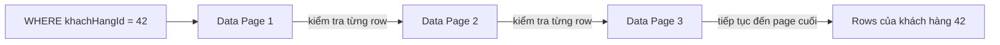
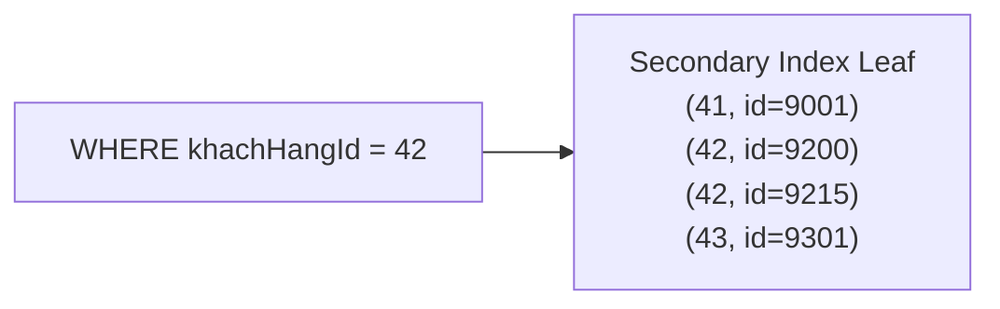
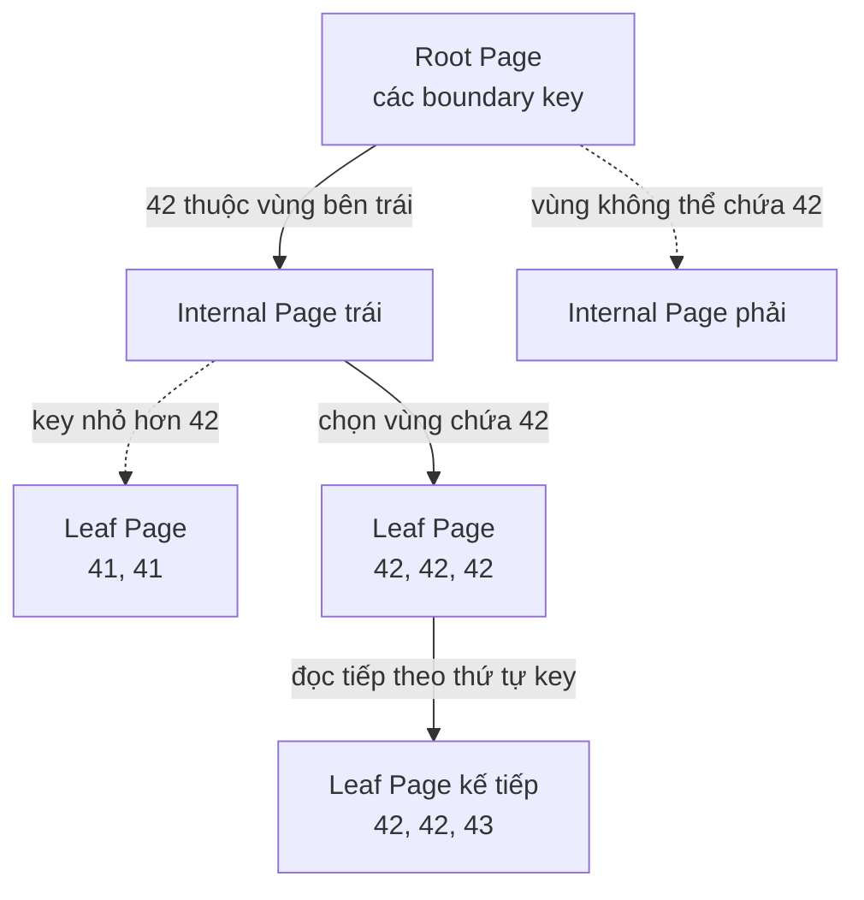
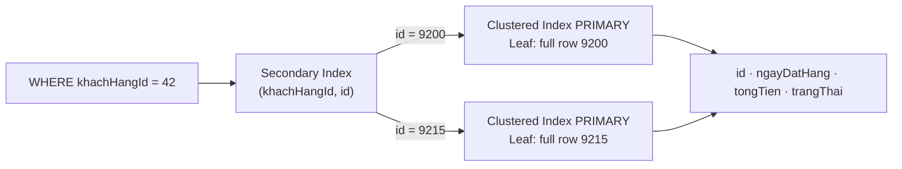
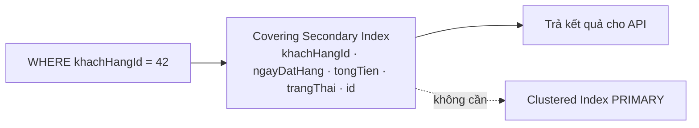
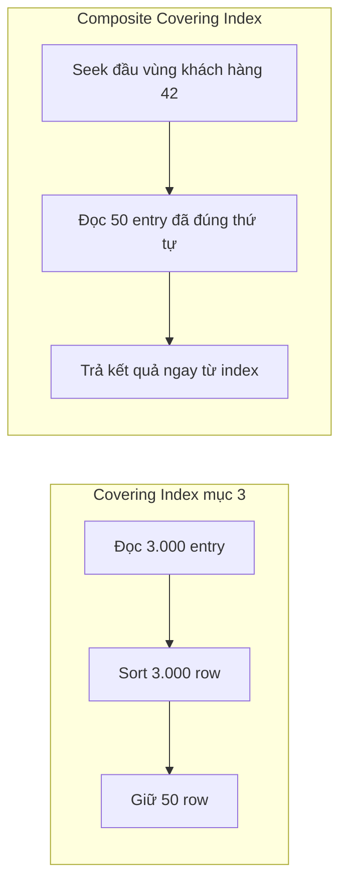
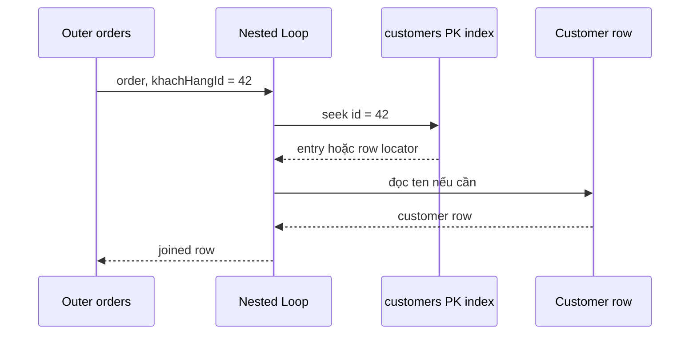
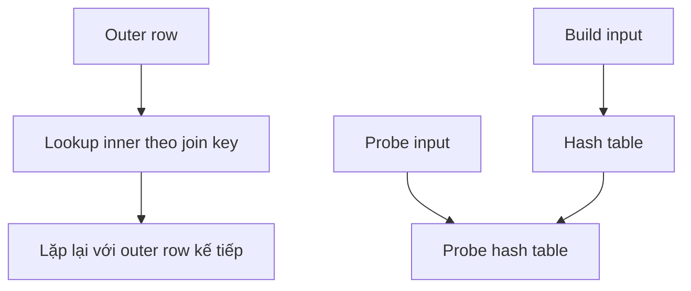
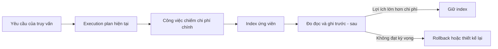

# Index trong cơ sở dữ liệu

Một truy vấn nhanh không chỉ phụ thuộc vào câu SQL ngắn hay dài. Chi phí thực sự nằm ở lượng dữ liệu database phải đọc, số row phải kiểm tra, cách các bảng được ghép và lượng công việc cần thực hiện trước khi trả về kết quả.

Ví dụ, trang lịch sử đơn hàng chỉ cần 50 đơn gần nhất của một khách hàng. Khi bảng có vài nghìn row, database có thể đọc toàn bộ bảng mà người dùng chưa nhận thấy độ trễ. Khi bảng tăng lên hàng triệu row, cách đọc đó phải xử lý một lượng dữ liệu rất lớn để trả về cùng 50 row.

**Index** là cấu trúc dữ liệu phụ tổ chức các key theo một thứ tự xác định và giữ thông tin để tìm row tương ứng. Nhờ thứ tự đó, database có thêm một con đường để đi tới vùng dữ liệu cần thiết thay vì luôn đọc toàn bộ bảng.

Các ví dụ trong bài sử dụng hai bảng của một hệ thống bán hàng:

- `customers` lưu khách hàng.
- `orders` lưu đơn hàng của từng khách.

Hai bảng cùng phục vụ trang lịch sử đơn hàng, báo cáo có thông tin khách hàng và worker lấy các đơn đang chờ xử lý. Bài học bắt đầu khi database chưa có index phù hợp, sau đó bổ sung từng yêu cầu để thấy vì sao một index hữu ích cho truy vấn này nhưng không phù hợp với truy vấn khác.

> **Phạm vi:** Các ví dụ về storage layout và Execution Plan trong bài sử dụng MySQL/InnoDB. Cấu trúc page và Buffer Pool được trình bày sâu hơn trong [Cơ chế lưu trữ, Buffer Pool và I/O](/database/storage-io/theory). Cách đọc toàn bộ Execution Plan nằm trong [Execution Plans](/database/execution-plan/theory).

## 1. Table Scan

### 1.1 Lược đồ dữ liệu

Ví dụ sử dụng hai bảng `customers` và `orders`, liên kết bằng Foreign Key `orders.khachHangId`:

```sql
CREATE TABLE customers (
  id         BIGINT         NOT NULL,
  khuVuc     VARCHAR(20)    NOT NULL,
  ten        VARCHAR(200)   NOT NULL,
  email      VARCHAR(320)   NOT NULL,
  CONSTRAINT pk_customers PRIMARY KEY (id),
  CONSTRAINT ux_customers_email UNIQUE (email)
);

CREATE TABLE orders (
  id           BIGINT         NOT NULL,
  khachHangId  BIGINT         NOT NULL,
  ngayDatHang  TIMESTAMP      NOT NULL,
  trangThai    VARCHAR(20)    NOT NULL,
  tongTien     DECIMAL(18, 2) NOT NULL,
  CONSTRAINT pk_orders PRIMARY KEY (id),
  CONSTRAINT fk_orders_customer
    FOREIGN KEY (khachHangId) REFERENCES customers (id)
);
```

### 1.2 Truy vấn lịch sử đơn hàng

Bài toán đầu tiên là lấy lịch sử đơn hàng của khách hàng `42`:

```sql
SELECT id,
       ngayDatHang,
       tongTien,
       trangThai
FROM orders
WHERE khachHangId = 42;
```

Hãy tưởng tượng bảng `orders` có **5.000 row**, được lưu trữ trên **50 Data Page** - trung bình 100 row trên mỗi page.

> **Tại sao dữ liệu được đọc theo Data Page?** Database thường gom nhiều row vào một page rồi dùng page làm đơn vị đọc từ storage và lưu trong Buffer Pool. Cách này hiệu quả hơn việc thực hiện một lần I/O riêng cho từng row. Cơ chế page và Buffer Pool được trình bày chi tiết trong [Cơ chế lưu trữ, Buffer Pool và I/O](/database/storage-io/theory).

Khi cần tìm **30 đơn hàng** của khách hàng có mã `42`, các row này không được bảo đảm nằm cạnh nhau và có thể xuất hiện ở bất kỳ Data Page nào. Database không thể biết chính xác chúng nằm ở đâu, nên phải **đọc toàn bộ 50 Data Page** và kiểm tra từng row để lọc ra đủ 30 đơn hàng thỏa mãn điều kiện.

Hành động đọc từ đầu đến cuối bảng để tìm các row phù hợp được gọi là **Table Scan**.



Với 5.000 row, Table Scan có thể hoàn thành đủ nhanh và chưa tạo ra vấn đề đáng kể.

Điểm cần theo dõi không phải 30 row được trả về, mà là 5.000 row database phải kiểm tra để tìm ra chúng.

### 1.3 Quy mô bảng `orders`

Sau một thời gian vận hành, `orders` tăng lên 10.000.000 row. Khách hàng `42` lúc này có 3.000 đơn hàng, nhưng câu SQL và cách đọc dữ liệu không thay đổi.

Giả sử mỗi Data Page chứa trung bình 100 row, database phải đi qua khoảng 100.000 page và kiểm tra 10.000.000 row để tìm ra 3.000 row cần trả về:

| Đại lượng | Bảng nhỏ | Bảng sau khi tăng trưởng |
|---|---:|---:|
| Tổng row | 5.000 | 10.000.000 |
| Data Page, giả định 100 row/page | 50 | 100.000 |
| Row cần trả cho khách hàng `42` | 30 | 3.000 |
| Row có thể phải kiểm tra | 5.000 | 10.000.000 |

> Các con số trong bảng dùng để giải thích quan hệ chi phí, không phải benchmark của một engine cụ thể. Số page thực tế phụ thuộc page size, row width, compression và storage layout.

Trong 10.000.000 row, API chỉ cần 3.000 row - tương đương khoảng 0,03% dữ liệu. Table Scan vẫn phải kiểm tra 100% bảng để tìm ra phần dữ liệu nhỏ đó. Chi phí của Table Scan vì thế phụ thuộc vào kích thước toàn bảng, không chỉ vào số row được trả về.

Table Scan vẫn là lựa chọn hợp lý khi bảng nhỏ hoặc khi truy vấn cần phần lớn số row trong bảng. Trong những trường hợp đó, đọc tuần tự có thể rẻ hơn việc tìm và lấy từng nhóm row riêng lẻ.

## 2. Cơ chế hoạt động của Index

Table Scan phải đọc 100% bảng vì trước khi mở một Data Page, database chưa có thông tin để loại trừ page đó. Muốn bỏ qua phần dữ liệu không liên quan, database cần một cấu trúc phụ trả lời hai việc:

- Giá trị `khachHangId = 42` bắt đầu ở đâu.
- Từ vị trí đó, row tương ứng nằm ở đâu trong bảng.

Để lưu mối liên hệ giữa giá trị cần tìm và row tương ứng, InnoDB tạo một cấu trúc riêng gọi là **index**. Khi dữ liệu trong bảng thay đổi, các entry liên quan trong index cũng phải được cập nhật để hai cấu trúc luôn nhất quán.

InnoDB tổ chức index theo hai vai trò:

| Loại index | Leaf Page chứa gì? | Số lượng trên một bảng |
|---|---|---|
| **Clustered Index** | Full row, được sắp theo Primary Key | Một |
| **Secondary Index** | Secondary Key cùng Primary Key của row | Có thể có nhiều |

Trong bảng `orders`, `PRIMARY KEY (id)` tạo Clustered Index. Index trên `khachHangId` là Secondary Index vì nó cung cấp một access path khác nhưng không thay đổi nơi lưu row gốc.

Với Secondary Index trên `khachHangId`, mỗi Leaf entry chứa hai phần chính:

- **Secondary Key:** giá trị `khachHangId` dùng để tìm kiếm.
- **Primary Key:** giá trị `id` dùng làm Row Locator tới row gốc trong Clustered Index.

Khi tìm `khachHangId = 42`, database đọc các entry có Secondary Key `42` và thu được Primary Key của từng đơn hàng:



Mỗi row của `orders` phải lưu tất cả các cột như `id`, `khachHangId`, `ngayDatHang`, `trangThai` và `tongTien`. Secondary Index chưa cần lặp lại toàn bộ row. Nó chỉ giữ `khachHangId` và Primary Key `id` để tìm lại row đầy đủ khi cần.

Giả sử một Data Page chứa 100 row đầy đủ. Nếu một Secondary Index entry chỉ chiếm khoảng một phần năm kích thước của row, một Index Page cùng kích thước có thể chứa khoảng 500 entry:

| Loại page | Nội dung mỗi phần tử | Số phần tử minh họa trên một page |
|---|---|---:|
| Data Page | Row đầy đủ của `orders` | 100 row |
| Secondary Index Page | `khachHangId` và Primary Key `id` | 500 entry |

Index Page chứa được nhiều entry hơn nên Secondary Index thường cần ít page hơn bảng. Tuy nhiên, cấu trúc nhỏ hơn chưa tự động tạo ra khả năng tìm kiếm nhanh. Nếu các entry không được tổ chức, database vẫn phải đọc lần lượt mọi Index Page để tìm `khachHangId = 42`.

Vì vậy, index còn phải sắp xếp key theo cách giúp database đi thẳng tới vùng chứa giá trị `42`. Sau khi tìm thấy các entry phù hợp, Primary Key mới được dùng để tìm row gốc trong Clustered Index.

> Các tỷ lệ trên chỉ dùng để minh họa vì sao index entry hẹp giúp giảm số page cần đọc. Kích thước thực tế phụ thuộc page size, kiểu dữ liệu, row format, payload và storage engine.

### 2.1 Thứ tự của key

Nếu chỉ lưu trữ các cặp `khachHangId → Primary Key` một cách lộn xộn trong index thì chưa đủ. Database cần tổ chức các cặp dữ liệu này theo một trật tự nghiêm ngặt để có thể tìm ra bất kỳ giá trị nào mà không phải quét lại từ đầu toàn bộ index - tránh biến Index Scan thành một Table Scan thứ hai.

Khi các key được duy trì theo **thứ tự tăng dần**, toàn bộ các entry có cùng `khachHangId = 42` chắc chắn nằm liền kề nhau. Nhờ vậy, cấu trúc tìm kiếm chỉ cần xác định vị trí của entry `42` đầu tiên, sau đó tiếp tục đọc tuyến tính các entry kế tiếp cho đến khi key chuyển sang giá trị `43` thì dừng lại ngay lập tức.

```text
41 → row A
41 → row D
42 → row B  ← entry đầu tiên, bắt đầu đọc
42 → row F
42 → row H
43 → row C  ← key đã đổi, dừng lại
```

#### Equality lookup, Range Scan và Ordering

Ví dụ `WHERE khachHangId = 42` là một **equality lookup** - truy vấn cần tìm đúng một giá trị cụ thể. Database tìm entry `42` đầu tiên, đọc hết vùng key `42` rồi dừng khi key thay đổi.

Thứ tự của key còn giải quyết hai bài toán rộng hơn.

**Range Scan** cần đọc mọi key nằm giữa hai boundary. Ví dụ sau lấy các `khachHangId` từ `42` đến `45`:

```sql
WHERE khachHangId BETWEEN 42 AND 45
```

Với index có thứ tự, database tìm entry `42` đầu tiên rồi đọc liên tiếp vùng `42, 43, 44, 45`. Khi gặp key `46`, nó biết range đã kết thúc và dừng lại.

```text
41 | 42 42 43 44 45 | 46
     ↑ bắt đầu         ↑ dừng
```

Nếu các key không có thứ tự, entry `42`, `43`, `44` và `45` có thể nằm ở những vùng không liên quan. Database không có điểm kết thúc liên tục để dựa vào, nên phải kiểm tra toàn bộ cấu trúc để chắc chắn không bỏ sót key trong range.

**Ordering** xuất hiện khi truy vấn yêu cầu kết quả theo một thứ tự cụ thể:

```sql
ORDER BY khachHangId
```

Nếu key order và hướng đọc của index phù hợp với `ORDER BY`, database có thể trả row theo thứ tự các entry đang có. Execution plan khi đó có thể loại bỏ bước `Sort` riêng.

Nếu không có thứ tự phù hợp, database phải thu thập các row trước rồi sắp xếp lại. Bước `Sort` sử dụng CPU và memory. Khi dữ liệu vượt quá vùng memory được cấp, một số engine còn phải ghi dữ liệu trung gian xuống storage.

Nhờ duy trì key có thứ tự, cùng một index có thể hỗ trợ ba nhu cầu:

- Equality lookup với toán tử `=`.
- Range Scan với `BETWEEN`, `>`, `>=`, `<` hoặc `<=`.
- Ordering với `ORDER BY` phù hợp với key order của index.

#### Thử thách trong việc chọn lựa cấu trúc dữ liệu

Để đạt được khả năng sắp xếp và tìm kiếm tối ưu, database không thể sử dụng các cấu trúc dữ liệu phổ thông vì những hạn chế cố hữu:

- **Sorted Array:** `Binary Search` tìm một key trong `O(log n)`, đồng thời thứ tự sẵn có hỗ trợ Range Scan và Ordering. Giới hạn nằm ở write path. Khi một đơn hàng mới của khách hàng `42` phải được chèn vào giữa mảng, nhiều entry phía sau có thể phải dịch chuyển để tạo chỗ trống. Với hàng triệu entry và write workload liên tục, chi phí duy trì một mảng phẳng trở nên quá lớn.
- **Hash Table:** Hàm `hash` đưa key tới một bucket, nên equality lookup có chi phí trung bình gần `O(1)`. Đổi lại, hashing phân tán key theo bucket thay vì giữ chúng theo thứ tự. Key `42` và `43` có thể nằm ở hai vùng hoàn toàn khác nhau, nên Hash Table không thể tự đọc một Range Scan hoặc cung cấp Ordering nếu không quét và sort kết quả bằng bước riêng.

`Sorted Array` giữ được thứ tự nhưng khó duy trì khi dữ liệu thay đổi liên tục. `Hash Table` cập nhật linh hoạt và tìm equality nhanh nhưng đánh mất thứ tự cần cho Range Scan và Ordering.

Database vì thế cần một cấu trúc giữ các key theo thứ tự nhưng không đặt toàn bộ chúng trong một mảng phẳng. Cấu trúc đó phải chia key thành từng page nhỏ, cho phép tìm đúng vùng cần đọc và chỉ tổ chức lại một phần cục bộ khi có entry được thêm hoặc xóa.

**B+Tree** đáp ứng sự cân bằng này - key vẫn có thứ tự để phục vụ lookup, Range Scan và Ordering, trong khi cấu trúc phân page phù hợp với cách database đọc storage, quản lý Buffer Pool và xử lý write workload.

### 2.2 Vì sao cấu trúc B+Tree lại phù hợp?

B+Tree chia tập hợp key đã được sắp xếp thành nhiều nút (**node**), tổ chức các node thành một cây cân bằng và thường lưu mỗi node trong một **Index Page**.

Vì database đọc dữ liệu từ storage theo từng page, một lần đọc có thể đưa toàn bộ node vào **Buffer Pool** để so sánh key và chọn nhánh tiếp theo ngay trong memory.

Cấu trúc này phải đáp ứng hai yêu cầu:

- **Read path:** key giữ đúng thứ tự để phục vụ Equality Lookup, Range Scan và Ordering.
- **Write path:** khi thêm hoặc xóa entry, database chỉ tổ chức lại một vùng nhỏ thay vì dịch chuyển toàn bộ index.

Nhờ vậy, B+Tree vừa hỗ trợ tìm kiếm theo thứ tự, vừa phù hợp với dữ liệu thay đổi liên tục.

#### Fan-out và chiều cao cây

Khác với cây tìm kiếm nhị phân (Binary Search Tree) chỉ chia tối đa 2 nhánh tại mỗi nút, B+Tree cho phép một node trỏ tới nhiều node con, nhờ đó mỗi tầng của cây có thể loại bỏ nhiều vùng key không liên quan.

Để chọn đúng node con, B+Tree lưu các **boundary key** — những cột mốc phân chia phạm vi dữ liệu.

Nếu một node chứa hai boundary key `30` và `60`, các con trỏ của node sẽ dẫn tới ba vùng:

```text
key < 30        30 <= key < 60        key >= 60
    │                  │                   │
    ▼                  ▼                   ▼
 node con A         node con B          node con C
```

- **Fan-out** là số node con mà một node có thể trỏ tới.
- **Chiều cao cây** giảm khi fan-out lớn. Mỗi tầng thường tương ứng với một page read, nên cây thấp giúp database tìm key với ít I/O hơn ngay cả khi index có hàng triệu entry.

#### Key Lookup trong B+Tree

Khi tìm `khachHangId = 42`, database không đọc lần lượt mọi Index Page. Nó bắt đầu tại Root Page, so sánh `42` với các boundary key rồi chỉ đi xuống nhánh có thể chứa giá trị này. Mỗi Internal Page tiếp tục thu hẹp khoảng key cho đến khi database tới Leaf Page chứa entry `42` đầu tiên.



Mỗi tầng đảm nhiệm một phần riêng của quá trình tìm kiếm:

| Tầng | Nội dung chính | Vai trò |
|---|---|---|
| Root | Boundary key và con trỏ | Chọn vùng lớn có thể chứa key cần tìm |
| Internal | Boundary key và con trỏ | Tiếp tục thu hẹp vùng key |
| Leaf | Index key và row locator | Giữ các entry theo thứ tự và chỉ ra row tương ứng |

Root và Internal Page không cần chứa mọi index entry. Chúng chỉ giữ đủ boundary để dẫn đường. Toàn bộ entry được đặt ở tầng Leaf, vì vậy database luôn đi qua cùng một số tầng để tới dữ liệu dù key nằm ở đầu hay cuối index. Đặc tính này làm B+Tree luôn cân bằng.

#### Page Split

Thứ tự của key phải được duy trì cả khi dữ liệu thay đổi. Giả sử Leaf Page đang chứa các key từ `40` đến `49` và không còn chỗ trống. Khi một entry mới có key `42` được thêm vào, database không thể đặt entry này ở cuối index vì như vậy sẽ phá vỡ thứ tự.

B+Tree xử lý tình huống đó bằng **Page Split**. Leaf Page đầy được tách thành hai page, các entry được phân phối lại theo thứ tự, sau đó boundary key ở parent page được cập nhật để trỏ đúng tới hai vùng mới.

```text
Trước khi split
[40, 41, 42, 43, 44, 45, 46, 47, 48, 49]

Sau khi split
[40, 41, 42, 43, 44]  ⇄  [45, 46, 47, 48, 49]
                         ↑
              parent thêm boundary 45
```

Nếu parent page cũng đầy, việc split có thể tiếp tục lên tầng trên. Phạm vi thay đổi vẫn bắt đầu từ nhánh chứa entry mới thay vì buộc database dịch chuyển toàn bộ index như một Sorted Array.

#### Linked Leaves

Sau khi tìm được entry `42` đầu tiên, database còn phải đọc hết các entry `42` còn lại. Nếu mỗi Leaf Page đứng độc lập, nó sẽ phải quay lại Internal Page để tìm vị trí tiếp theo mỗi khi đọc hết một page.

Để tránh việc đó, các Leaf Page được liên kết theo thứ tự key. Database có thể đi từ Leaf Page hiện tại sang Leaf Page kế tiếp, tiếp tục đọc tuần tự và dừng ngay khi key chuyển từ `42` sang `43`.

Liên kết giữa các Leaf Page cũng là cơ sở để Range Scan hoạt động hiệu quả. Database tìm điểm bắt đầu của range qua các tầng Root và Internal đúng một lần, sau đó đi ngang qua các Leaf Page cho đến khi chạm boundary kết thúc.

B+Tree vì thế kết hợp được ba đặc tính trong cùng một cấu trúc:

- Fan-out lớn giữ cây thấp, giúp equality lookup tìm tới Leaf Page qua một số ít tầng.
- Key có thứ tự và các Leaf Page được liên kết, giúp Range Scan và Ordering đọc dữ liệu tuần tự.
- Page Split giới hạn phần lớn thay đổi trong vùng bị ảnh hưởng, phù hợp với dữ liệu được `INSERT`, `UPDATE` và `DELETE` liên tục.

### 2.3 Range Predicate

Cơ chế tìm điểm bắt đầu trong B+Tree cũng hỗ trợ predicate có khoảng giá trị:

```sql
WHERE ngayDatHang >= '2026-07-01'
  AND ngayDatHang <  '2026-08-01'
```

Nếu có B+Tree bắt đầu bằng `ngayDatHang`, database có thể tìm entry đầu tháng 7 rồi đi tuần tự qua các leaf page cho tới boundary đầu tháng 8. Nó không cần quay lại root cho từng ngày trong khoảng.

```text
Chi phí tương đối
≈ đường đi root → leaf
+ số leaf page trong range
+ số lần đọc row từ bảng
```

Độ phức tạp `O(log n)` chỉ mô tả đường đi tới leaf đầu tiên. Tổng chi phí còn phụ thuộc số entry trong range, số page phải đọc và số lần database phải quay lại bảng để lấy các cột không nằm trong index.

### 2.4 Phạm vi dữ liệu của Secondary Index

Secondary Index theo `khachHangId` được tạo như sau:

```sql
CREATE INDEX ix_orders_customer
ON orders (khachHangId);
```

B+Tree có thể tìm ra khoảng 3.000 entry của khách hàng `42`. Mỗi entry cho biết `khachHangId` và Primary Key `id` của đơn hàng:

```text
Secondary Index entry
(khachHangId = 42, id = 9200)
```

Tuy nhiên, câu SQL còn yêu cầu `ngayDatHang`, `tongTien` và `trangThai`:

```sql
SELECT id,
       ngayDatHang,
       tongTien,
       trangThai
FROM orders
WHERE khachHangId = 42;
```

Các cột này không nằm trong Secondary Index hiện tại. Database đã biết những `id` nào phù hợp nhưng chưa có đủ dữ liệu để trả kết quả.

Trong InnoDB, table data được tổ chức thành một B+Tree theo Primary Key. Cấu trúc này được gọi là **Clustered Index**, và Leaf Page của nó chứa full row.

Để lấy các cột còn thiếu, InnoDB tìm từng Primary Key trong Clustered Index:

1. Đọc các entry có `khachHangId = 42` từ Secondary Index.
2. Lấy Primary Key `id` của từng entry.
3. Tìm `id` trong Clustered Index `PRIMARY`.
4. Đọc full row tại Leaf Page rồi trả các cột cho API.



> **Chi phí mới — Clustered Index Lookup:** Khoảng 3.000 Secondary Index entry có thể tạo ra khoảng 3.000 lookup theo Primary Key. Con số này không mặc định bằng 3.000 physical I/O vì nhiều row có thể nằm chung một page hoặc page đã có trong Buffer Pool. MySQL còn có thể tối ưu thứ tự đọc bằng Multi-Range Read.

Secondary Index đã tránh Table Scan, nhưng query vẫn phải quay về Clustered Index để lấy `ngayDatHang`, `tongTien` và `trangThai`. Covering Index giải quyết bước lookup này bằng cách giữ đủ dữ liệu ngay trong Secondary Index.

## 3. Covering Index trong InnoDB

Mục 2.4 đã làm lộ ra chi phí Clustered Index Lookup. Nếu Secondary Index chứa đủ các cột query cần đọc, InnoDB có thể trả kết quả ngay từ index mà không phải quay về `PRIMARY`.

### 3.1 Non-covering Index và Covering Index

Secondary Index ban đầu chỉ chứa `khachHangId` và Primary Key `id`:

```text
ix_orders_customer
(khachHangId, id)
```

`ngayDatHang`, `tongTien` và `trangThai` không có trong Leaf entry, nên query phải lookup Clustered Index. Covering Index bổ sung các cột đó vào Secondary Index:

```sql
CREATE INDEX ix_orders_customer_cover
ON orders (khachHangId, ngayDatHang, tongTien, trangThai);
```

InnoDB tự mang Primary Key `id` trong mỗi Secondary Index entry. Leaf entry lúc này có đủ dữ liệu cho câu `SELECT` ở mục 2.4:

```text
(khachHangId, ngayDatHang, tongTien, trangThai, id)
```

### 3.2 Index-only Access

Query không cần thay đổi:

```sql
SELECT id,
       ngayDatHang,
       tongTien,
       trangThai
FROM orders
WHERE khachHangId = 42;
```

Luồng đọc dừng ngay tại Secondary Index:



`EXPLAIN` thường hiển thị `Using index` trong cột `Extra` khi MySQL có thể hoàn thành query chỉ bằng index. `Using index condition` là Index Condition Pushdown, không đồng nghĩa query đã được cover hoàn toàn.

### 3.3 Access Predicate và Residual Predicate

Một cột nằm trong Covering Index chưa chắc giúp thu hẹp Leaf range. Vai trò của predicate phụ thuộc vị trí cột trong key order:

| Vai trò | Cách xử lý |
|---|---|
| **Access Predicate** | Xác định điểm bắt đầu và kết thúc của Leaf range |
| **Residual Predicate** | Kiểm tra các entry sau khi Leaf range đã được đọc |
| **Output Column** | Chỉ cung cấp dữ liệu cho kết quả |

Với index `(khachHangId, ngayDatHang, tongTien, trangThai)`, predicate `khachHangId = 42` xác định Leaf range. Nếu query thêm `tongTien >= 1000000` nhưng không giới hạn `ngayDatHang`, `tongTien` thường được kiểm tra như Residual Predicate vì các giá trị này không tạo thành một range liên tiếp ngay sau `khachHangId`.

Covering Index vẫn có lợi trong trường hợp đó: InnoDB có thể kiểm tra `tongTien` từ Secondary Index mà không lookup Clustered Index. Nó vẫn phải đọc các entry trong range của khách hàng `42`.

### 3.4 Trade-off của Covering Index

Covering Index loại Clustered Index Lookup nhưng làm mỗi Leaf entry rộng hơn:

| Lợi ích | Chi phí |
|---|---|
| Không phải lookup `PRIMARY` cho từng row | Secondary Index chiếm thêm storage |
| Giảm logical read và Random I/O | Ít entry hơn trên mỗi Index Page, fan-out có thể giảm |
| Đọc đủ output column ngay tại Leaf Page | `INSERT`, `UPDATE`, `DELETE` phải duy trì index rộng hơn |
| `EXPLAIN` có thể hiển thị `Using index` | Buffer Pool phải giữ nhiều index page hơn |

Không nên đưa mọi cột vào một Covering Index. Chỉ nên cover query có tần suất hoặc latency đủ quan trọng để bù chi phí storage, memory và write amplification.

Covering Index đã loại bước quay về Clustered Index. Yêu cầu tiếp theo là đưa đơn hàng mới nhất lên trước và chỉ giữ 50 row, nên index còn phải cung cấp đúng ordering.

## 4. Composite Index

Covering Index ở mục 3 đã loại Clustered Index Lookup, nhưng chưa bảo đảm các entry nằm theo đúng thứ tự mà API cần. Khi query thêm `ORDER BY ... LIMIT 50`, key order phải đồng thời phục vụ filter, ordering và output columns.

### 4.1 Filter, ordering và LIMIT

API hoàn chỉnh thêm ordering và giới hạn kết quả:

```sql
SELECT id,
       ngayDatHang,
       tongTien,
       trangThai
FROM orders
WHERE khachHangId = 42
ORDER BY ngayDatHang DESC, id DESC
LIMIT 50;
```

`id` là tie-breaker. Nếu nhiều đơn hàng có cùng `ngayDatHang`, nó tạo ra thứ tự xác định và tránh kết quả dao động giữa các lần thực thi.

Với `ix_orders_customer_cover` ở mục 3, query đã được cover nhưng plan vẫn có thể phải sort:

```text
Covering Index range: khachHangId = 42
  ↓ 3.000 rows đã có đủ output columns
Sort: ngayDatHang DESC, id DESC
  ↓
Limit: 50 rows
```

Sort trên 3.000 row có thể vẫn chấp nhận được. Khi một khách hàng có hàng trăm nghìn đơn hàng, chi phí sort và memory tăng theo fan-out của khách hàng đó.

### 4.2 Equality predicate, ordering và tie-breaker

Index cuối cùng đặt các key theo thứ tự query cần duyệt, sau đó thêm output columns để tiếp tục cover query:

```sql
CREATE INDEX ix_orders_customer_history
ON orders (
  khachHangId,
  ngayDatHang DESC,
  id DESC,
  tongTien,
  trangThai
);
```

Các key có trách nhiệm khác nhau:

| Key | Vai trò |
|---|---|
| `khachHangId` | Equality Predicate xác định vùng của khách hàng |
| `ngayDatHang DESC` | Đặt đơn hàng mới nhất ở đầu vùng |
| `id DESC` | Tie-breaker khi nhiều đơn hàng có cùng thời điểm |
| `tongTien`, `trangThai` | Cover output columns, không thu hẹp Leaf range của query hiện tại |

InnoDB vốn đã mang Primary Key `id` trong Secondary Index entry. `id DESC` vẫn được khai báo tường minh vì query cần chính direction này làm tie-breaker cho `ORDER BY`.

Plan có thể seek tới đầu vùng của khách hàng `42`, đọc đúng chiều ordering và dừng sau 50 entry. Composite Index không làm bước sort nhanh hơn — nó làm bước sort không còn cần thiết:



So với Covering Index ở mục 3, index mới thay đổi cả ordering lẫn khả năng dừng sớm:

| Metric | `ix_orders_customer_cover` | `ix_orders_customer_history` |
|---|---|---|
| Vùng khách hàng phải định vị | Có | Có |
| Ordering khớp `ORDER BY` | Không đầy đủ | Có |
| Sort Operator | Có thể có | Có thể được loại bỏ |
| Entry cần đi qua trước `LIMIT 50` | Có thể là toàn bộ đơn hàng của khách | Gần 50 nếu không có Residual Predicate |
| Clustered Index Lookup | Không | Không |

### 4.3 Thứ tự từ điển và leftmost prefix

Trong `ix_orders_customer_history`, ba leading key quyết định access path và ordering. Tạm bỏ hai output columns ở cuối, các entry được sắp xếp theo tuple từ trái sang phải:

```text
(42, 2026-07-22 10:00, 9200)
(42, 2026-07-22 10:00, 9187)
(42, 2026-07-21 16:30, 9102)
(43, 2026-07-25 08:15, 9301)
(43, 2026-07-20 11:10, 9008)
```

`khachHangId` tạo nhóm lớn nhất. Trong mỗi khách hàng, `ngayDatHang` tạo thứ tự tiếp theo. `id` chỉ quyết định vị trí khi hai key trước bằng nhau.

Ví dụ dễ hình dung: một tủ hồ sơ được chia ngăn theo khách hàng, bên trong mỗi ngăn mới xếp theo ngày. Biết khách hàng `42` cho phép đi thẳng tới một ngăn rồi tìm theo ngày. Chỉ biết ngày không đủ để chọn ngăn, nên phải kiểm tra nhiều nhóm khách hàng.

Cách sắp xếp này giải thích **leftmost prefix**:

| Predicate | Phần key thường tạo range | Phần còn lại |
|---|---|---|
| `A = value` | `A` | Đọc mọi `B, C` trong nhóm `A` |
| `A = value AND B = value` | `A, B` | Đọc mọi `C` trong nhóm đó |
| `A = value AND B >= value` | `A, B` | `C` thường không tạo range liên tiếp mới sau range trên `B` |
| `B = value` | Thiếu leading key `A` | Có thể full index scan hoặc dùng tối ưu riêng của engine |
| `A = value AND C = value` | `A` | `C` thường là residual trong vùng `A` |

Nếu chưa biết `khachHangId`, các entry cùng `ngayDatHang` nằm rải trong từng nhóm khách hàng. Index `(khachHangId, ngayDatHang)` vì thế không phải access path tốt cho truy vấn chỉ lọc theo ngày trên toàn bảng.

MySQL có thể dùng Skip Scan, Index Merge hoặc Index Condition Pushdown trong một số plan. Các tối ưu này không thay đổi nguyên tắc nền tảng: key order quyết định dữ liệu nào nằm liền nhau trong B+Tree.

### 4.4 Keyset pagination

Ordering xác định cho phép trang sau tiếp tục từ tuple cuối của trang hiện tại:

```sql
SELECT id,
       ngayDatHang,
       tongTien
FROM orders
WHERE khachHangId = 42
  AND (
    ngayDatHang < '2026-07-20 09:30:00'
    OR (
      ngayDatHang = '2026-07-20 09:30:00'
      AND id < 9120
    )
  )
ORDER BY ngayDatHang DESC, id DESC
LIMIT 50;
```

Cursor phải chứa cả `ngayDatHang` và `id`. Nếu thiếu tie-breaker, row có cùng thời điểm có thể bị lặp hoặc bỏ qua.

`ix_orders_customer_history` đã phục vụ filter, ordering, dừng sớm và toàn bộ output columns ngay trên Secondary Index. Access path cho một bảng đã hoàn chỉnh. Yêu cầu tiếp theo cần ghép thêm row từ `customers` bằng JOIN.

## 5. Index và JOIN

Đến đây, truy vấn lịch sử đơn hàng chỉ đọc `orders`. Báo cáo tiếp theo cần thêm tên khách hàng, nên database phải ghép mỗi đơn hàng với row tương ứng trong `customers`.

Điều kiện `customers.id = orders.khachHangId` chỉ mô tả hai row khớp nhau khi nào. Nó không quy định database phải đọc bảng nào trước hoặc phải ghép hai luồng row bằng cách nào. Những quyết định đó thuộc về execution plan.

Index cũng không tự thực hiện `JOIN`. Nó chỉ cung cấp đường đi vào từng bảng. Join algorithm quyết định đường đi đó được dùng một lần cho cả tập dữ liệu hay được gọi lặp lại cho từng row ở phía còn lại.

### 5.1 Nested Loop và inner index seek

Một báo cáo lấy đơn hàng trong tháng cùng tên khách hàng:

```sql
SELECT o.id,
       o.ngayDatHang,
       c.ten
FROM orders o
JOIN customers c ON c.id = o.khachHangId
WHERE o.ngayDatHang >= '2026-07-01'
  AND o.ngayDatHang <  '2026-08-01';
```

Giả sử optimizer chọn `orders` làm Outer Input và `customers` làm Inner Input. Nested Loop thực hiện theo thứ tự:

1. Đọc các đơn hàng trong khoảng ngày.
2. Lấy `khachHangId` từ một outer row.
3. Seek `customers(id)` bằng giá trị đó.
4. Lấy `ten` từ khách hàng phù hợp.
5. Ghép hai row rồi lặp lại với outer row tiếp theo.



Primary Key trên `customers(id)` biến bước 3 thành Equality Lookup trả tối đa một row. Nếu thiếu access path phù hợp, Inner Input có thể bị scan lặp lại cho từng outer row.

Chi phí của Nested Loop phụ thuộc số outer row:

```text
Số inner probes = số outer rows đi vào Nested Loop

1.200 outer rows × 1 inner lookup
= 1.200 inner lookups
```

Một lookup đơn lẻ có thể rất rẻ. 100.000 lookup không còn là chi phí nhỏ. Runtime metrics phải được đọc cùng `loops`, không chỉ theo tên node `Index Seek`.

### 5.2 Access path cho outer input

Inner Primary Key giải quyết bước tìm khách hàng. Query vẫn cần tạo Outer Input gồm các đơn hàng trong khoảng ngày:

```sql
CREATE INDEX ix_orders_date_customer
ON orders (ngayDatHang, khachHangId);
```

`ngayDatHang` xác định range của tháng. `khachHangId` có sẵn tại leaf để làm probe key cho `customers`.

Index `orders(khachHangId)` không giúp định vị range ngày khi `orders` là Outer Input của truy vấn này. Nó phục vụ truy vấn bắt đầu từ một khách hàng, không phải truy vấn bắt đầu từ thời gian.

Nếu truy vấn còn cần `o.id`, khả năng index đã chứa `id` hay phải lookup về bảng phụ thuộc engine và cấu trúc index. Execution plan phải xác nhận thay vì suy luận từ DDL chung.

### 5.3 Join order

Một truy vấn khác bắt đầu từ khách hàng trong khu vực rồi lấy các đơn hàng gần đây:

```sql
SELECT c.id,
       c.ten,
       o.id,
       o.ngayDatHang
FROM customers c
JOIN orders o ON o.khachHangId = c.id
WHERE c.khuVuc = 'HN'
  AND o.ngayDatHang >= '2026-07-01'
  AND o.ngayDatHang <  '2026-08-01';
```

Nếu optimizer đọc `customers` trước, hai Input cần hai access path khác nhau:

```sql
CREATE INDEX ix_customers_region_id
ON customers (khuVuc, id);

CREATE INDEX ix_orders_customer_date
ON orders (khachHangId, ngayDatHang);
```

Luồng thực thi có thể là:

```text
Seek customers(khuVuc = 'HN')
  ↓ 80 customer rows
Với mỗi customer.id
  ↓
Range seek orders(
  khachHangId = customer.id,
  ngayDatHang từ đầu tháng đến cuối tháng
)
  ↓ trung bình 15 orders/customer
1.200 joined rows
```

Trong inner index `(khachHangId, ngayDatHang)`, equality trên `khachHangId` xác định nhóm đơn hàng của một khách hàng. Range trên `ngayDatHang` tiếp tục thu hẹp bên trong nhóm đó.

Đảo thứ tự thành `(ngayDatHang, khachHangId)` tạo một range ngày chứa đơn hàng của mọi khách hàng. `khachHangId` không tạo vùng con liên tiếp sau khi leading key đã là range.

Hai yêu cầu truy vấn có thể cần hai index khác nhau:

| Query bắt đầu từ | Index trên `orders` | Lý do |
|---|---|---|
| Khoảng ngày | `(ngayDatHang, khachHangId)` | Range ngày tạo outer input |
| Một khách hàng | `(khachHangId, ngayDatHang)` | Join Key tạo nhóm, ngày tạo range bên trong |
| Tenant và khách hàng | `(tenantId, khachHangId, ngayDatHang)` | Giữ tenant boundary trước các key còn lại |

Chỉ giữ nhiều index khi lợi ích đọc đủ lớn để bù chi phí ghi và dung lượng.

### 5.4 Join fan-out

Index giúp tìm điểm bắt đầu nhưng không giảm số row đúng mà quan hệ 1:N phải trả về. Nếu một khách hàng có 500.000 đơn hàng, lookup `orders(khachHangId)` vẫn phải đọc vùng leaf chứa 500.000 entry.

Tổng công việc của Nested Loop phụ thuộc cả loops và fan-out:

```text
Tổng inner rows
≈ outer loops × inner rows trung bình mỗi loop
```

| Outer rows | Inner rows/loop | Tổng inner rows |
|---:|---:|---:|
| 10 | 1 | 10 |
| 10.000 | 1 | 10.000 |
| 100 | 5.000 | 500.000 |
| 50.000 | 20 | 1.000.000 |

Nested Loop phù hợp nhất khi outer input nhỏ và mỗi inner probe chọn ít row. Outer nhỏ nhưng fan-out lớn vẫn có thể tạo plan đắt.

### 5.5 Nested Loop và Hash Join

MySQL chủ yếu kết hợp row bằng Nested Loop hoặc Hash Join. Algorithm phù hợp phụ thuộc số row của mỗi input và access path hiện có:

| Join algorithm | Cách kết hợp | Vai trò của B+Tree |
|---|---|---|
| Nested Loop | Lặp outer row rồi lookup inner input | Index trên inner join key giúp mỗi lookup đọc ít row |
| Hash Join | Build hash table từ một input rồi probe bằng input còn lại | Index có thể giảm input trước build/probe |



Hash Join không đồng nghĩa index vô dụng. Index vẫn có thể giảm input trước join:

```text
Index Range Scan orders theo ngày
  ↓ 20.000 rows
Build hoặc probe Hash Join
  ↓
Không phải đọc toàn bộ 10.000.000 orders
```

Nếu predicate trả phần lớn bảng, optimizer có thể bỏ index và scan tuần tự để cấp dữ liệu cho Hash Join. Đây có thể là plan đúng.

> **Lưu ý:** MySQL không triển khai Merge Join. Execution Plan của MySQL vì thế không có operator này.

### 5.6 Kiểu dữ liệu và collation của join key

Hai join key nên có cùng domain. Mismatch có thể gây implicit conversion, estimate kém hoặc làm một phía không còn indexable như mong đợi.

| Vấn đề | Ví dụ | Hậu quả có thể gặp |
|---|---|---|
| Khác kiểu số | `INT` join với `BIGINT` | Conversion hoặc estimate không ổn định |
| Khác collation | Hai cột text có quy tắc so sánh khác nhau | Conversion hoặc so sánh tốn thêm chi phí |
| Function trên key | `lower(a.email) = lower(b.email)` | B+Tree trên cột gốc có thể không dùng trực tiếp |
| Khác format | UUID binary join với UUID text | Conversion và index rộng hơn cần thiết |

Cách sửa ưu tiên là thống nhất schema của hai key. Expression index chỉ phù hợp khi normalization là một phần ổn định của domain và engine hỗ trợ access path tương ứng.

### 5.7 Quan hệ nhiều-nhiều

Junction Table thường cần access path theo cả hai hướng quan hệ. Giả sử bảng `products` đã có Primary Key `id`:

```sql
CREATE TABLE order_items (
  orderId    BIGINT NOT NULL,
  productId  BIGINT NOT NULL,
  soLuong    INT    NOT NULL,
  CONSTRAINT pk_order_items PRIMARY KEY (orderId, productId),
  CONSTRAINT fk_order_items_order
    FOREIGN KEY (orderId) REFERENCES orders (id),
  CONSTRAINT fk_order_items_product
    FOREIGN KEY (productId) REFERENCES products (id)
);
```

Primary Key `(orderId, productId)` có hai tác dụng:

- Bảo vệ một sản phẩm không bị lặp trong cùng đơn hàng.
- Hỗ trợ hướng JOIN từ đơn hàng sang sản phẩm.

Nó không hỗ trợ tốt truy vấn bắt đầu từ `productId` vì thiếu leading key. Access path ngược cần index riêng:

```sql
CREATE INDEX ix_order_items_product_order
ON order_items (productId, orderId);
```

Hai Composite Index này không trùng chức năng. Mỗi index phục vụ một hướng traversal và mang key còn lại để tiếp tục JOIN.

### 5.8 Index cho Foreign Key

Index trên child Foreign Key không chỉ phục vụ `SELECT`. Khi parent bị thay đổi, database phải tìm child row để bảo vệ referential integrity:

```sql
DELETE FROM customers
WHERE id = 42;
```

Nếu `orders(khachHangId)` có index, engine có thể định vị các đơn hàng tham chiếu khách hàng `42`. Nếu thiếu access path, nó có thể phải scan `orders` để xác nhận có child row hay không.

Việc engine tự tạo index cho Foreign Key là khác biệt triển khai. Schema migration phải kiểm tra index thực tế thay vì suy luận từ constraint.

### 5.9 Phân tích execution plan của JOIN

Một plan JOIN phải được đọc theo luồng dữ liệu, không phải từng index node độc lập:

| Bằng chứng | Nội dung cần đọc |
|---|---|
| Join order | Relation nào tạo outer/build input? |
| Join algorithm | Nested Loop, Hash hay Merge? |
| Access condition | Key nào thực sự xác định lookup/range? |
| Residual filter | Bao nhiêu row bị đọc rồi mới loại? |
| Estimated và actual rows | Optimizer có hiểu đúng selectivity và fan-out không? |
| Loops | Inner access path bị gọi bao nhiêu lần? |
| Rows per loop | Mỗi probe trả một row hay một vùng lớn? |
| Logical reads | Index có thực sự giảm số page được đọc không? |
| Table lookup | Có lookup lặp lại để lấy output column không? |
| Sort hoặc spill | Join có cần sort hoặc vượt memory estimate không? |

Hai plan cùng có `Index Seek` vẫn có thể khác nhau rất lớn:

```text
Plan A
Outer rows: 100
Inner Index Seek loops: 100
Rows/loop: 1

Plan B
Outer rows: 100.000
Inner Index Seek loops: 100.000
Rows/loop: 20
```

Plan B xử lý khoảng 2.000.000 inner rows. Tên operator không thay thế runtime metrics.

Join order và algorithm phụ thuộc estimated rows. Khi estimate sai, optimizer có thể chọn repeated lookup cho một input lớn hoặc cấp không đủ memory cho Hash Join.

## 6. Optimizer và statistics

Nhiều access path cùng tồn tại sau khi hệ thống thêm index. Optimizer phải dự đoán số row mỗi path tạo ra trước khi truy vấn thực sự chạy.

### 6.1 Cardinality và selectivity

**Cardinality** là số giá trị phân biệt trong một tập dữ liệu. **Selectivity** mô tả mức độ một predicate thu hẹp số row.

| Cột | Phân bố thường gặp | Ý nghĩa với index |
|---|---|---|
| `email`, `soHoaDon` | Gần unique | Equality lookup thường trả rất ít row |
| `khachHangId` | Một khách hàng có nhiều đơn hàng | Hiệu quả phụ thuộc fan-out của khách hàng |
| `trangThai` | Ít giá trị và có thể lệch mạnh | Giá trị hiếm vẫn có selectivity cao |
| `deletedAt` | Phần lớn `NULL` | Partial index có thể phù hợp với tập active |

Cột ít giá trị phân biệt không tự động là index kém. `trangThai = 'FAILED'` có thể chọn rất ít row nếu lỗi hiếm. `trangThai = 'COMPLETED'` có thể trả phần lớn bảng và khiến Table Scan rẻ hơn.

### 6.2 Statistics và data skew

Statistics cung cấp row count, distinct count, histogram hoặc thông tin phân bố tương đương. Optimizer dùng dữ liệu này để ước lượng chi phí.

Estimate thường sai trong các trường hợp:

- Statistics cũ sau một đợt import lớn.
- Dữ liệu bị skew mạnh.
- Hai predicate có tương quan nhưng được ước lượng như độc lập.
- Parameter hiện tại khác xa parameter từng tạo hoặc cache plan.
- Fan-out của một số khách hàng lớn hơn phần còn lại nhiều lần.

Ví dụ, phần lớn khách hàng có dưới 100 đơn hàng nhưng một khách hàng lớn có 500.000 đơn hàng. Average fan-out không đại diện cho khách hàng đó.

```text
Estimated rows: 100
Actual rows:    500.000
```

Optimizer có thể chọn Nested Loop vì estimate nhỏ. Runtime thực tế lại thực hiện hàng trăm nghìn inner lookup.

### 6.3 Khi Table Scan phù hợp

Index không phải lựa chọn mặc định. Query báo cáo cần 8.000.000 trong tổng số 10.000.000 đơn hàng có thể được thực thi rẻ hơn bằng Table Scan và Hash Join.

Scan có các lợi thế khi đọc phần lớn dữ liệu:

- Đọc tuần tự nhiều page.
- Tránh hàng triệu row locator lookup.
- Cấp input theo lô cho Hash Join hoặc aggregate.
- Không phải đi qua cả index lẫn bảng.

Missing-index suggestion chỉ phản ánh một phần plan. Nó thường không tính đầy đủ write cost, index hiện có hoặc khả năng hợp nhất nhiều workload. Suggestion là giả thuyết cần kiểm chứng, không phải DDL sẵn sàng triển khai.

Statistics đúng giúp optimizer chọn giữa các access path khả dụng. Nó không thể biến một predicate không khớp key thành lookup hiệu quả.

## 7. SARGability và các loại index

Một B+Tree chỉ định vị được range khi operator có thể đối chiếu trực tiếp với key. Khả năng này thường được gọi là **SARGability**.

### 7.1 Range predicate

Predicate sau phải tính function trên giá trị cột:

```sql
WHERE DATE(ngayDatHang) = '2026-07-26'
```

B+Tree trên `ngayDatHang` phù hợp hơn với range nửa mở:

```sql
WHERE ngayDatHang >= '2026-07-26 00:00:00'
  AND ngayDatHang <  '2026-07-27 00:00:00'
```

Range cung cấp điểm bắt đầu và kết thúc trực tiếp trong cây. Dạng nửa mở còn tránh phụ thuộc độ chính xác phần thập phân của timestamp.

### 7.2 Kiểu dữ liệu của parameter

Parameter nên có kiểu tương thích với cột. Cast trên cột có thể làm access condition không còn dùng được như mong muốn:

```sql
-- Kém phù hợp với B+Tree trên orders.id
WHERE CAST(orders.id AS VARCHAR(30)) = :orderIdText
```

Application nên parse và validate parameter tại trust boundary, sau đó bind đúng type:

```sql
WHERE orders.id = :orderIdBigInt
```

Query text giống nhau không bảo đảm plan giống nhau nếu parameter metadata khác nhau.

### 7.3 Prefix search và contains search

Prefix search có leading value để xác định range:

```sql
WHERE ten LIKE 'nguyen%'
```

Contains search không có leading value:

```sql
WHERE ten LIKE '%nguyen%'
```

Nếu contains search là access pattern chính, B+Tree không phải cấu trúc phù hợp. Full-text index, inverted index hoặc search engine được thiết kế cho bài toán này.

### 7.4 Phép toán và Functional Index

Predicate nên giữ key ở dạng có thể định vị trực tiếp:

```sql
-- Phải tính biểu thức trên từng giá trị tongTien
WHERE tongTien * 1.1 >= 1100000
```

Khi phép biến đổi bảo toàn semantics, đưa tính toán sang phía hằng số:

```sql
WHERE tongTien >= 1000000
```

Phép biến đổi phải giữ nguyên rounding, overflow, kiểu dữ liệu và `NULL` semantics.

Functional Index lưu kết quả của một biểu thức ổn định. MySQL 8.0.13 trở lên hỗ trợ functional key part:

```sql
CREATE INDEX ix_customers_email_lower
ON customers ((lower(email)));
```

Query phải sử dụng expression tương ứng để optimizer nhận diện access path:

```sql
SELECT id, email
FROM customers
WHERE lower(email) = lower('Lan@example.com');
```

Với phiên bản MySQL cũ hơn, generated column được index là phương án thay thế.

### 7.5 Index trên cột trạng thái

Worker thường chỉ lấy các đơn hàng `PENDING`:

```sql
SELECT id, ngayDatHang
FROM orders
WHERE trangThai = 'PENDING'
ORDER BY ngayDatHang, id
LIMIT 100;
```

MySQL không hỗ trợ Filtered Index hoặc Partial Index bằng mệnh đề `WHERE`. Access path thông thường là Composite Index theo filter và ordering:

```sql
CREATE INDEX ix_orders_status_created
ON orders (trangThai, ngayDatHang, id);
```

Index này hiệu quả khi `PENDING` chỉ chiếm một phần nhỏ hoặc query có thể dừng sớm sau 100 entry. Nếu phần lớn bảng đang ở trạng thái `PENDING`, optimizer có thể đánh giá Table Scan rẻ hơn.

### 7.6 Chọn index theo operator

MySQL cung cấp nhiều index type cho các access pattern khác nhau:

| Access pattern | Index trong MySQL |
|---|---|
| Equality, range, ordering | B+Tree — mặc định của InnoDB |
| Uniqueness | `UNIQUE` B+Tree |
| Expression ổn định | Functional Index |
| Full-text search | `FULLTEXT` Index |
| Dữ liệu không gian | `SPATIAL` Index |
| Prefix của chuỗi dài | Prefix Index như `ten(20)` |

InnoDB không cho application tạo Hash Index. Adaptive Hash Index là cơ chế nội bộ của InnoDB và không thay thế B+Tree được khai báo trong schema.

Predicate và index giờ đã khớp ở phía đọc. Mỗi cấu trúc mới đồng thời tạo thêm công việc ở phía ghi.

## 8. Chi phí ghi và concurrency

Execution plan chỉ thể hiện lợi ích của một truy vấn đọc. Toàn workload còn phải duy trì mọi index khi dữ liệu thay đổi.

### 8.1 Write amplification

Mỗi index thêm thao tác vào write path:

```text
INSERT
  → thêm entry vào từng index

UPDATE key column
  → loại entry cũ
  → thêm entry mới

DELETE
  → đánh dấu hoặc loại entry theo cơ chế storage engine
```

Chi phí phụ thuộc cả số lượng lẫn độ rộng index:

| Thuộc tính | Ảnh hưởng có thể gặp |
|---|---|
| Nhiều key column | So sánh key và maintenance tốn thêm CPU |
| Key rộng | Ít entry mỗi page, fan-out thấp hơn |
| Payload rộng | Cover nhiều truy vấn hơn nhưng leaf lớn hơn |
| Key thay đổi thường xuyên | `UPDATE` phải di chuyển index entry |
| Giá trị chèn ngẫu nhiên | Write phân tán và có thể tạo page split |
| Giá trị tăng tuần tự | Tập trung write ở leaf cuối và có thể tạo hot page |

Khi page mục tiêu không còn chỗ, engine có thể split hoặc tổ chức lại page. Fill factor, fragmentation và background cleanup là chi tiết theo engine.

### 8.2 Buffer pool và working set

Index chỉ giảm I/O khi nó giảm lượng page phải đọc hoặc giữ được page hữu ích trong working set. Index rộng chiếm nhiều buffer pool hơn và có thể đẩy data page hoặc index khác ra khỏi cache.

Một Covering Index có thể giảm Key Lookup cho truy vấn mục tiêu nhưng làm write workload và các truy vấn khác chậm hơn. Đánh giá cần bao gồm:

- Logical reads của truy vấn mục tiêu.
- Physical reads trong cold và warm cache.
- Kích thước index.
- Buffer pool pressure.
- Latency `INSERT`, `UPDATE`, `DELETE`.
- Write log hoặc WAL volume.

### 8.3 Index và phạm vi lock

Index không phải concurrency-control mechanism, nhưng access path quyết định số resource statement phải chạm tới.

```text
Access path chọn lọc
  → ít page và row được chạm tới
  → statement hoàn thành sớm hơn
  → transaction có cơ hội giữ resource trong thời gian ngắn hơn
```

Đây không phải bảo đảm tuyệt đối. Lock footprint còn phụ thuộc:

- Isolation level.
- Locking hay MVCC implementation.
- Statement đọc hoặc ghi.
- Range predicate và loại index.
- Lock escalation hoặc predicate locking.
- Thời gian transaction tiếp tục mở sau statement.

Range lock, gap lock và next-key lock thuộc cơ chế riêng của engine. Phần [Locking, Blocking và Deadlock](/database/locking-deadlock/theory) mô tả mô hình tổng quát. Hành vi InnoDB nằm trong [MySQL InnoDB Concurrency Internals](/database/mysql-innodb-concurrency/theory).

Lợi ích của một index vì thế phải được đánh giá cùng write cost, cache footprint và workload đồng thời.

## 9. Vòng đời index

Sau nhiều lần tối ưu, một bảng có thể tích lũy các index gần giống nhau. Bài toán không còn là thêm index, mà là quản lý cả danh mục access path như một phần của production system.

### 9.1 Duplicate index và overlapping index

Giả sử schema đã có index:

```sql
CREATE INDEX ix_orders_customer_date
ON orders (khachHangId, ngayDatHang);
```

Index ngắn hơn có thể trùng chức năng cho một số truy vấn:

```sql
CREATE INDEX ix_orders_customer
ON orders (khachHangId);
```

Không nên xóa chỉ dựa trên leftmost prefix. Index ngắn hơn có thể:

- Nhỏ hơn đáng kể.
- Có fan-out cao hơn.
- Phù hợp hơn cho truy vấn chỉ cần `khachHangId`.
- Được engine dùng để bảo vệ constraint riêng.

Quyết định hợp nhất hoặc xóa cần kiểm tra:

| Bằng chứng | Nội dung cần so sánh |
|---|---|
| DDL đầy đủ | Key order, direction, payload và filter |
| Usage | Tần suất dùng trong khoảng thời gian đại diện |
| Execution plan | Query quan trọng đang phụ thuộc index nào |
| Kích thước | Storage và cache footprint |
| Write overhead | Chi phí duy trì từng index |
| Constraint | Primary Key, Unique Index hoặc Foreign Key dependency |

### 9.2 Tạo index trên bảng lớn

Tạo index là một data operation, không chỉ là schema metadata change. Engine có thể phải scan bảng, sort key, ghi log và xây page mới.

| Giai đoạn | Rủi ro cần đánh giá |
|---|---|
| Create/rebuild | I/O burst, CPU, memory, log và temporary storage |
| Deploy | Plan thay đổi cho truy vấn ngoài mục tiêu |
| Observe | Statistics chưa ổn định hoặc workload chưa đại diện |
| Remove index cũ | Query hiếm hoặc batch định kỳ mất access path |
| Rollback | Thời gian và tài nguyên để tạo lại index |

Online hoặc concurrent index creation có thể giảm blocking nhưng không loại bỏ chi phí CPU, I/O, log và temporary storage. Cú pháp cùng bảo đảm phải được kiểm tra theo engine và phiên bản đang chạy.

Index mới và việc xóa index cũ nên tách thành các bước quan sát được khi rủi ro workload cao.

### 9.3 Khác biệt giữa database engine

Mô hình B+Tree, composite key, leftmost prefix, selectivity, covering và access path có thể dùng chung. Các khả năng sau cần đọc tài liệu riêng của engine:

- Clustered, nonclustered, heap và row locator.
- Payload syntax như `INCLUDE`.
- Expression, filtered hoặc partial index.
- Skip scan và index condition pushdown.
- Index-only scan và kiểm tra MVCC visibility.
- `NULL`, collation và sort direction trong index.
- Full-text, document, spatial, bitmap và block-range index.
- Index tự động tạo bởi Primary Key hoặc Foreign Key.
- Tên execution-plan node và cách lấy runtime I/O.
- Fill factor, page split, fragmentation và rebuild.
- Online hoặc concurrent index creation.
- Range, gap và predicate locking.

Không nên lấy cú pháp hoặc hành vi của một engine làm quy tắc chung cho mọi database.

### 9.4 Thiết kế và kiểm chứng index

Sau khi đã thấy từng index xuất hiện từ một bottleneck cụ thể, quy trình có thể được tổng quát hóa. Điểm bắt đầu vẫn là truy vấn và execution plan hiện tại, không phải tên một cột trong schema.



Một đề xuất index bắt đầu từ truy vấn và kết thúc bằng số liệu production:

1. Xác định output, predicate, join key, ordering và giới hạn số row.
2. Xác định tần suất chạy, latency budget và write rate của bảng.
3. Đo table size, phân bố dữ liệu, fan-out và parameter đại diện.
4. Đọc plan hiện tại, gồm actual rows, loops và I/O nếu engine hỗ trợ.
5. Phân loại cột thành access key, residual, ordering hoặc output payload.
6. Chọn key order theo vùng dữ liệu cần đặt liền nhau trong B+Tree.
7. Đánh giá covering khi table lookup là chi phí đáng kể.
8. Kiểm tra index hiện có, index chồng lấn và constraint liên quan.
9. Tạo index trong môi trường có dữ liệu đại diện.
10. So sánh correctness, plan, runtime, logical reads và write latency.
11. Triển khai với metric theo dõi, ngưỡng rollback và thời gian quan sát đủ dài.

Một đề xuất nên chứa bằng chứng thay vì chỉ có DDL:

| Mục | Nội dung cần có |
|---|---|
| Truy vấn mục tiêu | Cấu trúc truy vấn và parameter đại diện |
| Baseline | Duration, rows, loops và I/O |
| Index đề xuất | Key, payload, filter và kích thước ước lượng |
| Kỳ vọng | Node nào đổi và metric nào phải giảm |
| Tác động phụ | Write latency, storage, cache và truy vấn bị ảnh hưởng |
| Rollout | Cách tạo index, quan sát và rollback |

Không nên thêm index khi bảng nhỏ, truy vấn hiếm, truy vấn trả phần lớn bảng hoặc bottleneck nằm ngoài access path. Report quét và tổng hợp phần lớn dữ liệu có thể cần partition, bảng tổng hợp, columnar storage hoặc hệ thống phân tích riêng.

Quy trình điều tra đầy đủ từ baseline đến rollout nằm trong [Quy trình phân tích và tối ưu truy vấn](/database/query-tuning-workflow/theory).

## 10. Tổng kết

Query lịch sử đơn hàng bắt đầu bằng Table Scan vì schema chưa có access path theo khách hàng. Secondary Index giảm phạm vi đọc nhưng phải dùng Primary Key để lookup Clustered Index. Covering Index loại bước lookup này. Composite Index tiếp tục bổ sung ordering và khả năng dừng sớm.

Trong JOIN, index hiệu quả phụ thuộc join order và join algorithm. Nested Loop hưởng lợi từ inner lookup khi outer input nhỏ. Hash Join có thể dùng index để giảm input trước join. Chi phí phải được đọc bằng rows, loops, fan-out và I/O thay vì tên operator.

B+Tree chỉ hữu ích khi predicate khớp với thứ tự key. Statistics quyết định optimizer tin rằng access path nào rẻ. Mỗi index mới đồng thời làm tăng write, storage và cache cost.

Thiết kế index vì thế không bắt đầu từ tên cột. Nó bắt đầu từ yêu cầu của truy vấn, phát triển theo bottleneck quan sát được, rồi kết thúc bằng execution plan và số liệu trước - sau.
