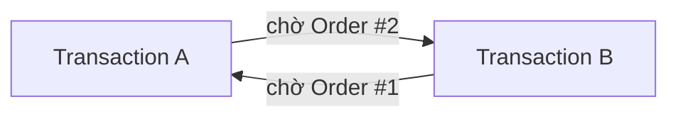

# Locking, Blocking và Deadlock

**Locking** là cơ chế cấp quyền tạm thời trên resource dữ liệu. **Blocking** xảy ra khi một transaction phải chờ quyền đang do transaction khác giữ. **Deadlock** là trạng thái các transaction chờ nhau theo một chu trình nên không transaction nào có thể tự tiếp tục.

Bài [Transaction Isolation](/database/isolation-levels/theory) mô tả transaction đồng thời được phép quan sát lẫn nhau đến mức nào. Database engine phải hiện thực contract đó bằng lock, row version hoặc conflict detection.

Bài này tập trung vào phần lock-based coordination: transaction nào được giữ resource, transaction nào phải chờ, và vì sao hai wait hợp lệ riêng lẻ có thể tạo thành deadlock.

Tình huống xuyên suốt là hai transaction cùng cập nhật hai đơn hàng:

```text
Transaction A cần Order #1 và Order #2
Transaction B cũng cần Order #1 và Order #2
```

Khi cả hai lấy resource theo cùng thứ tự, một transaction có thể chờ rồi tiếp tục. Khi thứ tự ngược nhau, wait-for graph có thể tạo chu trình mà không transaction nào tự tiến lên được.

---

## 1. Lock Resources

**Lock** là trạng thái database engine dùng để cấp quyền tạm thời trên một **lock resource**. Resource là đơn vị được bảo vệ, chẳng hạn row, index key, khoảng key, page hoặc table; loại resource thực tế phụ thuộc engine và access path của câu lệnh.

Hai transaction cùng ghi một resource không thể hoàn tất đồng thời mà không có điểm phân xử. Engine dùng lock để bảo đảm mỗi write được áp dụng trên một trạng thái xác định.

### 1.1. Write–write conflict trên cùng row

Transaction A cập nhật tồn kho và chưa commit:

```sql
BEGIN TRANSACTION;

UPDATE Products
SET StockQuantity = StockQuantity - 2
WHERE Id = 42;

-- Chưa COMMIT.
```

Transaction B thực hiện một update khác trên cùng row:

```sql
UPDATE Products
SET StockQuantity = StockQuantity - 3
WHERE Id = 42;
```

B không thể ghi xuyên qua thay đổi chưa hoàn tất của A. Nó thường phải chờ A commit hoặc rollback.

```text
A giữ quyền ghi Product 42
→ B yêu cầu quyền ghi Product 42
→ B chờ
→ A COMMIT
→ B tiếp tục trên trạng thái mới
```

### 1.2. Lock lifecycle

Lock có lifecycle gắn với statement hoặc transaction:

```text
Transaction yêu cầu lock
→ engine kiểm tra compatibility
→ lock được cấp hoặc transaction phải chờ
→ transaction dùng resource
→ lock được giải phóng theo isolation và transaction lifecycle
```

Lock không phải lỗi. Nó là cơ chế ngăn hai write phá nhau. Vấn đề xuất hiện khi phạm vi lock rộng, thời gian giữ dài hoặc wait tạo chu trình.

---

## 2. Lock compatibility

Reader và writer cần quyền khác nhau. Hai mode nền tảng là Shared và Exclusive.

### 2.1. Shared Lock

**Shared Lock** cho phép nhiều transaction cùng đọc một resource khi không có writer không tương thích.

```text
A giữ Shared Lock trên row 42
B yêu cầu Shared Lock trên row 42
→ có thể cùng đọc
```

Shared Lock không có nghĩa reader luôn chặn writer tới cuối transaction. Thời gian giữ lock phụ thuộc isolation level và engine.

### 2.2. Exclusive Lock

**Exclusive Lock** bảo vệ thao tác ghi. Transaction khác không thể lấy một lock không tương thích trên cùng resource cho tới khi lock được giải phóng.

```text
A giữ Exclusive Lock trên row 42
B yêu cầu Exclusive Lock trên row 42
→ B chờ
```

Trong lock-based read, reader cần Shared Lock cũng có thể phải chờ Exclusive Lock của writer.

Trong MVCC read, reader thường có thể đọc một row version đã commit mà không lấy Shared Lock xung đột với writer. Writer–writer conflict vẫn phải được điều phối.

### 2.3. Lock compatibility matrix

| Lock đang giữ | Lock yêu cầu | Kết quả phổ biến |
|---|---|---|
| Shared | Shared | Tương thích |
| Shared | Exclusive | Không tương thích |
| Exclusive | Shared | Không tương thích trong lock-based read |
| Exclusive | Exclusive | Không tương thích |

Bảng chỉ mô tả mô hình nền tảng. Engine còn có intent lock, update lock, schema lock, key-range lock và nhiều mode nội bộ khác.

### 2.4. Update Lock trong SQL Server

SQL Server có **Update Lock** để đánh dấu một read có ý định chuyển sang write:

```sql
BEGIN TRANSACTION;

SELECT StockQuantity
FROM Products WITH (UPDLOCK)
WHERE Id = @productId;

UPDATE Products
SET StockQuantity = StockQuantity - @quantity
WHERE Id = @productId;

COMMIT;
```

Update Lock giúp tránh trường hợp nhiều transaction cùng giữ Shared Lock rồi cùng cố nâng lên Exclusive Lock trên một resource.

> **Cảnh báo:** `UPDLOCK` là SQL Server-specific. Lock hint thay đổi concurrency behavior và có thể tăng blocking. Chỉ dùng khi failure window đã được chứng minh và execution plan cùng lock observation xác nhận phạm vi phù hợp.

Lock mode mới chỉ mô tả quyền. Phạm vi resource engine thực sự khóa còn phụ thuộc query và index.

---

## 3. Access path và lock footprint

Câu nói “database khóa row” thường quá đơn giản. Engine khóa những resource mà access path chạm tới, thường gắn với index record hoặc page vật lý.

### 3.1. Lock granularity

| Resource | Phạm vi |
|---|---|
| Row hoặc key | Một row hay index key cụ thể |
| Page | Một page dữ liệu hoặc index |
| Table | Toàn bộ table |
| Range hoặc gap | Một khoảng key, kể cả vị trí chưa có row |
| Schema/metadata | Cấu trúc table hoặc object database |

Tên và semantics chính xác phụ thuộc engine.

### 3.2. Point lookup và range scan

Unique lookup có access path hẹp:

```sql
UPDATE Orders
SET Status = 'Expired'
WHERE Id = @orderId;
```

Nếu `Id` là key được index, engine có thể định vị resource trực tiếp.

Range update có phạm vi lớn hơn:

```sql
UPDATE Orders
SET Status = 'Expired'
WHERE Status = 'Pending'
  AND ExpiredAt < @now;
```

Nếu thiếu index phù hợp, engine phải scan nhiều row hoặc index entry trước khi biết row nào cần update.

### 3.3. Index và lock footprint

Index không chỉ giảm CPU hoặc I/O. Nó còn rút ngắn thời gian và phạm vi query chạm resource.

```text
Thiếu access path
→ scan nhiều page/key
→ giữ hoặc yêu cầu nhiều lock hơn
→ transaction kéo dài
→ blocking window lớn hơn
```

Index gợi ý cần được kiểm chứng bằng execution plan:

```sql
CREATE INDEX IX_Orders_Status_ExpiredAt
ON Orders(Status, ExpiredAt);
```

Mỗi index bổ sung cũng tăng write amplification. Mục tiêu là access path phù hợp, không phải thêm index theo mọi điều kiện từng xuất hiện.

### 3.4. Foreign key và lock footprint

Khi xóa parent, database phải kiểm tra row tham chiếu ở bảng child:

```sql
DELETE FROM Customers
WHERE Id = @customerId;
```

Nếu `Orders(CustomerId)` thiếu index, engine có thể scan nhiều child row để xác minh Foreign Key. Transaction giữ lock lâu hơn và ảnh hưởng nhiều request hơn.

Index trên Foreign Key thường quan trọng với delete/update parent và join thường xuyên.

### 3.5. Lock escalation

Một số engine, đặc biệt SQL Server, có thể thay nhiều lock nhỏ bằng lock lớn hơn để giảm overhead quản lý lock.

```text
Nhiều row/key lock
→ lock memory tăng
→ engine chọn table lock
→ nhiều transaction không liên quan cũng bị chặn
```

Escalation không phải hành vi chung giống nhau ở mọi engine. Cần quan sát engine cụ thể thay vì suy từ số row update.

Resource và mode đã xác định transaction nào phải chờ. Chờ một chiều là blocking, chưa phải deadlock.

---

## 4. Lock Waits và Blocking

**Blocking** xảy ra khi transaction chưa thể lấy lock vì transaction khác đang giữ lock không tương thích.

### 4.1. One-way blocking

```text
Transaction A giữ Exclusive Lock trên Order #1
Transaction B cần Exclusive Lock trên Order #1
→ B chờ A
```

A vẫn có thể tiếp tục tới commit. Khi A giải phóng lock, B được đánh thức và thử tiếp tục.

Blocking là hành vi bình thường khi nhiều transaction tranh chấp cùng resource.

### 4.2. Blocking chains

Một blocker có thể tạo chuỗi chờ:

```text
A giữ lock Product 42
B chờ A, đồng thời giữ lock Order 100
C chờ B trên Order 100
D chờ C trên resource khác
```

Request đầu chuỗi có thể đang chờ API ngoài hoặc bị bỏ quên trong transaction. Các waiter phía sau chỉ biểu hiện timeout, nhưng nguyên nhân nằm ở root blocker.

### 4.3. Lock timeout

Lock timeout xảy ra khi waiter chờ quá thời hạn cấu hình:

```text
B chờ A
→ A chưa giải phóng lock trước deadline
→ B nhận timeout
```

Timeout không chứng minh deadlock. Có thể chỉ tồn tại một cạnh chờ.

Tăng timeout kéo dài thời gian user chờ nhưng không sửa blocker. Cần xác định:

- Ai giữ resource?
- Transaction mở bao lâu?
- Blocker đang chạy hay đang idle?
- Query có scan rộng không?
- Transaction có chờ network không?

### 4.4. Long-running transaction

```text
BEGIN
→ UPDATE Order
→ gọi payment API 3 giây
→ gửi email
→ COMMIT
```

Lock từ `UPDATE Order` có thể tồn tại trong toàn bộ thời gian chờ. Side effect ngoài database phải được tách khỏi transaction boundary như đã giải thích ở bài [Transaction](/database/transactions/theory).

Blocking có thể tự kết thúc khi blocker commit. Deadlock khác ở chỗ mọi transaction trong chu trình đều đang chờ nhau và không transaction nào tự tiến lên được.

---

## 5. Deadlock và wait-for graph

**Deadlock** là chu trình chờ giữa các transaction. Mỗi transaction giữ ít nhất một resource mà transaction khác cần, đồng thời chờ resource do transaction khác giữ.

### 5.1. Circular lock acquisition

Transaction A:

```sql
BEGIN TRANSACTION;

UPDATE Orders
SET Status = 'Processing'
WHERE Id = 1;

UPDATE Orders
SET Status = 'Processing'
WHERE Id = 2;

COMMIT;
```

Transaction B:

```sql
BEGIN TRANSACTION;

UPDATE Orders
SET Status = 'Cancelled'
WHERE Id = 2;

UPDATE Orders
SET Status = 'Cancelled'
WHERE Id = 1;

COMMIT;
```

Interleaving nguy hiểm:

```text
A khóa Order #1
B khóa Order #2
A yêu cầu Order #2 → chờ B
B yêu cầu Order #1 → chờ A
```

### 5.2. Wait-for graph



Chu trình `A → B → A` chứng minh deadlock. Chỉ có `B → A` thì đó là blocking một chiều.

### 5.3. Deadlock detection và victim selection

Database engine theo dõi wait hoặc chạy deadlock detection. Khi phát hiện chu trình, engine chọn một transaction làm **victim**:

```text
Phát hiện cycle
→ chọn victim theo cost/policy của engine
→ rollback victim
→ giải phóng lock
→ transaction còn lại tiếp tục
```

Victim nhận exception. Operation đã rollback hoàn toàn và có thể được retry nếu retry an toàn.

Deadlock không có nghĩa database bị treo vĩnh viễn. Engine chủ động phá chu trình bằng cách abort một transaction.

---

## 6. Lock ordering

Deadlock ở mục 5 xuất hiện vì A và B lấy cùng tập resource theo thứ tự khác nhau. Một thứ tự toàn cục loại bỏ cạnh chờ ngược chiều trong tình huống này.

### 6.1. Inconsistent lock ordering

```text
Flow A: Order #1 → Order #2
Flow B: Order #2 → Order #1
```

Mỗi flow hợp lệ khi chạy riêng. Khi chạy đồng thời, chúng có thể giữ lock chéo nhau.

### 6.2. Consistent lock ordering

```text
Mọi flow: sort OrderId tăng dần
→ Order #1
→ Order #2
```

Interleaving mới:

```text
A khóa Order #1
B chờ Order #1, chưa giữ Order #2
A khóa Order #2
A COMMIT
B tiếp tục Order #1 rồi Order #2
```

B vẫn bị blocking, nhưng không tạo chu trình vì nó chưa giữ resource mà A đang cần.

### 6.3. Cross-table lock ordering

Lock ordering không chỉ áp dụng cho row trong cùng table:

```text
Mọi use case
→ Orders trước
→ Products sau
→ StockTransactions cuối
```

Nếu flow khác cập nhật `Products → Orders`, deadlock vẫn có thể xuất hiện giữa table.

Thứ tự phải được review ở cấp use case, không chỉ trong một repository method.

### 6.4. Remaining deadlock risks

Deadlock còn có thể liên quan:

- Index key và table row.
- Foreign Key validation.
- Range lock.
- Trigger.
- Lock conversion.
- Parallel execution plan.

Ordering giảm một nhóm deadlock phổ biến, không phải bằng chứng hệ thống không còn deadlock. Application vẫn cần retry có kiểm soát.

---

## 7. Range protection

Isolation bài trước đã mô tả Phantom. Lock-based engine có thể bảo vệ predicate bằng lock trên khoảng key, không chỉ row hiện có.

### 7.1. Predicate protection cho row chưa tồn tại

Booking query:

```sql
SELECT Id
FROM Bookings
WHERE RoomId = @roomId
  AND StartTime < @endTime
  AND EndTime > @startTime;
```

Nếu không có booking trùng, query trả `0 row`. Transaction khác vẫn có thể insert một row mới vào khoảng đó.

Range/predicate protection đại diện cho quyền trên tập giá trị phù hợp điều kiện, kể cả vị trí chưa có row.

### 7.2. Access path và protected range

Range lock thường gắn với index range engine scan. Thiếu index có thể làm phạm vi bảo vệ rộng hơn dự kiến.

```text
Có composite index phù hợp
→ seek vào range hẹp
→ lock footprint hẹp hơn

Thiếu index
→ scan range lớn hoặc toàn index
→ nhiều key/gap bị ảnh hưởng
```

Chi tiết record, gap và next-key lock của MySQL nằm trong [MySQL InnoDB Concurrency Internals](/database/mysql-innodb-concurrency/theory).

### 7.3. Constraint-based protection

Nếu booking dùng slot rời rạc, unique constraint trên `(RoomId, SlotStart)` tạo điểm phân xử đơn giản hơn manual range lock.

Lock mạnh chỉ nên dùng khi rule không thể biểu diễn bằng constraint hoặc atomic state transition phù hợp.

---

## 8. Lock Duration và Batch Workloads

Deadlock probability tăng khi transaction giữ nhiều resource trong thời gian dài. Batch job là nguồn contention phổ biến vì chạm nhiều row trong một transaction.

### 8.1. Large batch update

```sql
UPDATE Orders
SET Status = 'Expired'
WHERE Status = 'Pending'
  AND ExpiredAt < @now;
```

Nếu câu lệnh update hàng triệu row:

- Lock hoặc version footprint lớn.
- Transaction log tăng mạnh.
- Request online chờ lâu hơn.
- Rollback kéo dài khi lỗi.
- Deadlock window rộng hơn.

### 8.2. Batch sizing

```text
Đọc 1.000 OrderId theo thứ tự ổn định
→ BEGIN
→ update batch
→ COMMIT
→ lưu checkpoint
→ lặp tiếp
```

Batch nhỏ giảm thời gian giữ resource mỗi transaction. Đổi lại, toàn job không còn atomic. Job cần checkpoint, idempotency và cách resume.

### 8.3. Long-running report và snapshot

Report lớn có thể không giữ Shared Lock dài trong MVCC engine, nhưng vẫn giữ snapshot cũ và gây pressure lên version cleanup. Trong lock-based read, report còn có thể chặn writer.

Các hướng phù hợp có thể gồm:

- Read replica.
- Report async.
- Bảng tổng hợp hoặc materialized view.
- Giới hạn khoảng thời gian.
- Tách OLTP khỏi analytics khi workload đủ lớn.

---

## 9. Blocking và Deadlock Diagnostics

Exception chỉ cho biết transaction hiện tại là victim. Root cause cần deadlock graph hoặc engine log mô tả toàn bộ chu trình.

### 9.1. Deadlock graph contents

| Dữ liệu | Câu hỏi trả lời |
|---|---|
| Process/transaction ID | Những transaction nào tham gia? |
| SQL và execution plan | Câu lệnh nào đang chạy? |
| Resource | Row, key, page, table hay range nào tranh chấp? |
| Held mode | Transaction đang giữ lock gì? |
| Requested mode | Transaction đang chờ lock gì? |
| Victim | Transaction nào bị rollback? |
| Wait edge | Thứ tự chờ tạo chu trình ra sao? |

### 9.2. Deadlock graph analysis

```text
1. Xác định victim và các transaction còn lại
2. Liệt kê resource mỗi transaction đang giữ
3. Liệt kê resource mỗi transaction đang chờ
4. Vẽ thứ tự acquisition
5. Đối chiếu SQL, plan và index
6. Tìm flow lấy resource theo thứ tự ngược
7. Đo transaction duration và row/page đã chạm
```

Không chỉ nhìn câu SQL cuối đang chờ. Transaction có thể đã lấy lock từ một câu SQL trước đó trong cùng boundary.

### 9.3. Blocking diagnostics

Với blocking, cần tìm **root blocker** thay vì deadlock cycle:

- Session nào đứng đầu chain?
- Nó đang chạy hay idle trong transaction?
- Transaction mở từ khi nào?
- Có external call trong boundary không?
- Waiter có timeout vì blocker hay vì query của chính nó chậm?

---

## 10. Deadlock Recovery

Deadlock victim đã rollback nên thường có thể retry. Retry là recovery, không thay thế việc giảm chu trình chờ lặp lại.

### 10.1. Transaction-level retry

Dữ liệu đọc trong attempt cũ có thể không còn đúng:

```text
Deadlock victim
→ transaction rollback
→ backoff
→ BEGIN mới
→ đọc lại state
→ chạy lại toàn bộ operation
→ COMMIT
```

Không chỉ retry câu SQL cuối cùng.

### 10.2. Safe retry conditions

- Exception được phân loại đúng là deadlock/transient conflict.
- Operation idempotent hoặc có idempotency key.
- Side effect ngoài database không bị lặp không kiểm soát.
- Có giới hạn attempt.
- Có backoff và jitter.
- Có metric cho deadlock rate và retry outcome.

### 10.3. Recovery và prevention

Deadlock xảy ra hiếm dưới interleaving ngẫu nhiên có thể là chi phí chấp nhận được. Deadlock lặp lại với cùng graph thường cho thấy:

- Lock order không nhất quán.
- Transaction quá dài.
- Query scan rộng vì thiếu index.
- Batch quá lớn.
- Lock hint quá mạnh.

Retry giúp request phục hồi. Thiết kế và query tuning mới giảm tần suất deadlock.

---

## 11. Checklist Locking và Deadlock

### 11.1. Blocking

```text
[ ] Waiter đang chờ resource nào?
[ ] Ai đang giữ resource đó?
[ ] Root blocker mở transaction bao lâu?
[ ] Blocker có đang idle hoặc chờ network không?
[ ] Query có access path đủ hẹp không?
[ ] Batch/report nào đang chạy cùng thời điểm?
[ ] Timeout đang che root cause nào?
```

### 11.2. Deadlock

```text
[ ] Đã lấy deadlock graph hoặc engine log chưa?
[ ] Các transaction giữ và chờ resource nào?
[ ] Lock order có ngược nhau không?
[ ] Query có scan rộng vì thiếu index không?
[ ] Transaction có quá dài không?
[ ] Batch nhiều row có sort key nhất quán không?
[ ] Retry có chạy lại toàn transaction không?
[ ] Operation có idempotent không?
```

### 11.3. Thiết kế

```text
[ ] Có thể dùng atomic statement thay cho read rồi lock không?
[ ] Constraint có thể bảo vệ rule thay cho lock mạnh không?
[ ] Các flow có cùng resource ordering không?
[ ] Transaction đã mở muộn và commit sớm chưa?
[ ] Có external side effect trong transaction không?
[ ] Foreign Key và write predicate có index phù hợp không?
[ ] Lock hint có bằng chứng và test concurrency không?
```

---

## 12. Tóm tắt

Locking trả lời câu hỏi:

```text
Engine điều phối resource tranh chấp giữa transaction như thế nào?
```

```text
Lock request
→ compatibility check
→ cấp lock hoặc chờ
→ giữ tới mốc theo statement/transaction
→ giải phóng khi commit/rollback
```

```text
Blocking = chờ một chiều
Deadlock = chờ theo chu trình
Timeout  = chờ vượt deadline
```

Các ý chính:

- Writer–writer conflict cần điểm phân xử.
- Lock mode và resource đều ảnh hưởng blocking.
- Index quyết định access path và lock footprint.
- Transaction dài làm wait kéo dài.
- Lock ordering nhất quán giảm deadlock phổ biến.
- Deadlock victim phải retry toàn transaction.
- Retry là recovery, không thay root-cause analysis.

[Concurrency Control Patterns](/database/concurrency-control-patterns/theory) tiếp tục bằng câu hỏi application cần chọn constraint, atomic update, optimistic lock, pessimistic lock, queue hay Outbox trong từng failure window nào.
