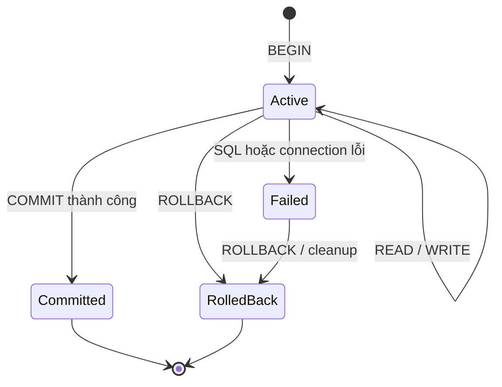

# Transaction

Một request tạo đơn hàng có thể cần nhiều câu SQL. Trong bài này, **write** là câu lệnh làm thay đổi dữ liệu, chẳng hạn `INSERT`, `UPDATE` hoặc `DELETE`:

- Tạo `Order`.
- Tạo các `OrderItem`.
- Giảm tồn kho.
- Ghi lịch sử biến động kho.

Bốn câu SQL cùng tạo ra một kết quả nghiệp vụ. Nếu chỉ một phần được lưu, database chứa một đơn hàng không hoàn chỉnh.

**Transaction** là ranh giới gom một hoặc nhiều thao tác database thành một đơn vị công việc. Các write bên trong ranh giới này cùng tạo ra một kết quả: database hoặc công bố tất cả bằng `COMMIT`, hoặc loại bỏ các thay đổi chưa công bố bằng `ROLLBACK`.

```text
Trạng thái ban đầu
→ bắt đầu transaction
→ thực hiện các thay đổi tạm thời
→ COMMIT   → công bố toàn bộ trạng thái mới
→ ROLLBACK → hoàn tác toàn bộ transaction
```

Bài này trả lời một câu hỏi trung tâm:

```text
Những thao tác database nào phải cùng commit hoặc cùng rollback?
```

---

## 1. Transaction semantics

Transaction tạo một ranh giới giữa trạng thái đã được database công nhận và các thay đổi vẫn còn tạm thời.

### 1.1. Single-statement và multi-statement transaction

Một transaction có thể chứa một câu SQL:

```sql
BEGIN TRANSACTION;

UPDATE Products
SET Price = @newPrice
WHERE Id = @productId;

COMMIT;
```

Nó cũng có thể chứa nhiều câu SQL cùng phục vụ một nghiệp vụ:

```sql
BEGIN TRANSACTION;

INSERT INTO Orders(Id, CustomerId, Status)
VALUES (@orderId, @customerId, 'Created');

INSERT INTO OrderItems(OrderId, ProductId, Quantity)
VALUES (@orderId, @productId, @quantity);

COMMIT;
```

Số câu SQL không quyết định boundary. Câu hỏi cần trả lời là: nếu một bước thất bại, các bước trước đó có còn được phép tồn tại không?

```text
Order không có OrderItem
→ trạng thái không hoàn chỉnh
→ hai INSERT phải cùng một transaction
```

### 1.2. Uncommitted changes

Sau `BEGIN`, transaction có thể tạo hoặc sửa dữ liệu. Những thay đổi này chưa phải kết quả cuối cùng cho tới khi commit.

```text
BEGIN
→ INSERT Order
→ Order tồn tại trong transaction đang chạy
→ chưa có kết quả commit
```

Transaction thường đọc được write của chính nó. Transaction khác nhìn thấy dữ liệu đó thế nào phụ thuộc isolation level.

> **Lưu ý:** “Chưa commit” không đồng nghĩa dữ liệu chỉ nằm trong application memory. Database đã thực thi write và có thể giữ log, lock hoặc row version cần thiết. Điểm quan trọng là kết quả chưa được công bố như một commit hoàn chỉnh.

### 1.3. COMMIT

`COMMIT` yêu cầu database kết thúc transaction thành công và công bố toàn bộ thay đổi thuộc boundary.

```text
BEGIN
→ Insert Order
→ Insert OrderItems
→ COMMIT
→ cả Order và OrderItems trở thành kết quả đã commit
```

Sau commit, transaction không thể rollback bằng lệnh `ROLLBACK` thông thường nữa. Muốn đảo kết quả phải thực hiện một transaction nghiệp vụ mới, ví dụ tạo phiếu hủy hoặc ghi bút toán bù.

### 1.4. ROLLBACK

`ROLLBACK` kết thúc transaction mà không công bố các write của transaction đó.

```text
BEGIN
→ Insert Order
→ Insert OrderItems
→ phát hiện không đủ tồn kho
→ ROLLBACK
→ Order và OrderItems không được công bố
```

Rollback bảo vệ boundary database. Nó không hoàn tác email đã gửi, file đã upload hoặc HTTP request đã được service khác xử lý.

### 1.5. Auto-commit và explicit transaction

**Auto-commit** là chế độ mỗi câu SQL tự tạo một transaction riêng nếu application không mở explicit transaction.

```sql
UPDATE Products
SET Price = @newPrice
WHERE Id = @productId;
```

Câu lệnh trên thường commit khi thực thi thành công.

Hai câu SQL đặt cạnh nhau trong code không tự dùng chung transaction:

```text
Insert Order      → auto-commit transaction 1
Insert OrderItems → auto-commit transaction 2
```

**Explicit transaction** là boundary do application mở để phối hợp nhiều câu SQL:

```sql
BEGIN TRANSACTION;

INSERT INTO Orders(Id, CustomerId, Status)
VALUES (@orderId, @customerId, 'Created');

INSERT INTO OrderItems(OrderId, ProductId, Quantity)
VALUES (@orderId, @productId, @quantity);

COMMIT;
```

Khái niệm transaction đến đây đã rõ. Phần tiếp theo xác định vì sao boundary nhiều câu lệnh cần tồn tại và cách chọn phạm vi phù hợp.

---

## 2. Transaction boundary

**Transaction boundary** xác định operation đầu tiên và cuối cùng phải cùng tạo ra một kết quả commit hoặc cùng bị rollback. Boundary quá hẹp công bố dữ liệu nửa chừng; boundary quá rộng giữ tài nguyên database trong lúc chờ công việc không cần atomic với write.

### 2.1. Partial business state với auto-commit

Luồng tạo đơn không có transaction chung:

```sql
INSERT INTO Orders(Id, CustomerId, Status)
VALUES (@orderId, @customerId, 'Created');

INSERT INTO OrderItems(OrderId, ProductId, Quantity)
VALUES (@orderId, @productId, @quantity);

UPDATE Products
SET StockQuantity = StockQuantity - @quantity
WHERE Id = @productId;

INSERT INTO StockTransactions(ProductId, Quantity, ReferenceId)
VALUES (@productId, -@quantity, @orderId);
```

Nếu giảm tồn kho thất bại:

```text
Insert Order            → đã commit
Insert OrderItem        → đã commit
Update Product          → thất bại
Insert StockTransaction → chưa chạy
```

Database không tự biết hai `INSERT` đầu phải bị xóa. Từ góc nhìn auto-commit, chúng là hai transaction đã hoàn tất.

### 2.2. Multi-statement atomicity

Use case chỉ hợp lệ khi các thay đổi đi cùng nhau:

```text
Order tồn tại
↔ OrderItems tồn tại
↔ Stock đã giảm
↔ StockTransaction đã được ghi
```

Boundary phù hợp:

```sql
BEGIN TRANSACTION;

INSERT INTO Orders(Id, CustomerId, Status)
VALUES (@orderId, @customerId, 'Created');

INSERT INTO OrderItems(OrderId, ProductId, Quantity)
VALUES (@orderId, @productId, @quantity);

UPDATE Products
SET StockQuantity = StockQuantity - @quantity
WHERE Id = @productId
  AND StockQuantity >= @quantity;

-- Nếu affected rows = 0: ROLLBACK.

INSERT INTO StockTransactions(ProductId, Quantity, ReferenceId)
VALUES (@productId, -@quantity, @orderId);

COMMIT;
```

Nếu bất kỳ write bắt buộc nào thất bại, application rollback toàn bộ transaction.

### 2.3. Narrow transaction boundary

Mỗi repository tự commit làm use case mất quyền phối hợp:

```text
OrderRepository.Insert      → commit
OrderItemRepository.Insert  → commit
InventoryRepository.Reserve → lỗi
```

Transaction boundary thuộc lớp biết toàn bộ use case, thường là application service hoặc use-case handler.

### 2.4. Wide transaction boundary

Boundary sau giữ transaction trong lúc chờ network:

```text
BEGIN
→ ghi Order
→ gọi payment API
→ upload file
→ gửi email
→ COMMIT
```

Trong thời gian chờ, transaction có thể giữ:

- Connection.
- Lock của write đã thực hiện.
- Snapshot hoặc row version cũ.
- Log hoặc undo cần cho rollback.

Email và HTTP call cũng không rollback cùng database.

### 2.5. Business transaction boundary

Chuẩn bị trước những dữ liệu không cần transaction:

```text
Validate request shape
→ tạo identifier
→ tính dữ liệu không phụ thuộc state đang tranh chấp
→ BEGIN
→ đọc state cần quyết định
→ thực hiện write
→ COMMIT
→ xử lý side effect ngoài database
```

Boundary phù hợp có các đặc điểm:

- Bao đủ các write local cần cùng commit.
- Không chờ người dùng hoặc dịch vụ ngoài.
- Mở muộn, ghi nhanh và commit sớm.
- Có một owner rõ ràng cho commit và rollback.

---

## 3. Transaction lifecycle

Transaction lifecycle giúp phân biệt state đang chạy, đã commit, đã rollback và lỗi chưa được cleanup.

### 3.1. Transaction states



Sau một số loại lỗi, transaction không còn an toàn để tiếp tục. Application phải rollback theo contract của driver, ORM và engine.

### 3.2. Business error và technical failure

Cả hai loại lỗi có thể dẫn tới rollback:

| Loại lỗi | Ví dụ |
|---|---|
| Nghiệp vụ | Không đủ tồn kho, trạng thái không còn hợp lệ |
| Constraint | Unique key hoặc Foreign Key conflict |
| Concurrency | Deadlock victim, serialization failure |
| Hạ tầng | Connection mất, storage error |
| Application | Exception trước commit |

Rollback là một nhánh kết quả hợp lệ, không chỉ là xử lý exception bất ngờ.

### 3.3. Savepoint

Savepoint tạo một mốc rollback cục bộ bên trong transaction:

```sql
BEGIN TRANSACTION;

INSERT INTO Orders(Id, CustomerId)
VALUES (@orderId, @customerId);

SAVEPOINT BeforeOptionalItems;

-- Các thao tác tùy chọn.

ROLLBACK TO SAVEPOINT BeforeOptionalItems;

COMMIT;
```

Savepoint không tạo commit bền vững độc lập. Outer rollback vẫn hoàn tác phần trước savepoint.

> **Lưu ý:** PostgreSQL và MySQL hỗ trợ `SAVEPOINT name` cùng `ROLLBACK TO SAVEPOINT name`. SQL Server dùng `SAVE TRANSACTION name` và `ROLLBACK TRANSACTION name`. Ví dụ mô tả lifecycle, không phải SQL dùng nguyên xi cho mọi engine.

### 3.4. Nested transaction trong framework

API “nested transaction” có thể là:

- Savepoint trên cùng connection.
- Bộ đếm scope.
- Ambient transaction.
- Transaction độc lập trên connection khác.

Cần xác nhận:

| Câu hỏi | Ý nghĩa |
|---|---|
| Inner commit có bền vững độc lập không? | Outer rollback có hoàn tác phần inner không? |
| Các scope dùng cùng connection không? | Có thật sự cùng local transaction không? |
| Framework có tạo savepoint không? | Rollback cục bộ tới đâu? |
| Inner error có làm outer transaction unusable không? | Outer còn được phép commit không? |

---

## 4. Application Transaction Management

Database chỉ thấy connection, transaction và SQL. Application phải bảo đảm repository thực sự tham gia cùng boundary.

### 4.1. Transaction boundary ownership

Use case biết những write nào tạo thành một kết quả nghiệp vụ:

```text
CreateOrderUseCase
├── Begin transaction
├── OrderRepository.Insert
├── InventoryRepository.Reserve
├── StockMovementRepository.Insert
└── Commit
```

Repository không tự commit nếu caller cần phối hợp nhiều repository.

### 4.2. Connection-scoped transaction

Khi dùng ORM, cần xác nhận:

- Các repository có dùng cùng `DbContext`, session hoặc connection không?
- Nhiều lần `SaveChanges` có nằm trong cùng explicit transaction không?
- Repository có tự mở transaction riêng không?
- Exception có làm transaction không thể commit tiếp không?
- Connection có còn sống tới lúc commit không?

Hai context hoặc hai connection không tự dùng chung local transaction.

### 4.3. Short-lived transaction

`await` không tự làm transaction sai. Vấn đề là transaction giữ resource trong lúc chờ công việc gì.

Không giữ transaction khi:

- Gọi HTTP API.
- Chờ message broker.
- Upload file.
- Gửi email.
- Chờ người dùng.
- Chạy CPU work dài không cần database state.

### 4.4. Business invariant trong write path

Transaction không tự biết rule nghiệp vụ. Câu update tồn kho phải chứa điều kiện đủ hàng:

```sql
UPDATE Products
SET StockQuantity = StockQuantity - @quantity
WHERE Id = @productId
  AND StockQuantity >= @quantity;
```

| Affected rows | Ý nghĩa |
|---:|---|
| `1` | Update thành công |
| `0` | Row không tồn tại hoặc không đủ tồn tại thời điểm write |

Application rollback khi điều kiện không đạt.

### 4.5. Database constraint

Constraint là nơi database phân xử cuối cùng cho rule có thể biểu diễn trực tiếp:

```sql
CREATE UNIQUE INDEX UX_Users_Tenant_Email
ON Users(TenantId, Email);
```

Application check trước chỉ cải thiện UX. Constraint ngăn hai request đồng thời cùng insert key trùng.

Chi tiết Atomicity, Consistency, Isolation và Durability thuộc bài [ACID](/database/acid/theory).

---

## 5. Commit outcome và retry

Commit là boundary giữa trạng thái tạm và trạng thái đã công bố. Network failure quanh commit có thể làm client không biết kết quả cuối.

### 5.1. Commit failure windows

| Thời điểm | Trạng thái có thể xảy ra |
|---|---|
| Trước khi database nhận commit | Chưa commit |
| Trong lúc database xử lý commit | Có thể commit hoặc chưa |
| Sau commit, trước khi client nhận response | Đã commit nhưng client timeout |

Timeout không chứng minh rollback.

### 5.2. Ambiguous commit outcome

```text
COMMIT thành công
→ response bị mất
→ client retry CreateOrder
```

Không có business key hoặc idempotency key, retry có thể tạo đơn thứ hai.

Transaction chapter chỉ xác định failure window. Cách thiết kế idempotency thuộc [Concurrency Control Patterns](/database/concurrency-control-patterns/theory).

### 5.3. Transaction boundary retry

Khi database abort transaction do conflict transient, retry phải bắt đầu lại:

```text
BEGIN mới
→ đọc lại state
→ kiểm tra lại điều kiện
→ ghi lại dữ liệu
→ COMMIT
```

Không chỉ retry câu SQL cuối. State đã đọc ở attempt cũ có thể không còn đúng.

---

## 6. Long-running và Batch Transactions

Boundary đúng về dữ liệu vẫn có thể giữ resource quá lâu.

### 6.1. Long-running transaction

Transaction dài có thể giữ:

- Connection.
- Lock của write.
- Snapshot hoặc row version cũ.
- Log/undo phục vụ rollback.

Nguyên tắc vận hành:

```text
Chuẩn bị trước
→ mở transaction muộn
→ write nhanh
→ commit sớm
```

### 6.2. Batch transaction

Một transaction update hàng triệu row làm rollback và resource footprint rất lớn.

Chia batch:

```text
Đọc 1.000 key theo thứ tự ổn định
→ BEGIN
→ update batch
→ COMMIT
→ ghi checkpoint
→ batch tiếp
```

Batching làm toàn job không còn atomic. Job cần checkpoint, idempotency và cách resume rõ.

---

## 7. Checklist Transaction

```text
[ ] Transaction là đơn vị công việc nào?
[ ] Những write nào phải cùng commit hoặc rollback?
[ ] Ai sở hữu commit và rollback?
[ ] Các repository có dùng cùng session/connection không?
[ ] Boundary có quá hẹp hoặc quá rộng không?
[ ] Business condition nằm trong write path chưa?
[ ] Constraint nào bảo vệ schema rule?
[ ] Transaction có chờ network hoặc user không?
[ ] Ambiguous commit được xác minh bằng key nào?
[ ] Retry có chạy lại toàn boundary không?
```

---

## 8. Tóm tắt

Transaction là một đơn vị công việc database:

```text
BEGIN
→ thay đổi tạm thời
→ COMMIT toàn bộ
hoặc
→ ROLLBACK toàn bộ
```

Câu hỏi trung tâm:

```text
Những thao tác nào phải cùng commit hoặc cùng rollback?
```

Bài tiếp theo, [ACID](/database/acid/theory), giải thích database cần cung cấp những nhóm bảo đảm nào để transaction boundary này có ý nghĩa.
