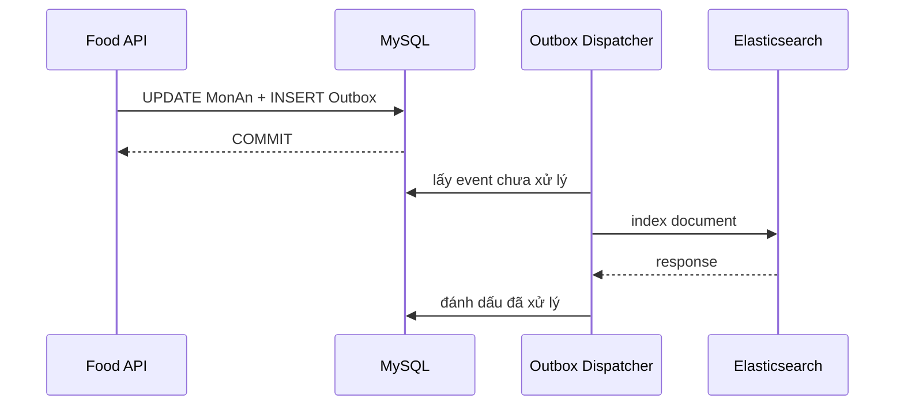

# Elasticsearch trong .NET

Một nền tảng đặt đồ ăn thường bắt đầu với truy vấn tìm món trực tiếp trong database:

```sql
SELECT id, tenMon, moTa, gia
FROM MonAn
WHERE tenMon LIKE '%ga ran%'
   OR moTa LIKE '%ga ran%'
ORDER BY tenMon
LIMIT 20;
```

Truy vấn này phù hợp khi dữ liệu còn nhỏ và người dùng nhập gần đúng nội dung đã lưu. Khi sản phẩm tăng lên hàng trăm nghìn bản ghi, yêu cầu tìm kiếm thường mở rộng:

- Tìm `ga ran` phải khớp với `Gà rán sốt cay` mà không phụ thuộc chữ hoa, chữ thường.
- Kết quả có tên món khớp phải đứng trước kết quả chỉ khớp mô tả.
- Người dùng có thể lọc theo shop, danh mục, khoảng giá và trạng thái còn bán.
- Gõ sai nhẹ như `hamberger` vẫn nên tìm được `hamburger`.
- API phải trả kết quả ổn định trong vài chục mili giây ngay cả khi lượng dữ liệu và truy vấn tăng.

**Elasticsearch** là một search engine — hệ thống chuyên lập chỉ mục, tìm kiếm và xếp hạng dữ liệu theo mức độ liên quan với nội dung người dùng nhập.

Thay vì quét trực tiếp từng bản ghi như truy vấn `LIKE`, Elasticsearch xây dựng trước một cấu trúc dữ liệu dành riêng cho tìm kiếm. Nhờ đó, hệ thống có thể xác định các kết quả liên quan mà không phải đọc lại toàn bộ tập dữ liệu cho mỗi truy vấn.

Elasticsearch cũng là một distributed search engine. Dữ liệu và công việc tìm kiếm có thể được phân phối trên nhiều node để mở rộng dung lượng lưu trữ và xử lý nhiều truy vấn cùng lúc.

Elasticsearch xử lý dữ liệu tìm kiếm theo ba bước:

- Mỗi bản ghi tìm kiếm được biểu diễn dưới dạng một document JSON.
- Khi document được ghi, nội dung được phân tích thành các đơn vị có thể tra cứu gọi là term.
- Document và term được phân phối trên nhiều node để tìm kiếm song song, sau đó kết quả được hợp nhất trước khi trả về ứng dụng.

Ví dụ xuyên suốt của bài có ba thành phần:

- **Bối cảnh**: tìm món ăn trong hệ thống multi-tenant.
- **Source of truth**: MySQL lưu và quyết định trạng thái nghiệp vụ.
- **Search index**: Elasticsearch giữ dữ liệu phục vụ tìm kiếm và có thể được xây dựng lại từ MySQL.

## 1. Database search và search engine

### 1.1 B-tree và giới hạn của `LIKE`

Index B-tree trong relational database được tổ chức theo thứ tự của giá trị. Nó hỗ trợ tốt equality, range và prefix đã biết:

```sql
WHERE shopId = 42
WHERE gia BETWEEN 30000 AND 80000
WHERE tenMon LIKE 'ga%'
```

Nhờ thứ tự này, database có thể tra cứu hiệu quả khi truy vấn cung cấp phần đầu của chuỗi, chẳng hạn `LIKE 'ga%'`. Từ tiền tố `ga`, database xác định được vùng dữ liệu cần đọc rồi bỏ qua phần còn lại của index.

Với `LIKE '%ga%'`, ký tự `%` ở đầu cho phép chuỗi `ga` xuất hiện ở bất kỳ vị trí nào. Database không còn một tiền tố cố định để xác định vùng bắt đầu trong B-tree. Vì vậy, nó thường phải kiểm tra nhiều giá trị ứng viên, thậm chí quét toàn bộ bảng hoặc toàn bộ index nếu không có cấu trúc text index phù hợp.

Một số database cung cấp full-text index, trigram index hoặc extension tìm kiếm riêng. Các công cụ này có thể đáp ứng tốt nhiều hệ thống và nên được đánh giá trước khi bổ sung hạ tầng mới. Tuy nhiên, khi sản phẩm cần đồng thời phân tích từ, sửa lỗi gõ, đặt trọng số cho từng field và xếp hạng theo relevance, search engine cung cấp một mô hình chuyên biệt hơn cho nhóm công việc đó.

Elasticsearch không thay thế database nghiệp vụ. Hai hệ thống trả lời hai nhóm câu hỏi khác nhau:

- **Database nghiệp vụ** trả lời trạng thái chính xác hiện tại, chẳng hạn món ăn có tồn tại không, giá đang áp dụng là bao nhiêu và món còn được phép bán không.
- **Elasticsearch** trả lời kết quả nào liên quan nhất với nội dung người dùng nhập, chẳng hạn `gà cay` nên ưu tiên món có cụm từ đó trong tên hơn món chỉ nhắc đến trong mô tả.

Để phục vụ tìm kiếm, Elasticsearch giữ một read model được tạo từ dữ liệu gốc. Read model có thể chứa sẵn tên món, mô tả, danh mục, tag và thông tin shop trong cùng một document để tìm kiếm mà không cần join tại thời điểm truy vấn.


*Database tối ưu cho dữ liệu nghiệp vụ có cấu trúc. Inverted index tối ưu đường đi từ term đến document liên quan.*

### 1.2 Search index và source of truth

Mỗi món ăn vẫn được tạo và cập nhật trong MySQL. Một bản sao đã được định hình cho tìm kiếm được đưa sang Elasticsearch:


*Luồng ghi bảo vệ source of truth trong MySQL. Luồng search đọc một read model được cập nhật bất đồng bộ.*

Search index là **dữ liệu dẫn xuất**: có thể bị trễ, bị xóa rồi xây dựng lại, hoặc tồn tại dưới một schema khác với bảng nghiệp vụ. Vì vậy:

- Tạo đơn, trừ tồn kho và kiểm tra quyền sở hữu shop phải đọc database.
- Tìm món, gợi ý từ khóa và lọc catalog có thể đọc Elasticsearch.
- Elasticsearch không được quyết định một món còn đủ tồn kho tại thời điểm thanh toán.

Ranh giới này ngăn search engine trở thành một source of truth thứ hai khó đồng bộ.

## 2. Mô hình dữ liệu Elasticsearch

### 2.1 Document

**Document** là đơn vị dữ liệu JSON được Elasticsearch lập chỉ mục. Một document tìm kiếm món ăn có thể chứa thông tin đã tổng hợp từ nhiều bảng:

```json
{
  "monAnId": "mon-1001",
  "shopId": "shop-42",
  "tenMon": "Gà rán sốt cay",
  "moTa": "Đùi gà chiên giòn dùng với sốt cay Hàn Quốc",
  "danhMuc": "Món chính",
  "gia": 69000,
  "dangBan": true,
  "tags": ["gà", "đồ chiên", "cay"],
  "updatedAt": "2026-10-10T08:30:00Z"
}
```

Document không cần phản chiếu từng bảng theo mô hình quan hệ. Nó nên chứa đúng dữ liệu cần để tìm, lọc, xếp hạng và hiển thị kết quả mà không phải join ở thời điểm search.

### 2.2 Index

**Index** là tập hợp các document có cùng mục đích và mapping. Ví dụ `mon-an-v1` chứa read model cho tính năng tìm món.

Tên có hậu tố phiên bản giúp thay đổi mapping an toàn. Ứng dụng không truy cập trực tiếp `mon-an-v1` mà dùng alias ổn định `mon-an-search`:

```text
mon-an-search (alias) ──> mon-an-v1 (physical index)
```

Khi mapping thay đổi, hệ thống có thể tạo `mon-an-v2`, reindex dữ liệu rồi chuyển alias trong một thao tác atomic. Client không phải đổi endpoint và không thấy khoảng thời gian index vắng dữ liệu.

### 2.3 Mapping

**Mapping** mô tả kiểu dữ liệu và cách từng field được lập chỉ mục. Nó tương tự schema ở mục đích kiểm soát cấu trúc, nhưng quyết định cả hành vi tìm kiếm:

```json
PUT /mon-an-v1
{
  "mappings": {
    "dynamic": "strict",
    "properties": {
      "monAnId":   { "type": "keyword" },
      "shopId":    { "type": "keyword" },
      "tenMon":    { "type": "text" },
      "moTa":      { "type": "text" },
      "danhMuc":   { "type": "keyword" },
      "gia":       { "type": "integer" },
      "dangBan":   { "type": "boolean" },
      "tags":      { "type": "keyword" },
      "updatedAt": { "type": "date" }
    }
  }
}
```

`dynamic: strict` từ chối field chưa được khai báo. Đây là lựa chọn phù hợp cho read model có contract rõ ràng vì một lỗi chính tả như `shopID` không âm thầm tạo field mới và làm lệch dữ liệu.

Hai kiểu chuỗi quan trọng nhất có mục đích khác nhau:

| Kiểu | Hành vi | Dùng cho |
|---|---|---|
| `text` | Được analyzer tách thành term | Full-text search trong tên và mô tả |
| `keyword` | Giữ toàn bộ giá trị như một term | ID, trạng thái, filter, sort và aggregation |

Một field có thể có nhiều cách lập chỉ mục bằng multi-field. `tenMon` được tìm như `text` nhưng vẫn có thể sort theo một bản `keyword`:

```json
"tenMon": {
  "type": "text",
  "fields": {
    "raw": { "type": "keyword", "ignore_above": 256 }
  }
}
```

## 3. Text analysis và inverted index

### 3.1 Text analysis

Trước khi lập chỉ mục một field `text`, Elasticsearch chạy giá trị qua một **analyzer**. Analyzer là pipeline biến chuỗi đầu vào thành các term có thể tìm kiếm. Pipeline gồm ba nhóm thành phần:

1. Character filter chuẩn hóa ký tự trước khi tách từ.
2. Tokenizer chia chuỗi thành token.
3. Token filter biến đổi, loại bỏ hoặc bổ sung token.

Với analyzer đơn giản, chuỗi `Gà Rán Sốt Cay` có thể đi qua luồng:

```text
"Gà Rán Sốt Cay"
        ↓ lowercase
"gà rán sốt cay"
        ↓ tokenizer
["gà", "rán", "sốt", "cay"]
```

Search analyzer phải tương thích với index analyzer. Nếu lúc index bỏ dấu tiếng Việt nhưng lúc search vẫn giữ dấu, query và document có thể tạo ra hai tập term khác nhau rồi không khớp.

Có thể quan sát analyzer trước khi chốt mapping bằng `_analyze` API:

```json
POST /_analyze
{
  "analyzer": "standard",
  "text": "Gà rán sốt cay"
}
```

Đừng chọn analyzer chỉ vì tên của nó nghe phù hợp. Hãy tạo một tập câu truy vấn thực tế, xem token sinh ra và đo chất lượng kết quả bằng cùng một bộ test relevance.

### 3.2 Inverted index

Sau bước analysis, Elasticsearch tạo **inverted index** — cấu trúc ánh xạ mỗi term tới các document chứa term đó.

Giả sử có ba document:

| Document | `tenMon` |
|---|---|
| 1 | Gà rán sốt cay |
| 2 | Cơm gà Hải Nam |
| 3 | Mì bò sốt cay |

Inverted index rút gọn có dạng:

| Term | Document chứa term |
|---|---|
| `gà` | 1, 2 |
| `rán` | 1 |
| `sốt` | 1, 3 |
| `cay` | 1, 3 |
| `cơm` | 2 |
| `mì` | 3 |

Khi tìm `gà cay`, Elasticsearch tra danh sách document theo term thay vì quét toàn bộ `_source`. Cấu trúc này là nền tảng giúp full-text search nhanh, nhưng nó cũng giải thích vì sao thay analyzer hoặc kiểu field thường cần reindex: dữ liệu đã được biến đổi thành cấu trúc vật lý từ lúc ghi.

## 4. Truy vấn và xếp hạng kết quả

**Query DSL** là ngôn ngữ JSON dùng để mô tả truy vấn, filter và aggregation trong Elasticsearch. Một search request thường kết hợp hai ngữ cảnh:

- **Query context** xác định mức độ liên quan và tạo `_score`.
- **Filter context** chỉ trả lời đúng hoặc sai, không tác động relevance và phù hợp với điều kiện có cấu trúc.

### 4.1 Full-text query

`multi_match` tìm cùng một chuỗi trên nhiều field. Dấu `^` tăng trọng số của field:

```json
GET /mon-an-search/_search
{
  "query": {
    "multi_match": {
      "query": "gà cay",
      "fields": ["tenMon^3", "tags^2", "moTa"],
      "operator": "and"
    }
  }
}
```

Kết quả khớp trong `tenMon` được ưu tiên hơn cùng term chỉ xuất hiện trong `moTa`. `_score` là điểm relevance tương đối trong tập kết quả của query, không phải xác suất và không nên được hiểu như một điểm chất lượng tuyệt đối.

### 4.2 Structured filtering

`bool` kết hợp full-text query với các điều kiện nghiệp vụ đã biết chính xác:

```json
GET /mon-an-search/_search
{
  "from": 0,
  "size": 20,
  "query": {
    "bool": {
      "must": [
        {
          "multi_match": {
            "query": "gà cay",
            "fields": ["tenMon^3", "tags^2", "moTa"]
          }
        }
      ],
      "filter": [
        { "term":  { "shopId": "shop-42" } },
        { "term":  { "dangBan": true } },
        { "range": { "gia": { "gte": 30000, "lte": 80000 } } }
      ]
    }
  }
}
```

`term` không chạy text analysis. Vì vậy nó phù hợp với `keyword`, số và boolean. Dùng `term` trực tiếp trên `text` thường tạo kết quả khó hiểu. Với nội dung đã phân tích, dùng `match` hoặc `multi_match`.

### 4.3 Fuzzy search

Fuzzy query cho phép một số thao tác chèn, xóa, thay thế hoặc đảo ký tự:

```json
{
  "multi_match": {
    "query": "hamberger",
    "fields": ["tenMon^3", "tags"],
    "fuzziness": "AUTO"
  }
}
```

Fuzziness mở rộng số term cần xét nên tốn CPU hơn và có thể làm giảm precision. Chỉ bật trên field cần thiết, giới hạn độ dài query và đo bằng dữ liệu thật thay vì áp dụng mặc định cho mọi request.

## 5. Aggregation và bộ lọc facet

**Aggregation** tổng hợp dữ liệu trong tập document khớp. **Faceted search** là cách trình bày các nhóm tổng hợp đó thành bộ lọc kèm số lượng kết quả, chẳng hạn danh mục hoặc khoảng giá.

```json
GET /mon-an-search/_search
{
  "size": 0,
  "query": {
    "bool": {
      "filter": [
        { "term": { "shopId": "shop-42" } },
        { "term": { "dangBan": true } }
      ]
    }
  },
  "aggs": {
    "theoDanhMuc": {
      "terms": { "field": "danhMuc", "size": 20 }
    },
    "khoangGia": {
      "range": {
        "field": "gia",
        "ranges": [
          { "to": 50000 },
          { "from": 50000, "to": 100000 },
          { "from": 100000 }
        ]
      }
    }
  }
}
```

Aggregation chạy trên `keyword` hoặc numeric field, không nên chạy trực tiếp trên analyzed `text`. Nếu vừa tìm vừa tổng hợp theo một chuỗi, dùng multi-field như `tenMon.raw`.

## 6. Kiến trúc Elasticsearch cluster

Một Elasticsearch **cluster** gồm một hoặc nhiều node. Mỗi index được chia thành shard để lưu trữ và tìm kiếm phân tán:

- **Primary shard** giữ một phần dữ liệu gốc của index.
- **Replica shard** là bản sao của primary shard, phục vụ high availability và có thể xử lý search.
- **Node** là một Elasticsearch process tham gia cluster và giữ một số shard.


*Mỗi request chỉ cần một bản sao của từng shard. Coordinating node merge các top result cục bộ thành response cuối.*

Node nhận request đóng vai trò coordinating node: gửi query tới một bản sao của mỗi shard cần thiết, nhận top result cục bộ rồi merge thành kết quả cuối.

Nhiều shard không mặc nhiên nhanh hơn. Mỗi shard là một Lucene index có heap, file descriptor và chi phí điều phối riêng. Oversharding tạo nhiều shard nhỏ, tăng metadata và fan-out cho mỗi query. Chọn số primary shard từ dung lượng dự kiến, tốc độ tăng trưởng, tải và khả năng di chuyển shard. Không tạo shard theo từng tenant nhỏ.

Replica chỉ tăng availability khi nằm trên node khác. Một cluster một node có replica chưa được gán không thể tự bảo vệ trước việc node đó mất.

## 7. Cài đặt local bằng Docker Compose

Cấu hình dưới đây tạo một node cho development. Nó tắt authentication và TLS để ví dụ ngắn gọn, vì vậy không được dùng cho môi trường chia sẻ hoặc production:

```yaml
services:
  elasticsearch:
    image: docker.elastic.co/elasticsearch/elasticsearch:${STACK_VERSION}
    container_name: food-delivery-elasticsearch
    environment:
      - discovery.type=single-node
      - xpack.security.enabled=false
      - ES_JAVA_OPTS=-Xms1g -Xmx1g
    ports:
      - "9200:9200"
    volumes:
      - elasticsearch_data:/usr/share/elasticsearch/data
    healthcheck:
      test: ["CMD-SHELL", "curl -fsS http://localhost:9200/_cluster/health || exit 1"]
      interval: 10s
      timeout: 5s
      retries: 12

volumes:
  elasticsearch_data:
```

Đặt `STACK_VERSION` thành phiên bản đã được kiểm thử và pin trong file `.env`, sau đó khởi động:

```bash
docker compose up -d elasticsearch
docker compose ps elasticsearch
curl http://localhost:9200
```

Production cần authentication, TLS, quyền tối thiểu, snapshot repository, nhiều failure domain và giới hạn tài nguyên phù hợp. Local single-node chỉ dùng để học API và phát triển tính năng.

## 8. Elasticsearch .NET client

Elastic cung cấp client chính thức `Elastic.Clients.Elasticsearch` cho .NET:

```bash
dotnet add package Elastic.Clients.Elasticsearch
```

Không ghi một version package cố định trong bài vì server và client phải được chọn theo compatibility matrix của release đang triển khai. Project cần pin version trong file project và nâng version qua quy trình kiểm thử bình thường.

### 8.1 Configuration và dependency injection

```json
{
  "Elasticsearch": {
    "Endpoint": "http://localhost:9200",
    "IndexAlias": "mon-an-search"
  }
}
```

```csharp
public sealed class ElasticsearchOptions
{
    public const string SectionName = "Elasticsearch";

    public required Uri Endpoint { get; init; }
    public string IndexAlias { get; init; } = "mon-an-search";
}
```

`ElasticsearchClient` quản lý và tái sử dụng HTTP connection. Client là thread-safe và nên được đăng ký singleton thay vì tạo mới cho từng request:

```csharp
services
    .AddOptions<ElasticsearchOptions>()
    .BindConfiguration(ElasticsearchOptions.SectionName)
    .ValidateDataAnnotations()
    .ValidateOnStart();

services.AddSingleton(sp =>
{
    var options = sp.GetRequiredService<IOptions<ElasticsearchOptions>>().Value;
    var settings = new ElasticsearchClientSettings(options.Endpoint);

    return new ElasticsearchClient(settings);
});
```

Ví dụ local đang kết nối HTTP không xác thực. Với production, dùng HTTPS và API key riêng cho ứng dụng, chỉ cấp quyền trên index hoặc alias mà ứng dụng thực sự cần.

### 8.2 Search document

DTO gửi sang Elasticsearch mô tả search read model, không phải EF entity:

```csharp
public sealed record MonAnSearchDocument(
    string MonAnId,
    string ShopId,
    string TenMon,
    string MoTa,
    string DanhMuc,
    int Gia,
    bool DangBan,
    IReadOnlyCollection<string> Tags,
    DateTimeOffset UpdatedAt);
```

Việc tách DTO cho phép schema tìm kiếm phát triển theo nhu cầu search mà không kéo annotation hoặc persistence concern vào domain model.

### 8.3 Index một document

```csharp
public sealed class MonAnSearchIndexer
{
    private readonly ElasticsearchClient _client;
    private readonly ElasticsearchOptions _options;

    public MonAnSearchIndexer(
        ElasticsearchClient client,
        IOptions<ElasticsearchOptions> options)
    {
        _client = client;
        _options = options.Value;
    }

    public async Task IndexAsync(
        MonAnSearchDocument document,
        CancellationToken cancellationToken)
    {
        var response = await _client.IndexAsync(
            document,
            request => request
                .Index(_options.IndexAlias)
                .Id(document.MonAnId),
            cancellationToken);

        if (!response.IsValidResponse)
        {
            throw new InvalidOperationException(
                $"Không thể index món ăn {document.MonAnId}: {response.DebugInformation}");
        }
    }
}
```

Dùng `monAnId` làm document ID khiến một lần xử lý lại event ghi đè đúng document thay vì tạo bản sao. Điều này hỗ trợ idempotency, nhưng vẫn cần kiểm soát ordering khi event cũ có thể đến sau event mới.

### 8.4 Search service

```csharp
public sealed record TimMonAnRequest(
    string ShopId,
    string TuKhoa,
    int PageSize = 20);

public sealed class MonAnSearchService
{
    private readonly ElasticsearchClient _client;
    private readonly ElasticsearchOptions _options;

    public MonAnSearchService(
        ElasticsearchClient client,
        IOptions<ElasticsearchOptions> options)
    {
        _client = client;
        _options = options.Value;
    }

    public async Task<IReadOnlyCollection<MonAnSearchDocument>> SearchAsync(
        TimMonAnRequest request,
        CancellationToken cancellationToken)
    {
        var response = await _client.SearchAsync<MonAnSearchDocument>(search => search
            .Indices(_options.IndexAlias)
            .Size(Math.Clamp(request.PageSize, 1, 100))
            .Query(query => query.Bool(boolean => boolean
                .Must(must => must.MultiMatch(multi => multi
                    .Query(request.TuKhoa)
                    .Fields(new[] { "tenMon^3", "tags^2", "moTa" })))
                .Filter(
                    filter => filter.Term(term => term.Field("shopId").Value(request.ShopId)),
                    filter => filter.Term(term => term.Field("dangBan").Value(true))))),
            cancellationToken);

        if (!response.IsValidResponse)
        {
            throw new InvalidOperationException(response.DebugInformation);
        }

        return response.Documents;
    }
}
```

Fluent API thay đổi theo major version của client. Contract quan trọng không nằm ở cú pháp lambda mà ở query JSON được gửi đi: full-text nằm trong query context, còn tenant và trạng thái nằm trong filter context. Integration test nên chạy với đúng server version mà production sử dụng.

## 9. Đồng bộ MySQL và Elasticsearch

### 9.1 Dual-write problem

Một request không nên vừa commit MySQL vừa gọi Elasticsearch rồi giả định hai thao tác sẽ luôn cùng thành công:

```text
UPDATE MySQL thành công
        ↓
index Elasticsearch timeout
        ↓
database và search index khác nhau
```

Đảo thứ tự không giải quyết được vấn đề. Elasticsearch có thể nhận document nhưng database rollback. Hai hệ thống không chia sẻ một transaction ACID.

### 9.2 Transactional Outbox

Ghi business data và outbox event trong cùng transaction database, sau đó để worker cập nhật search index:



Dispatcher có thể chết sau khi Elasticsearch nhận document nhưng trước khi đánh dấu outbox. Event sẽ được gửi lại, nên thao tác index phải idempotent.

Đồng bộ search thường là eventual consistency. API tạo món có thể trả thành công trước khi món xuất hiện trong kết quả tìm kiếm. Product cần xác định độ trễ chấp nhận được và hiển thị hành vi phù hợp thay vì hứa read-after-write mà pipeline không đảm bảo.

### 9.3 Event ordering và versioning

Idempotent theo document ID chỉ chống tạo document trùng, không chống event cũ ghi đè trạng thái mới:

```text
MonAnUpdated(version 12) → index thành công
MonAnUpdated(version 11) → đến muộn và ghi đè sai
```

Search document nên mang `version` tăng đơn điệu từ source of truth. Indexer chỉ chấp nhận update khi version mới lớn hơn version hiện có, hoặc dùng cơ chế external versioning phù hợp với client/server version đang triển khai.

## 10. Bulk indexing và zero-downtime reindex

Gửi từng document tạo một HTTP round-trip cho mỗi bản ghi. Với initial load hoặc rebuild, dùng Bulk API để gom nhiều action trong một request:

```text
MySQL page 1 ──> transform ──> bulk 500 documents ──> Elasticsearch
MySQL page 2 ──> transform ──> bulk 500 documents ──> Elasticsearch
```

Bulk API có thể trả HTTP thành công trong khi một số item bên trong thất bại. Indexer phải kiểm tra từng item, log document ID và retry có giới hạn cho lỗi tạm thời. Không retry mù quáng lỗi mapping vì cùng payload sẽ tiếp tục thất bại.

Một quy trình rebuild không downtime:

1. Tạo `mon-an-v2` với mapping mới.
2. Đọc dữ liệu MySQL theo keyset pagination và bulk index vào `mon-an-v2`.
3. Kiểm tra document count, sample query và business invariant.
4. Bắt kịp các thay đổi phát sinh trong lúc rebuild.
5. Chuyển alias `mon-an-search` từ `mon-an-v1` sang `mon-an-v2` bằng một alias update atomic.
6. Giữ index cũ trong thời gian rollback ngắn rồi mới xóa.

Alias switch giải quyết khoảng trống phục vụ search, nhưng không tự giải quyết thay đổi diễn ra trong lúc copy. Pipeline cần một watermark hoặc event log để biết đã replay tới version nào trước khi chuyển alias.

## 11. Phân trang và sắp xếp

`from` và `size` đơn giản cho những trang đầu:

```json
{
  "from": 20,
  "size": 20,
  "sort": [
    { "_score": "desc" },
    { "monAnId": "asc" }
  ]
}
```

Deep pagination buộc mỗi shard thu thập nhiều kết quả rồi coordinating node mới loại bỏ phần trước `from`. Chi phí memory và CPU tăng theo độ sâu.

Với luồng “xem thêm” hoặc export dài, dùng `search_after` cùng một sort ổn định:

```json
{
  "size": 20,
  "sort": [
    { "_score": "desc" },
    { "monAnId": "asc" }
  ],
  "search_after": [8.2731, "mon-1001"]
}
```

Field cuối đóng vai trò tie-breaker để hai document có cùng `_score` vẫn có thứ tự xác định. Nếu cần một snapshot nhất quán qua nhiều request trong lúc index tiếp tục thay đổi, kết hợp `search_after` với point in time theo hướng dẫn của server version đang dùng.

## 12. Xử lý lỗi và giám sát production

Search là một external dependency. API cần xác định hành vi khi cluster chậm hoặc không truy cập được:

- Đặt timeout cho request và cancellation theo lifecycle của HTTP request.
- Giới hạn retry. Không cộng dồn retry ở client, proxy và application đến mức tạo retry storm.
- Trả lỗi có chủ đích hoặc fallback giới hạn, không âm thầm trả kết quả sai như thể search đầy đủ.
- Tách readiness của API search khỏi liveness của process. Cluster search lỗi không có nghĩa process cần restart liên tục.

Các tín hiệu cần quan sát gồm:

| Nhóm | Chỉ số cần theo dõi |
|---|---|
| Search | latency p50/p95/p99, request rate, timeout, error rate, slow query |
| Indexing | event lag, bulk latency, item failure, retry count, document throughput |
| Cluster | cluster health, unassigned shard, node count, disk watermark |
| JVM | heap usage, garbage collection pause, circuit breaker |
| Chất lượng | zero-result rate, click-through rate, query reformulation |

Cluster health `green` chỉ cho biết shard đã được gán đầy đủ. Nó không chứng minh kết quả đúng, relevance tốt hoặc pipeline đồng bộ không bị trễ. Technical health và search quality là hai lớp kiểm tra độc lập.

## 13. Production checklist

### Mapping và query

- [ ] Phân biệt rõ `text` và `keyword` cho từng field.
- [ ] Kiểm thử analyzer bằng tập từ khóa tiếng Việt thực tế.
- [ ] Tenant, trạng thái và quyền truy cập nằm trong filter bắt buộc.
- [ ] Query có giới hạn `size`, timeout và độ phức tạp.
- [ ] Relevance được đánh giá bằng expected result, không chỉ bằng latency.

### Đồng bộ dữ liệu

- [ ] MySQL hoặc database nghiệp vụ là source of truth.
- [ ] Outbox bảo vệ cửa sổ lỗi giữa database và Elasticsearch.
- [ ] Document ID ổn định và index operation idempotent.
- [ ] Có cơ chế chống event cũ ghi đè version mới.
- [ ] Có quy trình rebuild, bắt kịp event và alias switch.

### Hạ tầng

- [ ] Authentication và TLS được bật ngoài local development.
- [ ] API key dùng least privilege và được rotate.
- [ ] Primary shard, replica và disk capacity được tính từ tải đo được.
- [ ] Snapshot được lưu sang repository độc lập và đã thử restore.
- [ ] Alert bao phủ event lag, item failure, disk watermark và unassigned shard.

### Ứng dụng .NET

- [ ] `ElasticsearchClient` được tái sử dụng với singleton lifetime.
- [ ] Dùng async API và truyền `CancellationToken`.
- [ ] Kiểm tra response thay vì giả định mọi request HTTP 2xx đều thành công hoàn toàn.
- [ ] Log query category, duration và correlation ID nhưng không ghi credential hoặc dữ liệu nhạy cảm.
- [ ] Integration test chạy với đúng major version của Elasticsearch trong production.

## 14. Thuật ngữ

| Thuật ngữ | Ý nghĩa |
|---|---|
| Document | Bản ghi JSON được Elasticsearch lập chỉ mục |
| Index | Tập document có chung mapping và mục đích |
| Mapping | Khai báo kiểu field và cách field được index |
| Analyzer | Pipeline biến text thành term |
| Inverted index | Ánh xạ term tới document chứa term |
| Query DSL | Ngôn ngữ JSON mô tả search, filter và aggregation |
| Relevance | Mức độ một document phù hợp với query |
| Shard | Phần dữ liệu vật lý của một index |
| Replica | Bản sao của primary shard |
| Alias | Tên logic trỏ tới một hoặc nhiều physical index |
| Reindex | Xây dựng lại document trong index đích |
| Eventual consistency | Trạng thái trong search index có thể trễ ngắn so với source of truth |

## 15. Tài liệu tham khảo

- [Elasticsearch: Getting started](https://www.elastic.co/docs/solutions/search/elasticsearch-basics-quickstart) — luồng tạo index, index document và search cơ bản.
- [Elasticsearch Query DSL](https://www.elastic.co/docs/explore-analyze/query-filter/languages/querydsl) — query context, filter context và các nhóm query.
- [Elasticsearch text analysis](https://www.elastic.co/docs/manage-data/data-store/text-analysis) — analyzer, tokenizer và token filter.
- [Elasticsearch Bulk API](https://www.elastic.co/docs/api/doc/elasticsearch/operation/operation-bulk) — index, update và delete nhiều document trong một request.
- [Elasticsearch .NET client](https://www.elastic.co/docs/reference/elasticsearch-clients/dotnet) — cài package, kết nối, API và compatibility.
- [Elasticsearch Docker installation](https://www.elastic.co/docs/deploy-manage/deploy/self-managed/install-elasticsearch-with-docker) — hướng dẫn chạy self-managed bằng Docker.

## Tổng kết

Elasticsearch tăng tốc tìm kiếm bằng cách phân tích text thành term và lưu chúng trong inverted index. Mapping quyết định cách dữ liệu được biểu diễn. Query DSL kết hợp full-text relevance với structured filter. Shard và replica phân phối dữ liệu trên cluster.

Trong kiến trúc ứng dụng, điểm quan trọng nhất không phải câu query đầu tiên mà là ranh giới dữ liệu. Database nghiệp vụ giữ source of truth, còn Elasticsearch giữ read model phục vụ search. Outbox, idempotency, versioning và quy trình reindex bằng alias làm cho hai phía có thể lệch tạm thời nhưng vẫn phục hồi được.
