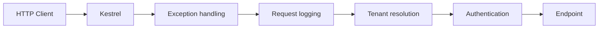

# Middleware và request pipeline trong ASP.NET Core

Khi một API nhận request tạo đơn hàng, controller không phải thành phần duy nhất tham gia xử lý. Request còn cần đi qua exception handling, logging, authentication, authorization, tenant resolution và nhiều bước hạ tầng khác.

Các chức năng xuất hiện ở nhiều use case nhưng không thuộc riêng use case nào được gọi là **cross-cutting concern**. Middleware đưa các concern ở HTTP boundary vào một request pipeline có thứ tự, thay vì để từng endpoint tự gọi lại cùng một đoạn code.

Bài này bắt đầu từ pipeline của ASP.NET trên .NET Framework, sau đó đi qua lý do ASP.NET Core chuyển sang middleware có thể compose bằng code. Một API đặt hàng multi-tenant được dùng làm ví dụ xuyên suốt. Mỗi cơ chế chỉ được giới thiệu sau khi vấn đề dẫn đến nó đã xuất hiện.

## 1. Pipeline trong ASP.NET trên .NET Framework

### 1.1 System.Web pipeline

Trước ASP.NET Core, ứng dụng ASP.NET chạy trên .NET Framework thường dựa vào IIS và `System.Web`. Request đi qua một pipeline do `HttpApplication` điều phối.

Hai extension point chính là:

- `IHttpModule`: tham gia các event trong vòng đời request, ví dụ `BeginRequest`, `AuthenticateRequest` và `EndRequest`.
- `IHttpHandler`: xử lý request và tạo response cho một loại resource hoặc route.

Ví dụ logging bằng `IHttpModule`:

```csharp
public sealed class RequestLoggingModule : IHttpModule
{
    public void Init(HttpApplication application)
    {
        application.BeginRequest += OnBeginRequest;
        application.EndRequest += OnEndRequest;
    }

    private static void OnBeginRequest(object sender, EventArgs args)
    {
        var application = (HttpApplication)sender;
        var context = application.Context;

        // Ghi nhận thời điểm request bắt đầu.
    }

    private static void OnEndRequest(object sender, EventArgs args)
    {
        var application = (HttpApplication)sender;
        var context = application.Context;

        // Ghi status code và thời gian xử lý.
    }

    public void Dispose()
    {
    }
}
```

Module thường được đăng ký qua `web.config` hoặc IIS configuration. Thứ tự xử lý chịu ảnh hưởng của pipeline event và hosting environment.

Mô hình này giải quyết được cross-cutting concern, nhưng application code phụ thuộc mạnh vào `System.Web`, `HttpApplication` và IIS. Unit test một module cũng khó hơn vì request context gắn với runtime lớn của framework.

### 1.2 OWIN và Katana

OWIN, viết tắt của Open Web Interface for .NET, tách web application khỏi web server bằng một interface nhỏ dựa trên delegate. Katana là implementation OWIN của Microsoft trên .NET Framework.

OWIN đưa ra một thay đổi quan trọng: application có thể tự compose pipeline từ các component nhỏ, thay vì chỉ gắn code vào event của `HttpApplication`.

```text
Web server
  -> middleware A
    -> middleware B
      -> application
```

Đây là bước chuyển tiếp về tư duy giữa `System.Web` pipeline và ASP.NET Core middleware.

### 1.3 ASP.NET Core middleware

ASP.NET Core bỏ dependency vào `System.Web` và thiết kế request pipeline quanh `HttpContext` cùng `RequestDelegate`. Pipeline được khai báo bằng code và chỉ chứa các component ứng dụng thực sự cần.

Các API `Use`, `Run` và `Map` xuất phát từ mô hình pipeline có thể compose này. Chúng không phải API riêng của ASP.NET Core 3.x và cũng không phải cú pháp thay thế một-một cho `IHttpModule`. Chúng đã tồn tại từ các phiên bản ASP.NET Core đầu tiên.

ASP.NET Core 3.x là một mốc dễ nhận thấy vì endpoint routing trở thành mô hình trung tâm. Tuy nhiên, bản chất middleware và các API compose pipeline đã xuất hiện trước đó.

Sự thay đổi có thể tóm tắt như sau:

| ASP.NET trên .NET Framework | ASP.NET Core |
| --- | --- |
| IIS và `System.Web` giữ vai trò trung tâm | Hosting abstraction không phụ thuộc `System.Web` |
| `IHttpModule` đăng ký vào request events | Middleware bao quanh `RequestDelegate` |
| `IHttpHandler` xử lý request cuối pipeline | Endpoint xử lý request sau middleware |
| Cấu hình phụ thuộc nhiều vào `web.config` | Pipeline được compose bằng code |
| Runtime cung cấp pipeline lớn | Ứng dụng chọn component cần dùng |

Lịch sử này giải thích vì sao người học ASP.NET cũ không gặp `app.Use(...)` hoặc `app.Map(...)`. Đó là API của mô hình pipeline mới, không phải cách viết khác của cùng `System.Web` pipeline.

## 2. Cross-cutting concern trong endpoint

### 2.1 Luồng tạo đơn hàng

Giả sử hệ thống bắt đầu với một endpoint tạo đơn hàng:

```csharp
[HttpPost("/api/don-hang")]
public async Task<IActionResult> TaoDonHang(
    TaoDonHangRequest request,
    CancellationToken cancellationToken)
{
    try
    {
        var correlationId = Request.Headers["X-Correlation-ID"].FirstOrDefault()
            ?? Guid.NewGuid().ToString("N");

        _logger.LogInformation(
            "Bat dau tao don hang {CorrelationId}",
            correlationId);

        if (_maintenanceOptions.Enabled)
        {
            return StatusCode(StatusCodes.Status503ServiceUnavailable);
        }

        var tenant = await _tenantLookup.FindByHostAsync(
            Request.Host.Host,
            cancellationToken);

        if (tenant is null)
        {
            return NotFound();
        }

        var donHangId = await _donHangService.TaoAsync(
            tenant.Id,
            request,
            cancellationToken);

        return Ok(new { donHangId });
    }
    catch (Exception exception)
    {
        _logger.LogError(exception, "Tao don hang that bai");
        return Problem(statusCode: StatusCodes.Status500InternalServerError);
    }
}
```

Business operation của endpoint là tạo đơn hàng. Phần còn lại là cross-cutting concern:

- Correlation ID liên kết log của cùng một request.
- Request logging cung cấp observability.
- Maintenance check có thể kết thúc request sớm.
- Tenant resolution tạo request context cho các bước phía sau.
- Exception handling chuyển lỗi thành HTTP response.

Khi hệ thống chỉ có một endpoint, cách viết trực tiếp này chưa tạo áp lực rõ ràng. Vấn đề xuất hiện khi cùng các concern phải chạy cho menu, giỏ hàng, thanh toán và quản trị shop.

### 2.2 Helper method

Bước refactor tự nhiên là chuyển code lặp vào helper:

```csharp
var correlationId = RequestContextHelper.GetCorrelationId(HttpContext);
var tenant = await RequestContextHelper.ResolveTenantAsync(
    HttpContext,
    cancellationToken);
```

Helper giảm số dòng code nhưng không tạo ra một execution contract. Mỗi endpoint vẫn phải nhớ:

- Gọi đúng helper.
- Gọi theo đúng thứ tự.
- Dừng xử lý khi helper không tìm thấy tenant.
- Bao toàn bộ code còn lại bằng exception handling và logging.

Endpoint quên một lời gọi vẫn biên dịch và chạy. Helper cũng không thể tự bao quanh phần xử lý phía sau để đo duration hoặc bắt exception.

### 2.3 Base controller và MVC filter

Base controller có thể đặt một số hành vi vào class cha, nhưng chỉ tác động đến MVC controller. Minimal API, health endpoint và static file không đi qua class đó. Inheritance còn ghép nhiều concern không liên quan vào cùng một hierarchy.

MVC filter là extension point hợp lệ khi concern cần model binding, action arguments hoặc action result. Tuy nhiên, filter chỉ bao quanh MVC action. Nó không bao quanh toàn bộ HTTP pipeline và không xử lý exception phát sinh trước khi MVC được chọn.

Vấn đề gốc không phải thiếu một method hoặc base class. Hệ thống cần một chuỗi xử lý dùng chung tại HTTP boundary, có thứ tự rõ ràng và có thể bao quanh endpoint.

## 3. Middleware và request pipeline

**Request pipeline** là chuỗi component xử lý một HTTP request trước và sau endpoint. Mỗi component trong chuỗi được gọi là **middleware**.

Middleware nhận `HttpContext` của request hiện tại và có ba lựa chọn:

1. Thực hiện công việc rồi chuyển request cho middleware kế tiếp.
2. Bao quanh middleware kế tiếp bằng logic chạy trước và sau.
3. Tự tạo response và kết thúc pipeline, gọi là short-circuit.



`HttpContext` là request context dùng chung cho toàn pipeline. Nó chứa:

- `Request`: method, path, headers, query string và body.
- `Response`: status code, headers và response body.
- `User`: identity của request.
- `RequestServices`: DI scope của request.
- `RequestAborted`: cancellation token được kích hoạt khi request bị hủy.

Middleware không tạo `HttpContext` mới khi chuyển tiếp. Nó đọc hoặc bổ sung state vào cùng một object để các bước phía sau sử dụng.

## 4. RequestDelegate

Request pipeline cuối cùng phải trở thành một hàm mà server có thể gọi. ASP.NET Core biểu diễn hàm đó bằng `RequestDelegate`:

```csharp
public delegate Task RequestDelegate(HttpContext context);
```

`RequestDelegate` nhận `HttpContext` và trả `Task`. Response không phải return value của delegate vì middleware ghi trực tiếp vào `HttpContext.Response`.

Một middleware cần tham chiếu đến delegate kế tiếp. Vì vậy hình thức nền tảng của middleware là:

```csharp
Func<RequestDelegate, RequestDelegate> component = next =>
{
    return async context =>
    {
        // Logic trước middleware kế tiếp.
        await next(context);
        // Logic sau middleware kế tiếp.
    };
};
```

Component nhận delegate đại diện cho phần pipeline phía sau rồi trả về một delegate mới bao quanh phần đó:

```text
next RequestDelegate
        ↓
middleware component
        ↓
wrapped RequestDelegate
```

Class middleware, extension method và các API registration đều được xây trên mô hình này. Class không phải bản chất của middleware. Nó chỉ là cách tổ chức dependency và logic.

## 5. Quá trình dựng request pipeline

Ứng dụng hiện đại đăng ký middleware trong `Program.cs`:

```csharp
var builder = WebApplication.CreateBuilder(args);
builder.Services.AddControllers();

var app = builder.Build();

app.UseExceptionHandler();
app.UseAuthentication();
app.UseAuthorization();
app.MapControllers();

app.Run();
```

Các lời gọi registration chưa xử lý request ngay lập tức. Chúng mô tả những component sẽ tham gia pipeline.

Khi application khởi động, hosting infrastructure ghép các component từ cuối về đầu. Giả sử pipeline có ba bước `A`, `B` và endpoint:

```text
terminal = endpoint delegate
B(terminal) = delegate B bao quanh endpoint
A(B(terminal)) = delegate A bao quanh B
```

Pipeline hoàn chỉnh có thể hình dung như một delegate lồng nhau:

```csharp
RequestDelegate pipeline = context =>
    A(context, () =>
        B(context, () =>
            Endpoint(context)));
```

Đoạn code trên chỉ minh họa cấu trúc, không phải API cần tự viết. Kestrel chuyển `HttpContext` vào delegate đầu tiên. Từ đó mỗi middleware quyết định có gọi delegate kế tiếp hay không.

## 6. Luồng request và response

`await next(context)` chia middleware thành hai pha:

```csharp
app.Use(async (context, next) =>
{
    Console.WriteLine("Logging: before");
    await next(context);
    Console.WriteLine("Logging: after");
});

app.Use(async (context, next) =>
{
    Console.WriteLine("Tenant: before");
    await next(context);
    Console.WriteLine("Tenant: after");
});
```

Kết quả khi endpoint hoàn thành:

```text
Logging: before
Tenant: before
Endpoint
Tenant: after
Logging: after
```

```text
Request
  -> Logging before
    -> Tenant before
      -> Endpoint
    <- Tenant after
  <- Logging after
Response
```

Request đi xuôi theo thứ tự đăng ký. Khi endpoint hoàn thành, quyền điều khiển quay ngược qua các lệnh `await` đang chờ.

Cấu trúc hai chiều giải thích vì sao middleware phù hợp với:

- Request timing: lấy thời điểm trước `next`, tính duration sau `next`.
- Request logging: mở log scope trước `next`, ghi status code sau `next`.
- Exception handling: đặt `next` trong `try/catch`.
- Response compression và response caching: xử lý response trên chiều quay về.

Pipeline có cấu trúc của Chain of Responsibility ở chiều request và hành vi giống Decorator khi middleware bao quanh delegate phía sau. Pattern mô tả cơ chế, không thay thế việc xác định đúng ownership của concern.

## 7. Request logging middleware

Controller ban đầu tự ghi log. Concern này áp dụng cho toàn bộ API và cần chạy trước lẫn sau endpoint, nên middleware là extension point phù hợp.

```csharp
public sealed class RequestLoggingMiddleware
{
    private readonly RequestDelegate _next;
    private readonly ILogger<RequestLoggingMiddleware> _logger;

    public RequestLoggingMiddleware(
        RequestDelegate next,
        ILogger<RequestLoggingMiddleware> logger)
    {
        _next = next;
        _logger = logger;
    }

    public async Task InvokeAsync(HttpContext context)
    {
        var startedAt = Stopwatch.GetTimestamp();

        await _next(context);

        var elapsed = Stopwatch.GetElapsedTime(startedAt);
        _logger.LogInformation(
            "{Method} {Path} returned {StatusCode} in {ElapsedMs} ms",
            context.Request.Method,
            context.Request.Path,
            context.Response.StatusCode,
            elapsed.TotalMilliseconds);
    }
}
```

```csharp
app.UseMiddleware<RequestLoggingMiddleware>();
```

Framework nhận biết conventional middleware qua hai convention:

- Constructor nhận `RequestDelegate` và các dependency có lifetime phù hợp.
- Method `Invoke` hoặc `InvokeAsync` nhận `HttpContext` và trả `Task`.

Sau khi registration hoàn tất, controller không cần gọi logging helper. Mọi request đi qua vị trí đó trong pipeline đều được xử lý nhất quán.

## 8. Short-circuit

Maintenance mode không cần chạy business use case. Middleware có đủ thông tin để tự tạo response và không gọi `next`:

```csharp
public async Task InvokeAsync(HttpContext context)
{
    if (_options.Enabled &&
        context.Request.Path.StartsWithSegments("/api"))
    {
        context.Response.StatusCode = StatusCodes.Status503ServiceUnavailable;
        context.Response.Headers["Retry-After"] = "120";

        await context.Response.WriteAsJsonAsync(new ProblemDetails
        {
            Status = StatusCodes.Status503ServiceUnavailable,
            Title = "Service is temporarily unavailable"
        });

        return;
    }

    await _next(context);
}
```

Đây là short-circuit: middleware kết thúc pipeline trước endpoint.

Short-circuit phù hợp khi quyết định chỉ phụ thuộc request context hoặc system state đã có tại HTTP boundary, ví dụ:

- Maintenance mode.
- Rate limiting.
- Authentication failure.
- CORS preflight.
- Request không thỏa giới hạn kích thước.

Short-circuit không phù hợp với business rule như “shop đóng cửa thì không nhận đơn”. Rule đó phải đúng cả khi use case được gọi từ scheduled job hoặc message consumer.

## 9. Pipeline branching

Một số concern chỉ áp dụng cho một nhóm request. ASP.NET Core cung cấp branching để tránh đặt điều kiện path rải rác trong nhiều middleware.

`Map` tạo branch theo path và không quay lại pipeline chính:

```csharp
app.Map("/internal", internalApp =>
{
    internalApp.UseMiddleware<InternalNetworkMiddleware>();
    internalApp.Run(context => context.Response.WriteAsync("Internal API"));
});
```

`UseWhen` chạy branch có điều kiện rồi quay lại pipeline chính:

```csharp
app.UseWhen(
    context => context.Request.Path.StartsWithSegments("/api"),
    apiApp => apiApp.UseMiddleware<ApiRequestLoggingMiddleware>());
```

Hai API này không phải kiến thức cần học thuộc trước khi hiểu pipeline:

- Dùng `Map` khi branch có terminal behavior và endpoint riêng.
- Dùng `UseWhen` khi request chỉ cần thêm một middleware rồi tiếp tục pipeline chung.
- Dùng endpoint metadata khi điều kiện gắn với ý nghĩa của endpoint thay vì cấu trúc URL.

## 10. Dependency injection lifetime

Conventional middleware thường được tạo một lần khi pipeline được dựng. Vì vậy scoped dependency không được giữ trong constructor của middleware đó.

`TenantContext` chứa state của request hiện tại nên có scoped lifetime:

```csharp
builder.Services.AddScoped<TenantContext>();
```

Inject nó vào constructor của conventional middleware sẽ tạo lifetime mismatch. Dependency scoped cần được resolve theo request qua `InvokeAsync`:

```csharp
public sealed class TenantResolutionMiddleware
{
    private readonly RequestDelegate _next;

    public TenantResolutionMiddleware(RequestDelegate next)
    {
        _next = next;
    }

    public async Task InvokeAsync(
        HttpContext context,
        TenantContext tenantContext,
        ITenantHostLookup tenantLookup)
    {
        var tenantId = await tenantLookup.FindActiveTenantIdAsync(
            context.Request.Host.Host,
            context.RequestAborted);

        if (tenantId is null)
        {
            context.Response.StatusCode = StatusCodes.Status404NotFound;
            return;
        }

        tenantContext.Set(tenantId.Value);
        await _next(context);
    }
}
```

`IMiddleware` là lựa chọn khác khi middleware cần per-request activation và constructor injection của scoped dependency:

```csharp
public sealed class TenantResolutionMiddleware : IMiddleware
{
    private readonly TenantContext _tenantContext;
    private readonly ITenantHostLookup _tenantLookup;

    public TenantResolutionMiddleware(
        TenantContext tenantContext,
        ITenantHostLookup tenantLookup)
    {
        _tenantContext = tenantContext;
        _tenantLookup = tenantLookup;
    }

    public Task InvokeAsync(HttpContext context, RequestDelegate next)
    {
        // Resolve tenant, set context, rồi gọi next.
    }
}
```

Không chọn `IMiddleware` vì nó mới hơn. Chọn nó khi activation qua DI container làm dependency ownership rõ hơn.

## 11. Middleware ordering

Thứ tự pipeline không phải danh sách cố định. Nó là kết quả của dependency giữa state mà mỗi middleware cần và tạo ra.

| Middleware | State đầu vào | State đầu ra |
| --- | --- | --- |
| Forwarded headers | Trusted proxy configuration | Scheme, host và client IP đã chuẩn hóa |
| Exception handling | Không có | Error response cho exception phía sau |
| Correlation ID | Request headers | `TraceIdentifier` và log scope |
| Routing | Request path | Endpoint và endpoint metadata |
| Authentication | Credential | `HttpContext.User` |
| Tenant resolution | Host hoặc signed claim | `TenantContext` |
| Authorization | User và endpoint metadata | Allow, 401 hoặc 403 |

Từ bảng dependency có thể suy ra:

- Forwarded headers chạy trước code đọc host, scheme hoặc client IP.
- Authentication chạy trước authorization.
- Middleware đọc `GetEndpoint()` chạy sau routing.
- Exception handling bao ngoài component có thể throw.
- Tenant resolution chạy trước query hoặc service cần `tenantId`.

```csharp
app.UseForwardedHeaders();
app.UseExceptionHandler();
app.UseMiddleware<CorrelationIdMiddleware>();

app.UseRouting();
app.UseAuthentication();
app.UseMiddleware<TenantResolutionMiddleware>();
app.UseAuthorization();

app.MapControllers();
```

Thứ tự giữa authentication và tenant resolution phụ thuộc nguồn tenant. Tenant từ host có thể được resolve trước authentication. Tenant từ signed claim cần authentication chạy trước. Thiết kế phải xác định nguồn có thẩm quyền thay vì sao chép một thứ tự mẫu.

## 12. Exception handling

Exception handling cần bao quanh phần pipeline có thể throw. Trên .NET hiện đại, ưu tiên `UseExceptionHandler` và `IExceptionHandler` để tích hợp với framework.

```csharp
builder.Services.AddProblemDetails();
builder.Services.AddExceptionHandler<ApiExceptionHandler>();

var app = builder.Build();
app.UseExceptionHandler();
```

Custom exception middleware vẫn có thể cần khi error contract hoặc telemetry có yêu cầu riêng. Dù dùng cơ chế nào, response state tạo ra một giới hạn quan trọng.

Khi `Response.HasStarted` là `true`, response headers đã được gửi. Exception handler không thể an toàn đổi status code hoặc thay toàn bộ body. Nó thường log rồi rethrow hoặc kết thúc connection thay vì ghi thêm một JSON error vào stream đang chứa dữ liệu khác.

`OperationCanceledException` cũng không mặc định là lỗi 500. Nếu `RequestAborted` đã được kích hoạt, client có thể đã ngắt kết nối. Trường hợp đó cần được phân loại riêng để tránh tạo error log và alert giả.

## 13. Tenant context và data isolation

Tenant resolution tạo request context cho các bước phía sau:

```csharp
public sealed class TenantContext
{
    public Guid? TenantId { get; private set; }

    public Guid RequireTenantId() => TenantId
        ?? throw new InvalidOperationException("Tenant has not been resolved.");

    public void Set(Guid tenantId)
    {
        if (TenantId is not null)
        {
            throw new InvalidOperationException("Tenant was already resolved.");
        }

        TenantId = tenantId;
    }
}
```

`Set` chỉ cho ghi một lần. `RequireTenantId` fail fast khi pipeline bị cấu hình sai.

Middleware chỉ giải quyết **context propagation**, không tự bảo đảm **data isolation**. Query vẫn phải dùng tenant predicate:

```csharp
public async Task<ShopDto?> GetShopAsync(Guid shopId, CancellationToken ct)
{
    var tenantId = _tenantContext.RequireTenantId();

    const string sql = """
        SELECT id, tenShop
        FROM Shop
        WHERE id = @shopId
          AND tenantId = @tenantId
          AND deletedAt IS NULL
        """;

    return await _connection.QuerySingleOrDefaultAsync<ShopDto>(
        new CommandDefinition(
            sql,
            new { shopId, tenantId },
            cancellationToken: ct));
}
```

Nếu query chỉ lọc `shopId`, middleware có thể resolve đúng tenant X nhưng query vẫn trả dữ liệu của tenant Y. Data isolation còn cần authorization theo resource, database constraint đúng scope và cross-tenant test.

## 14. Extension point

Middleware không phải lựa chọn mặc định cho mọi cross-cutting concern.

| Requirement | Extension point | Lý do |
| --- | --- | --- |
| Correlation ID cho mọi request | Middleware | Concern ở HTTP boundary |
| Error response thống nhất | `IExceptionHandler` hoặc middleware | Bao quanh request pipeline |
| Tenant từ trusted host | Middleware | Tạo request context |
| Validation của command DTO | Endpoint filter, model validation hoặc application layer | Cần input đã bind |
| Endpoint dành cho shop owner | Authorization policy | Cần user và endpoint metadata |
| `shopId` thuộc tenant hiện tại | Application/data layer | Resource authorization |
| Shop đóng cửa không nhận đơn | Domain/application layer | Business invariant |
| Timing cho command handler | Application decorator | Không phụ thuộc HTTP |

Một câu hỏi giúp xác định ownership:

```text
Rule có phải tiếp tục đúng khi use case được gọi ngoài HTTP không?
  Có  -> Không đặt ownership trong middleware.
  Không -> Kiểm tra rule có thuộc request pipeline hay extension point khác.
```

Middleware có thể chuẩn bị context cho business logic, nhưng không thay thế business logic.

## 15. Request body và cancellation

Request body thường là stream chỉ đọc một lần. Middleware đọc hết body có thể khiến model binding phía sau nhận stream đã ở cuối.

```csharp
context.Request.EnableBuffering();

using var reader = new StreamReader(
    context.Request.Body,
    Encoding.UTF8,
    detectEncodingFromByteOrderMarks: false,
    leaveOpen: true);

var body = await reader.ReadToEndAsync(context.RequestAborted);
context.Request.Body.Position = 0;
```

Buffering tăng memory hoặc disk I/O. Trước khi đọc body trong middleware, cần xác định:

- Có thể lấy dữ liệu từ header, route hoặc endpoint filter không?
- Request size limit là bao nhiêu?
- Body có token, password, thông tin thanh toán hoặc dữ liệu cá nhân không?
- Trường nào phải được redaction trước khi log?

I/O trong middleware phải truyền `RequestAborted` xuống dependency. Cancellation không rollback transaction đã commit. Nếu client retry sau khi mất response, API vẫn cần idempotency để tránh tạo tác dụng phụ trùng lặp.

## 16. Concurrency failure

Hai request cùng đặt phần hàng hóa cuối cùng:

```text
Request A -> TenantResolution -> đọc soLuong = 1
Request B -> TenantResolution -> đọc soLuong = 1
A tạo đơn và trừ kho
B tạo đơn và trừ kho
Kết quả: oversell
```

Middleware lock theo URL không giải quyết đúng vấn đề:

- In-memory lock chỉ bảo vệ một process.
- Nhiều application instance vẫn chạy đồng thời.
- URL không phải aggregate boundary.
- Lock toàn route làm giảm throughput của các shop không liên quan.

Correctness phải được bảo vệ tại nơi ghi dữ liệu:

```sql
UPDATE TonKho
SET soLuong = soLuong - @soLuongDat
WHERE tenantId = @tenantId
  AND shopId = @shopId
  AND hangHoaId = @hangHoaId
  AND soLuong >= @soLuongDat;
```

Nếu affected rows bằng `0`, use case trả conflict hoặc hết hàng. Middleware vẫn cung cấp request context và error mapping. Database transaction hoặc atomic update giải quyết concurrency.

Vị trí nhìn thấy lỗi không nhất thiết là vị trí sở hữu lời giải.

## 17. Middleware testing

Unit test phù hợp với middleware có branching logic độc lập:

```csharp
[Fact]
public async Task Adds_correlation_id_when_header_is_missing()
{
    var context = new DefaultHttpContext();
    var nextCalled = false;

    RequestDelegate next = _ =>
    {
        nextCalled = true;
        return Task.CompletedTask;
    };

    var middleware = new CorrelationIdMiddleware(
        next,
        NullLogger<CorrelationIdMiddleware>.Instance);

    await middleware.InvokeAsync(context);

    Assert.True(nextCalled);
    Assert.False(string.IsNullOrWhiteSpace(context.TraceIdentifier));
}
```

Integration test quan trọng hơn khi behavior phụ thuộc ordering, routing, authentication hoặc response thực. Dùng `WebApplicationFactory<Program>` để xác nhận:

- Happy path đi đến endpoint.
- Short-circuit trả đúng status, headers và body.
- Exception được map sang error contract mong muốn.
- Endpoint metadata tồn tại tại vị trí middleware đọc nó.
- Unknown tenant và cross-tenant access không làm lộ dữ liệu.
- Cancellation không tạo error log giả.

## 18. Middleware design workflow

Khi có một requirement mới, thực hiện theo thứ tự:

1. Xác định scope: mọi request, một branch, một endpoint hay một use case.
2. Xác định trusted input, state được tạo và failure response.
3. Kiểm tra entry point ngoài HTTP.
4. Viết invariant trước code.
5. Liệt kê state cần từ middleware trước và state cung cấp cho middleware sau.
6. Chọn continue, wrap `next`, short-circuit hoặc branching.
7. Chọn conventional middleware hoặc `IMiddleware` theo DI lifetime.
8. Kiểm tra `Response.HasStarted`, cancellation, body size và sensitive data.
9. Viết integration test cho ordering hoặc short-circuit.

Một middleware design note ngắn có thể dùng mẫu:

```text
Concern: tenant resolution cho tenant-scoped API.
Scope: HTTP request, trừ public endpoint có metadata cho phép bỏ qua.
Trusted input: normalized host sau trusted proxy hoặc signed claim.
Produces: request-scoped TenantContext.
Invariant: tenant được set tối đa một lần; query luôn dùng tenantId.
Ordering: sau ForwardedHeaders; trước consumer của TenantContext.
Failure: unknown hoặc inactive tenant -> 404.
Not owned here: shop ownership, menu visibility, stock concurrency.
Verification: known host, unknown host, bypass endpoint, cross-tenant query.
```

Mẫu này buộc thiết kế trả lời middleware sở hữu điều gì trước khi viết `InvokeAsync`.

## 19. Production checklist

1. Concern có thuộc HTTP boundary không?
2. Rule có phải đúng ở entry point ngoài HTTP không?
3. Middleware tiếp tục, bao quanh `next`, short-circuit hay branch?
4. Ordering có được suy ra từ dependency không?
5. Conventional middleware có giữ scoped dependency trong constructor không?
6. I/O có nhận `RequestAborted` không?
7. Middleware có ghi response sau khi `HasStarted` không?
8. Request body có size limit, buffering và redaction rõ ràng không?
9. Log và metric có tránh sensitive data cùng high-cardinality label không?
10. Integration test có bao phủ happy path, short-circuit và failure response không?

## 20. Tài liệu tham khảo

- [ASP.NET Core middleware](https://learn.microsoft.com/aspnet/core/fundamentals/middleware/)
- [Migrate HTTP modules to ASP.NET Core middleware](https://learn.microsoft.com/aspnet/core/migration/fx-to-core/areas/http-modules)
- [Migrate HTTP handlers to ASP.NET Core middleware](https://learn.microsoft.com/aspnet/core/migration/fx-to-core/areas/http-handlers)
- [OWIN with ASP.NET Core](https://learn.microsoft.com/aspnet/core/fundamentals/owin)

## Kết luận

Middleware giải quyết cross-cutting concern tại HTTP boundary bằng cách đưa chúng vào một request pipeline có thứ tự. Bản chất của middleware là một component bao quanh `RequestDelegate` phía sau. Từ mô hình đó có thể suy ra luồng request-response hai chiều, short-circuit, branching và DI lifetime.

Không nên chọn middleware chỉ vì code xuất hiện ở nhiều nơi. Middleware phù hợp khi concern cần quan sát hoặc tạo request context và phải chạy trong HTTP pipeline. Resource authorization, data isolation, concurrency và domain invariant vẫn phải được bảo vệ tại layer sở hữu dữ liệu và quyết định đó.

Khi thiết kế bắt đầu từ scope, dependency và failure mode, middleware trở thành một lựa chọn có thể giải thích thay vì một API phải học thuộc.
