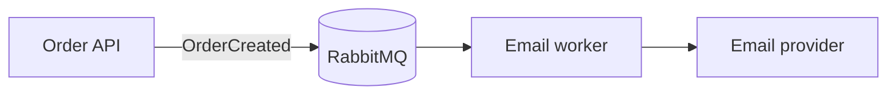
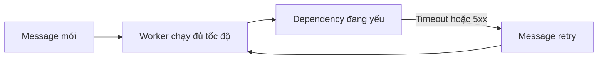
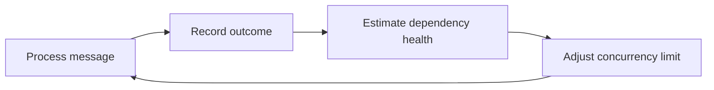

# Worker Backpressure trong RabbitMQ

Một message queue giúp request chính không phải chờ công việc nền hoàn thành. Tuy nhiên, queue không tự bảo vệ database hoặc dịch vụ bên ngoài mà worker gọi tới. Khi dependency bắt đầu chậm hoặc lỗi, một worker vẫn đọc message ở tốc độ tối đa có thể biến sự cố nhỏ thành retry storm và làm hàng đợi lỗi tăng nhanh.

**Worker backpressure** là cơ chế để worker chủ động giảm số công việc xử lý đồng thời khi dependency có dấu hiệu quá tải, rồi tăng dần trở lại khi dependency hồi phục. Mục tiêu không phải làm queue chạy nhanh nhất trong mọi thời điểm, mà giữ toàn hệ thống ổn định khi một thành phần suy yếu.

Tài liệu này tiếp nối [RabbitMQ và kiến trúc Message Queue trong .NET](/dotnet-core/rabbitmq-reliable-messaging). Hãy đọc bài đó trước nếu chưa quen với consumer, acknowledgement, `prefetch`, retry và Dead Letter Queue.

## 1. Worker xử lý ở tốc độ cố định

Xét luồng gửi email xác nhận đơn hàng trong hệ thống food delivery:



Phiên bản đầu tiên thường có cấu hình cố định:

```text
instanceCount       = 2
consumersPerInstance = 4
prefetchPerConsumer  = 8
```

Nếu mỗi consumer chỉ xử lý một message tại một thời điểm thì hệ thống có tối đa 8 lần gọi email đồng thời. `prefetch` cho phép mỗi consumer giữ trước một số delivery chưa ACK, nhưng không có nghĩa tất cả delivery đó đều được xử lý song song.

Khi email provider khỏe, cách này đơn giản và đủ tốt. Queue hấp thụ những đợt tăng tải ngắn, còn worker xử lý backlog theo năng lực đã cấu hình.

## 2. Dependency chậm dần

Giả sử provider bình thường trả lời trong 200 ms. Sau một sự cố, latency tăng lên 5 giây và 30% request trả về lỗi tạm thời.

Worker không biết provider đang quá tải. Nó vẫn tiếp tục lấy message vì còn permit xử lý, gọi provider, nhận lỗi và lên lịch retry. Sau đó message mới và message retry cùng tranh chấp năng lực xử lý.



Vòng lặp này tạo ra **retry amplification**, nghĩa là một đơn vị công việc nghiệp vụ sinh ra nhiều lần gọi kỹ thuật trong thời gian dependency đang ít khả năng phục vụ nhất.

Ví dụ 100 message mới mỗi phút, tỷ lệ lỗi 30% và tối đa 3 attempt:

```text
attempt đầu       = 100
retry lần một     = 30
retry lần hai     = 9
tổng gần đúng     = 139 lần gọi
```

Đây mới là mô hình đơn giản với các lần lỗi độc lập. Trong một outage kéo dài, cùng một message có thể thất bại ở mọi attempt. Khi đó retry gần như nhân tải theo số attempt tối đa.

Hệ quả thường thấy:

- Dependency mất nhiều thời gian hơn để hồi phục vì vẫn nhận traffic lớn.
- Thread, connection pool và memory của worker bị giữ bởi những request ít cơ hội thành công.
- Message mới phải chờ sau retry traffic.
- DLQ tăng dù payload không hỏng.
- On-call phải giảm worker bằng tay rồi tăng lại sau sự cố.

Đây là failure mode của một **greedy worker**: worker luôn cố lấy việc khi còn năng lực cục bộ, nhưng không xét năng lực hiện tại của dependency.

## 3. Giới hạn tải nền tảng

Adaptive backpressure không nên là bước đầu tiên. Với phần lớn hệ thống, một cấu hình tĩnh có giới hạn rõ ràng đã xử lý được phần lớn rủi ro.

### 3.1 Bounded concurrency

Số task đang gọi dependency phải có trần. Không tạo một `Task` mới cho mọi delivery rồi hy vọng connection pool tự điều tiết.

```text
globalConcurrency = instanceCount × concurrencyPerInstance
globalConcurrency ≤ downstreamSafeConcurrency
```

`downstreamSafeConcurrency` phải lấy từ load test hoặc giới hạn đã thống nhất với dependency. Nếu chưa có số đo, bắt đầu thấp và tăng theo quan sát.

### 3.2 Consumer prefetch

RabbitMQ `prefetch` giới hạn số delivery chưa ACK. Khi cửa sổ này đầy, broker ngừng đẩy thêm delivery cho consumer cho đến khi có message được ACK.

`prefetch` bảo vệ memory và giới hạn lượng message nằm ngoài broker. Nó không tự nhận biết rằng email provider vừa giảm một nửa năng lực. Một giá trị từng phù hợp vẫn có thể quá cao khi dependency suy yếu.

Đặt `prefetch` đủ nuôi concurrency, không dùng nó như hàng đợi thứ hai trong process:

```text
prefetchPerConsumer ≈ concurrencyPerConsumer × smallBuffer
smallBuffer thường bắt đầu từ 1 đến 2
```

Đây là điểm khởi đầu để đo, không phải hằng số áp dụng cho mọi workload.

### 3.3 Timeout

Mỗi lần gọi dependency cần timeout hữu hạn. Không có timeout, một dependency treo có thể giữ toàn bộ permit và khiến worker ngừng tiến triển mà controller không nhận được kết quả để phản ứng.

Timeout phải phản ánh deadline nghiệp vụ và latency thực tế. Một timeout rất dài chỉ biến lỗi nhanh thành lỗi chậm.

### 3.4 Bounded retry và jitter

Chỉ retry lỗi transient như timeout ngắn, `429` hoặc một số lỗi `5xx`. Validation error, payload sai và lỗi nghiệp vụ phải đi theo luồng permanent failure.

Retry cần:

- giới hạn số attempt;
- delay tăng dần;
- jitter để nhiều worker không retry cùng thời điểm;
- DLQ hoặc trạng thái terminal sau attempt cuối.

Các giới hạn này là baseline bắt buộc. Chỉ thêm adaptive backpressure khi dashboard cho thấy chúng chưa đủ bảo vệ dependency.

## 4. Giới hạn của các biện pháp riêng lẻ

Mỗi cơ chế sau giải quyết một phần khác nhau của sự cố. Không nên coi chúng là những lựa chọn thay thế hoàn toàn cho nhau.

| Cơ chế | Bảo vệ chính | Giới hạn |
|---|---|---|
| `prefetch` | Số delivery chưa ACK | Là giá trị tĩnh, không phản ứng theo sức khỏe dependency |
| Bounded concurrency | Số công việc chạy đồng thời | Trần an toàn lúc bình thường có thể vẫn quá cao trong outage |
| Rate limit cố định | Request mỗi đơn vị thời gian | Năng lực dependency thay đổi theo thời điểm |
| Retry backoff | Khoảng cách giữa các attempt của một message | Không trực tiếp điều tiết tổng traffic của cả worker |
| Circuit breaker | Ngắt request khi lỗi vượt ngưỡng | Thường chuyển từ chạy đủ tốc độ sang dừng hẳn, rồi có nguy cơ mở lại quá nhanh |
| Autoscaling | Năng lực xử lý backlog | Scale up có thể tăng tải lên dependency đang lỗi |

Circuit breaker vẫn hữu ích để fail fast khi dependency mất hoàn toàn. Worker backpressure bổ sung vùng điều tiết ở giữa: không chỉ có hai trạng thái chạy hết tốc độ và dừng hoàn toàn.

## 5. Feedback loop

Khi cấu hình tĩnh không còn đủ, worker có thể dùng một feedback loop gồm bốn bước:



### 5.1 Signal

Phiên bản đầu nên dùng ít signal để cơ chế dễ giải thích:

- `success` khi dependency hoàn thành đúng contract;
- `transient failure` khi timeout, throttling hoặc lỗi tạm thời;
- latency để phát hiện dependency suy yếu trước khi lỗi hàng loạt.

Không đưa lỗi validation hoặc lỗi nghiệp vụ vào failure rate. Nếu địa chỉ email không hợp lệ làm controller giảm concurrency, worker đang phản ứng với chất lượng dữ liệu chứ không phải sức khỏe dependency.

Signal nên được tổng hợp theo cửa sổ thời gian hoặc một moving average. Một lỗi đơn lẻ không nên khiến cả worker giảm tốc ngay lập tức.

### 5.2 Set point

`setPoint` là tỷ lệ lỗi nền mà hệ thống chấp nhận trước khi giảm tốc. Nó không phải một con số phổ quát.

Ví dụ:

```text
observedFailureRate ≤ 2%  → giữ nguyên
observedFailureRate > 2%  → giảm concurrency
```

Chỉ đặt set point sau khi biết failure rate lúc hệ thống khỏe. Nếu bình thường đã có 3% lỗi do dữ liệu đầu vào thì set point 2% sẽ làm worker throttling liên tục và che mất lỗi phân loại.

### 5.3 Permit

Trước khi bắt đầu xử lý message, worker phải lấy một permit. Số permit khả dụng chính là effective concurrency tại thời điểm đó.

```text
effectiveConcurrency = clamp(
    minConcurrency,
    configuredConcurrency × healthFactor,
    configuredConcurrency
)
```

`healthFactor` nằm trong khoảng `0..1`. Khi dependency khỏe, giá trị gần 1. Khi lỗi tăng, controller kéo giá trị xuống.

Không cần thay đổi `prefetch` sau mỗi signal. Worker có thể giữ `prefetch` ở mức giới hạn hợp lý và điều tiết phần xử lý bằng permit cục bộ. Message chưa được nhận vẫn nằm bền vững trong RabbitMQ, thay vì trở thành hàng nghìn task đang chờ trong process.

## 6. Điều khiển bằng AIMD

Canva công bố mô hình signal, controller và permit, nhưng Part 1 không công bố thuật toán điều khiển chi tiết. Với hệ thống có tải vừa phải, có thể bắt đầu bằng **Additive Increase, Multiplicative Decrease (AIMD)**: giảm nhanh khi thấy quá tải và tăng chậm khi hệ thống ổn định.

```text
if transientFailureRate > setPoint
    limit = max(minConcurrency, floor(limit × decreaseFactor))
else if healthyFor >= recoveryWindow
    limit = min(maxConcurrency, limit + increaseStep)
```

Ví dụ cấu hình khởi đầu để load test:

```text
minConcurrency  = 1
maxConcurrency  = 8
decreaseFactor  = 0.5
increaseStep    = 1
recoveryWindow  = 30 seconds
```

Nếu limit là 8 và lỗi transient vượt ngưỡng, worker giảm xuống 4 rồi có thể xuống 2. Khi dependency ổn định, worker tăng 2 → 3 → 4 thay vì nhảy thẳng về 8.

Cách tăng chậm này tránh **recovery storm**: dependency vừa hồi phục đã nhận lại toàn bộ traffic và sập lần nữa.

### 6.1 Hysteresis

Nếu cùng một ngưỡng được dùng cho cả giảm và tăng, controller có thể dao động liên tục quanh ngưỡng. Hysteresis tạo hai vùng quyết định:

```text
failureRate > 2%   → giảm
failureRate < 0.5% → có thể tăng sau recovery window
ở giữa             → giữ nguyên
```

### 6.2 Recovery probe

Worker không nên giảm về 0 chỉ dựa trên failure rate. Khi dừng hoàn toàn, nó không còn outcome mới để biết dependency đã hồi phục.

Giữ `minConcurrency = 1` như một probe tự nhiên. Nếu circuit breaker đang mở, half-open state cũng phải cho một lượng request nhỏ đi qua để kiểm tra recovery.

### 6.3 Controller cục bộ

Mỗi instance có thể tự điều chỉnh từ outcome của chính nó. Thiết kế này không cần coordinator hoặc network call mới, phù hợp để triển khai bước đầu.

Đổi lại, 10 instance với `minConcurrency = 1` vẫn có thể tạo 10 request đồng thời. Vì vậy:

```text
instanceCount × minConcurrency ≤ recoveryCapacity của dependency
```

Nếu fleet rất lớn hoặc dependency có quota toàn cục chặt, controller cục bộ không còn đủ. Khi đó mới cân nhắc distributed rate limiter hoặc quota coordinator.

## 7. Luồng xử lý trong worker

Pseudocode sau thể hiện ranh giới trách nhiệm, không phụ thuộc một thư viện cụ thể:

```csharp
async Task HandleAsync(Message message, CancellationToken cancellationToken)
{
    using var permit = await concurrencyLimiter.AcquireAsync(cancellationToken);

    var startedAt = clock.UtcNow;

    try
    {
        await emailProvider.SendAsync(message, cancellationToken);
        healthController.RecordSuccess(clock.UtcNow - startedAt);
        await channel.AckAsync(message.DeliveryTag, cancellationToken);
    }
    catch (TransientDependencyException exception)
    {
        healthController.RecordTransientFailure(
            exception,
            clock.UtcNow - startedAt);

        await retryPublisher.ScheduleAsync(message, cancellationToken);
        await channel.AckAsync(message.DeliveryTag, cancellationToken);
    }
    catch (PermanentMessageException exception)
    {
        await deadLetterPublisher.PublishAsync(message, exception, cancellationToken);
        await channel.AckAsync(message.DeliveryTag, cancellationToken);
    }
}
```

Các invariant quan trọng vẫn giữ nguyên:

- Chỉ ACK bản gốc sau khi side effect thành công hoặc retry/DLQ publish đã được confirm.
- Consumer vẫn cần idempotent vì connection loss có thể làm message được giao lại.
- Backpressure không thay thế retry policy, DLQ hoặc circuit breaker.
- Permit điều tiết thời điểm bắt đầu công việc, không làm mất message.

## 8. Quan sát hệ thống

Không bật adaptive backpressure nếu không nhìn thấy controller đang làm gì. Dashboard tối thiểu cần ba nhóm chỉ số.

### 8.1 Queue

- `messages_ready` và tốc độ tăng backlog;
- `messages_unacknowledged`;
- tuổi của message lâu nhất;
- publish rate, delivery rate và ACK rate;
- retry rate và DLQ rate.

Queue depth một mình chưa đủ. Một queue có 10.000 message nhưng xử lý hết trong hai phút có thể khỏe hơn queue chỉ có 500 message nhưng message lâu nhất đã chờ một giờ.

### 8.2 Worker

- configured concurrency và effective concurrency;
- số permit đang dùng;
- thời gian chờ permit;
- success rate và transient failure rate;
- số lần controller giảm hoặc tăng limit;
- thời gian worker nằm dưới full capacity.

Không gắn `MessageId`, `TenantId` hoặc `ShopId` vào metric label vì sẽ tạo cardinality lớn.

### 8.3 Dependency

- latency theo percentile;
- timeout, `429` và `5xx` rate;
- connection pool usage;
- quota còn lại nếu provider cung cấp;
- saturation metric riêng của dependency.

Một controller được xem là hữu ích khi dependency có ít lỗi hơn, DLQ giảm và tự hồi phục mà không làm tuổi message vượt SLO. Chỉ thấy effective concurrency giảm chưa chứng minh thiết kế thành công.

## 9. Triển khai theo mức tải

Không cần thiết kế cho quy mô hàng chục triệu request nếu hệ thống chưa có tải đó. Chọn cơ chế theo failure mode đang tồn tại.

### Giai đoạn 1 — Cấu hình tĩnh

Phù hợp khi traffic ổn định và dependency do cùng đội kiểm soát:

- bounded concurrency;
- `prefetch` hữu hạn;
- timeout;
- retry có giới hạn và jitter;
- DLQ;
- metrics cơ bản.

Đây nên là trạng thái mặc định của đa số worker.

### Giai đoạn 2 — Cô lập dependency

Áp dụng khi nhiều loại công việc dùng các dependency khác nhau:

- queue hoặc concurrency pool riêng cho dependency quan trọng;
- rate limit theo quota của provider;
- circuit breaker;
- bulkhead để một provider lỗi không giữ hết permit của worker.

### Giai đoạn 3 — Adaptive backpressure

Chỉ thêm khi đã quan sát một trong các dấu hiệu:

- dependency overload lặp lại;
- phải scale worker bằng tay trong incident;
- retry traffic chiếm tỷ trọng đáng kể;
- DLQ tăng chủ yếu do lỗi transient;
- một concurrency cố định không phù hợp cho cả giờ bình thường và lúc suy yếu.

Bắt đầu với một worker ít rủi ro, chạy shadow metric trước khi cho controller thực sự thay đổi limit, sau đó rollout theo phần trăm instance.

## 10. Kiểm thử

Happy-path load test không đủ để xác nhận backpressure. Cần tiêm các failure profile có kiểm soát:

| Kịch bản | Kỳ vọng |
|---|---|
| Latency tăng dần | Effective concurrency giảm trước khi timeout hàng loạt |
| `5xx` tăng đột ngột | Worker giảm nhanh, retry và DLQ không bùng nổ |
| `429` kéo dài | Throughput hội tụ quanh quota thay vì liên tục vượt quota |
| Dependency hồi phục | Concurrency tăng chậm về mức cấu hình |
| Lỗi validation tăng | Controller không giảm concurrency |
| Một instance restart | Message được giao lại an toàn, controller khởi động với giới hạn thận trọng |

Các invariant cần kiểm tra sau mỗi test:

```text
business effects không mất
business effects không bị lặp ngoài contract
global concurrency không vượt ceiling
oldest message age không vượt SLO
DLQ chỉ chứa permanent failure hoặc message hết retry budget
```

## 11. Checklist quyết định

Trước khi thêm controller:

- [ ] Worker đã có bounded concurrency.
- [ ] `prefetch` hữu hạn và được tính theo tổng số consumer.
- [ ] Mọi dependency call có timeout.
- [ ] Retry phân biệt transient và permanent failure.
- [ ] Retry có giới hạn, delay và jitter.
- [ ] Dashboard có queue age, failure rate, latency và DLQ rate.
- [ ] Có bằng chứng cấu hình tĩnh không đủ.

Trước khi rollout production:

- [ ] `minConcurrency` được tính theo tổng số instance.
- [ ] Có hysteresis và recovery window.
- [ ] Có recovery probe.
- [ ] Controller không học từ business error.
- [ ] Có metric cho effective concurrency và từng lần điều chỉnh.
- [ ] Đã test latency spike, sustained overload và recovery storm.
- [ ] Có feature flag hoặc cấu hình để quay về fixed concurrency.

## 12. Kết luận

Queue hấp thụ công việc, nhưng không tạo thêm năng lực cho dependency. Khi downstream yếu đi, worker càng tham xử lý thì sự cố càng dễ khuếch đại qua timeout, retry và DLQ.

Thứ tự nâng cấp an toàn là:

```text
bounded concurrency
→ prefetch + timeout
→ bounded retry + jitter + DLQ
→ circuit breaker hoặc rate limit khi có failure mode phù hợp
→ adaptive backpressure khi cấu hình tĩnh không còn đủ
```

Với hệ thống tải vừa phải, controller AIMD cục bộ, giảm nhanh và tăng chậm thường là điểm khởi đầu hợp lý. Không cần distributed coordinator hoặc thuật toán phức tạp trước khi số liệu production chứng minh nhu cầu đó.

## 13. Tài liệu tham khảo

- [Worker Backpressure (Part 1) — Canva Engineering](https://www.canva.dev/blog/engineering/worker-backpressure-part-1-how-we-taught-our-queue-workers-to-slow-down/) — mô hình signal, controller và permit, cùng các trade-off quan sát trong production.
- [Consumer Prefetch — RabbitMQ](https://www.rabbitmq.com/docs/consumer-prefetch) — phạm vi áp dụng và hành vi của `prefetch_count`.
- [Consumer Acknowledgements and Publisher Confirms — RabbitMQ](https://www.rabbitmq.com/docs/confirms) — cửa sổ delivery chưa ACK và quan hệ giữa acknowledgement với prefetch.
- [Consumers — RabbitMQ](https://www.rabbitmq.com/docs/consumers) — lifecycle, concurrency và consumer capacity.

