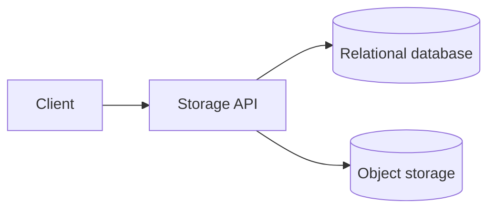
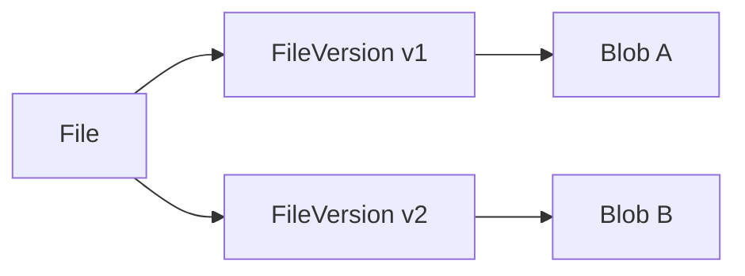
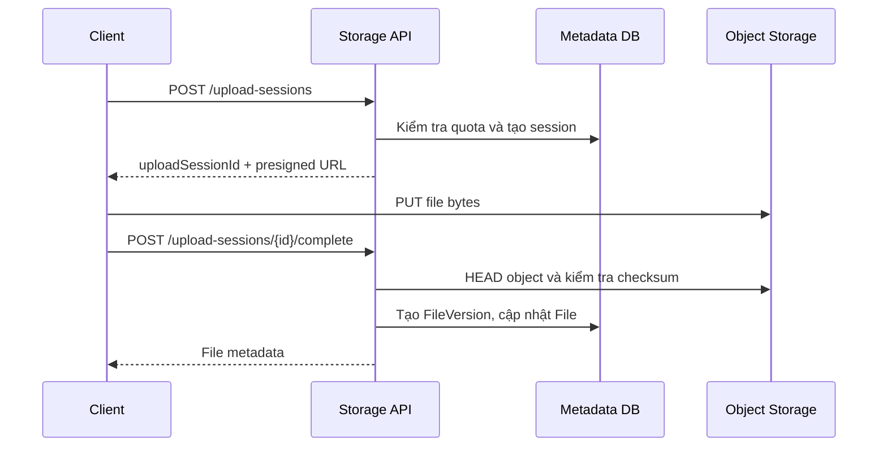
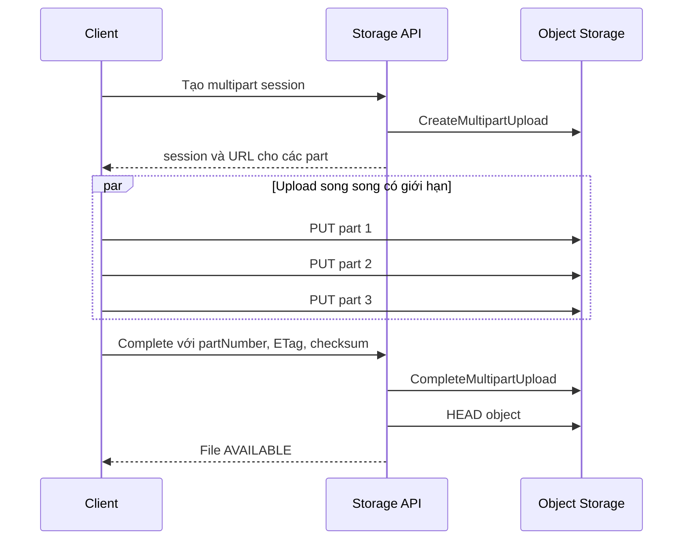
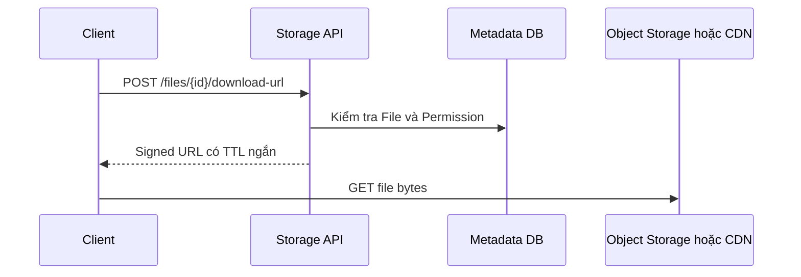
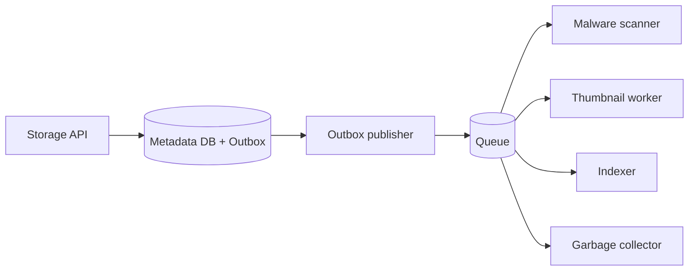

# Cloud Storage: upload file lớn và đồng bộ đa thiết bị

Một dịch vụ cloud storage cho phép người dùng lưu file trên object storage, mở lại từ nhiều thiết bị và chia sẻ cho người khác. Upload byte chỉ là một phần của bài toán. Hệ thống còn phải giữ metadata, phiên bản, quyền truy cập và trạng thái đồng bộ hội tụ khi client mất mạng hoặc nhiều thiết bị cùng thay đổi một file.

**Object storage** là nơi lưu nội dung file dưới dạng object, ví dụ Amazon S3 hoặc dịch vụ tương thích S3. **Metadata** là dữ liệu mô tả file như tên, thư mục, chủ sở hữu, phiên bản và quyền truy cập. **File sync** là quá trình làm cho trạng thái local và trạng thái cloud dần giống nhau sau các lần tạo, sửa, đổi tên hoặc xóa.

Tài liệu này phát triển một thiết kế từ mức tải nhỏ. Presigned URL, multipart upload, change log và deduplication chỉ xuất hiện khi giải pháp trước đó không còn đáp ứng.

---

## 1. Phạm vi hệ thống

Phiên bản đầu hỗ trợ năm luồng chính:

```text
- Upload và download file lớn
- Tạo folder, đổi tên, di chuyển và xóa file
- Đồng bộ thay đổi giữa nhiều thiết bị
- Chia sẻ file hoặc folder cho người dùng khác
- Khôi phục phiên bản cũ trong thời gian retention
```

Các yêu cầu ngoài phạm vi ban đầu:

```text
- Chỉnh sửa tài liệu cộng tác theo thời gian thực
- Search toàn văn bên trong file
- Global deduplication giữa mọi khách hàng
- Active-active write ở nhiều region
- Hàng chục triệu request mỗi giây
```

Việc loại các yêu cầu này giúp thiết kế tập trung vào correctness của lưu trữ và đồng bộ.

### 1.1 Access pattern

Thiết kế phải bắt đầu từ thao tác cần phục vụ:

```text
Write:
- Tạo upload session
- Upload một hoặc nhiều part
- Hoàn tất upload thành một file version
- Rename, move, delete hoặc restore
- Cấp và thu hồi permission

Read:
- Liệt kê nội dung folder
- Đọc metadata của file
- Download nội dung file
- Lấy các thay đổi kể từ cursor gần nhất
- Liệt kê version và permission
```

File bytes thường lớn hơn metadata nhiều bậc. Vì vậy hai loại dữ liệu cần đường đi và storage khác nhau.

### 1.2 Load parameter

Các tham số cần xác định trước khi chọn công nghệ:

```text
1. Số người dùng hoạt động hằng ngày và peak concurrent users?
2. Số file trung bình trên mỗi người dùng?
3. Kích thước file trung bình, p95 và lớn nhất?
4. Tỷ lệ upload so với download?
5. Băng thông peak cho upload và download?
6. Một folder có thể chứa tối đa bao nhiêu item?
7. Một file được chia sẻ cho bao nhiêu principal?
8. Thay đổi phải xuất hiện trên thiết bị khác sau bao lâu?
9. Version và file đã xóa được giữ trong bao lâu?
10. Có cần deduplication trong cùng account hoặc tenant không?
```

Ví dụ cho một sản phẩm giai đoạn đầu:

```text
100.000 người dùng đăng ký
10.000 DAU
1.000 người dùng đồng thời tại peak
20 file/người dùng
file trung bình 8 MB, p95 200 MB, tối đa 5 GB
peak 20 upload/giây
peak 80 download/giây
sync freshness mục tiêu dưới 30 giây
```

Đây chưa phải tải bắt buộc phải dùng DynamoDB, nhiều microservice hoặc CDN toàn cầu.

## 2. Mức tải nhỏ: API và object storage

Thiết kế nhỏ nhất có ba thành phần:



Relational database giữ metadata và quyền truy cập. Object storage giữ file bytes. Storage API xác thực người dùng, kiểm tra quota và điều phối hai nơi lưu trữ.

Phiên bản đơn giản có thể nhận file qua API rồi ghi sang object storage. Cách này dễ triển khai nhưng tạo hai lần truyền dữ liệu:

```text
Client → Application Server → Object Storage
```

Với file 500 MB, Application Server phải nhận và gửi lại toàn bộ 500 MB. Network, memory buffer, timeout và autoscaling của application bị chi phối bởi file transfer thay vì business logic.

Khi file lớn hoặc traffic upload tăng, file bytes cần đi thẳng từ client tới object storage.

## 3. Metadata và file bytes

Metadata không nên dùng object key làm định danh nghiệp vụ. Object key là chi tiết lưu trữ và có thể thay đổi khi migrate bucket hoặc storage provider.

Mô hình dữ liệu cốt lõi gồm ba tầng:



- `File` biểu diễn item người dùng nhìn thấy, gồm tên, folder cha và trạng thái xóa.
- `FileVersion` biểu diễn một lần thay đổi nội dung.
- `Blob` biểu diễn nội dung vật lý trong object storage.

Schema tối thiểu:

```sql
CREATE TABLE tep (
    id              uuid PRIMARY KEY,
    chuSoHuuId      uuid NOT NULL,
    thuMucChaId     uuid NULL,
    ten             varchar(255) NOT NULL,
    phienBanHienTai bigint NULL,
    daXoa            boolean NOT NULL DEFAULT false,
    version          bigint NOT NULL,
    createdAt        timestamp NOT NULL,
    updatedAt        timestamp NOT NULL
);

CREATE TABLE phien_ban_tep (
    tepId        uuid NOT NULL,
    soPhienBan   bigint NOT NULL,
    blobId       uuid NOT NULL,
    kichThuoc    bigint NOT NULL,
    contentType  varchar(255) NOT NULL,
    checksum     varchar(255) NOT NULL,
    createdAt    timestamp NOT NULL,
    PRIMARY KEY (tepId, soPhienBan)
);

CREATE TABLE blob (
    id              uuid PRIMARY KEY,
    objectKey       varchar(1024) NOT NULL UNIQUE,
    kichThuoc       bigint NOT NULL,
    checksum        varchar(255) NOT NULL,
    referenceCount  bigint NOT NULL,
    createdAt       timestamp NOT NULL
);
```

Ràng buộc tên file cần được định nghĩa theo business rule. Ví dụ, một folder không chứa hai item đang hoạt động có cùng tên sau khi chuẩn hóa case. Cách chuẩn hóa phải nhất quán giữa mọi client và server.

## 4. Presigned URL

**Presigned URL** là URL có chữ ký và thời hạn, cho phép client thực hiện một thao tác giới hạn trên object storage mà không nhận storage credential.

Luồng upload trực tiếp:



Presigned URL phải được giới hạn bởi:

- object key do server sinh, không lấy trực tiếp từ file name;
- HTTP method cụ thể;
- thời hạn ngắn;
- kích thước và content type khi storage policy hỗ trợ;
- checksum header đã thống nhất;
- principal có quyền tạo version cho file đích.

Presigned URL là bearer credential. Ai có URL còn hiệu lực có thể sử dụng quyền được ký trong URL. Không ghi URL vào log, analytics hoặc error message.

Client upload thành công chưa đủ để file chuyển sang `AVAILABLE`. Storage API phải xác minh object và commit metadata qua complete API.

## 5. Multipart upload

Single `PUT` phù hợp với file nhỏ. File lớn cần **multipart upload**, nghĩa là nội dung được chia thành nhiều part và object storage ghép chúng khi hoàn tất.



Client chỉ upload lại part thất bại. Trạng thái part có thể được phục hồi bằng `ListParts` của object storage, vì vậy không nhất thiết ghi từng progress event vào database.

Giới hạn concurrency ở client, ví dụ 3 đến 6 part đồng thời. Upload mọi part cùng lúc có thể làm nghẽn network của client và tạo request burst lên storage.

### 5.1 Upload session

Upload là một workflow có trạng thái:

```text
INITIATED → UPLOADING → VERIFYING → AVAILABLE
                 │            │
                 └→ EXPIRED   ├→ REJECTED
                              └→ QUARANTINED
```

```sql
CREATE TABLE phien_upload (
    id              uuid PRIMARY KEY,
    nguoiDungId     uuid NOT NULL,
    tepId           uuid NULL,
    objectKey       varchar(1024) NOT NULL UNIQUE,
    storageUploadId varchar(1024) NULL,
    kichThuocDuKien bigint NOT NULL,
    checksumDuKien  varchar(255) NULL,
    trangThai       varchar(32) NOT NULL,
    expiresAt       timestamp NOT NULL,
    createdAt       timestamp NOT NULL
);
```

Session hết hạn phải được abort và dọn các part chưa hoàn tất. Nếu không, multipart upload bỏ dở vẫn tiếp tục chiếm storage và phát sinh chi phí.

### 5.2 Checksum và ETag

Checksum kiểm tra file nhận được có đúng chuỗi byte client định gửi hay không. Nó không thay thế malware scan hoặc authorization.

Không mặc định dùng `ETag` làm MD5 của toàn file. Với multipart upload, ETag có thể được tổng hợp từ các part và không bằng MD5 của nội dung hoàn chỉnh. Hệ thống phải chọn checksum algorithm rõ ràng và lưu kèm tên thuật toán.

```text
checksumAlgorithm = SHA-256 hoặc checksum được storage hỗ trợ
checksumValue     = giá trị theo đúng algorithm
```

## 6. Deduplication

**Deduplication** là cơ chế để nhiều file logic dùng chung một blob vật lý khi nội dung giống nhau.

Hash chỉ tạo ra một ứng viên trùng lặp:

```text
dedupKey = tenantId + algorithm + checksum + fileSize
```

Server vẫn phải xác minh size và checksum. Không cung cấp API cho phép người dùng tùy ý hỏi một hash có tồn tại toàn hệ thống hay không. Phản hồi đó có thể trở thành existence oracle để suy đoán dữ liệu của người khác.

Mức triển khai an toàn theo thứ tự:

1. Không dedup ở phiên bản đầu.
2. Dedup các version trong cùng account hoặc tenant.
3. Chỉ cân nhắc global dedup khi chi phí storage chứng minh nhu cầu và đã thiết kế proof-of-possession.

Dedup cũng làm phức tạp encryption. Nếu mỗi tenant dùng encryption key riêng, hai nội dung giống nhau có thể tạo ciphertext khác nhau và không dùng chung blob được.

Garbage collector chỉ xóa blob khi không còn `FileVersion` tham chiếu và đã qua grace period. `referenceCount = 0` không nên dẫn đến xóa ngay vì transaction metadata và cleanup job có thể quan sát trạng thái ở thời điểm khác nhau.

## 7. Download và CDN

Download bắt đầu bằng authorization, không bắt đầu bằng object storage:



Signed URL phải trỏ tới version cụ thể. Nếu URL chỉ trỏ tới `fileId` nhưng nội dung file thay đổi, cùng một URL có thể trả về version khác với lúc authorization được kiểm tra.

CDN hữu ích khi cùng một nội dung được download nhiều lần hoặc người dùng ở xa region lưu trữ. CDN không cần xuất hiện ở tải nhỏ. Khi dùng CDN, cache key phải bao gồm version bất biến và private content phải dùng signed URL hoặc signed cookie.

## 8. Folder và permission

Folder là metadata, không phải prefix bắt buộc của object key. Di chuyển file sang folder khác chỉ cập nhật metadata. Không cần copy object lớn sang key mới.

Permission không nên lưu dưới dạng `userIds[]` trong một record share. Một permission record biểu diễn một principal:

```sql
CREATE TABLE quyen_truy_cap (
    taiNguyenId   uuid NOT NULL,
    principalType varchar(16) NOT NULL,
    principalId  uuid NOT NULL,
    vaiTro        varchar(16) NOT NULL,
    expiresAt     timestamp NULL,
    createdAt     timestamp NOT NULL,
    PRIMARY KEY (taiNguyenId, principalType, principalId)
);
```

`principalType` có thể là `USER`, `GROUP` hoặc `LINK`. `vaiTro` có thể là `VIEWER`, `EDITOR` hoặc `OWNER`.

Permission trên folder đặt ra câu hỏi kế thừa. Hai lựa chọn phổ biến:

- Tính quyền khi đọc bằng cách đi ngược cây folder. Write đơn giản nhưng read phức tạp.
- Materialize effective permission xuống descendant. Read nhanh nhưng move folder và revoke permission trở thành workflow lớn.

Ở mức tải nhỏ, cây folder có depth giới hạn và permission không thay đổi liên tục, tính quyền từ ancestor hoặc cache kết quả thường đơn giản hơn.

## 9. Change log và cursor

Filesystem watcher chỉ cho biết local có thể đã thay đổi. Nó không bảo đảm ghi nhận mọi event khi process dừng, máy sleep hoặc buffer của hệ điều hành tràn. Server notification cũng có thể bị mất khi client offline.

Nguồn sự thật cho sync cần là **change log**. Mỗi mutation metadata tạo một change có sequence tăng đơn điệu trong cùng phạm vi sync.

```sql
CREATE TABLE thay_doi (
    sequence      bigint GENERATED ALWAYS AS IDENTITY PRIMARY KEY,
    nguoiDungId   uuid NOT NULL,
    taiNguyenId   uuid NOT NULL,
    loai          varchar(32) NOT NULL,
    resourceVersion bigint NOT NULL,
    createdAt     timestamp NOT NULL
);
```

Client lưu cursor đã xử lý:

```http
GET /changes?cursor=1050&limit=500
```

```json
{
  "changes": [
    {
      "sequence": 1051,
      "resourceId": "file-42",
      "type": "FILE_UPDATED",
      "resourceVersion": 7
    }
  ],
  "nextCursor": 1092,
  "hasMore": false
}
```

Cursor đại diện cho vị trí trong change stream, không phải timestamp của thiết bị. Client clock có thể sai và nhiều thay đổi có thể có cùng timestamp.

### 9.1 Notification hint

SSE, WebSocket hoặc push notification chỉ cần báo:

```text
Có thay đổi mới. Hãy gọi /changes từ cursor hiện tại.
```

Notification không phải nguồn sự thật và không cần chứa toàn bộ metadata. Nếu client bỏ lỡ notification, lần polling hoặc reconnect tiếp theo vẫn đọc được mọi change từ cursor.

Polling mỗi 30 giây là baseline hợp lý cho MVP. Notification hint làm giảm latency nhưng không thay thế periodic reconciliation.

### 9.2 Tombstone

Xóa vật lý metadata ngay sẽ khiến thiết bị offline không biết file đã bị xóa. Server cần giữ **tombstone**, một record biểu diễn việc resource đã bị xóa.

Tombstone tồn tại ít nhất lâu hơn thời gian một client được phép offline mà vẫn incremental sync. Nếu cursor quá cũ và change log đã hết retention, server yêu cầu client thực hiện full reconciliation.

## 10. Conflict và version

Mỗi mutation gửi `baseVersion`, là version mà client đã dùng để tạo thay đổi:

```http
PATCH /files/file-42
If-Match: 7
```

Nếu version hiện tại vẫn là 7, server áp dụng thay đổi và tăng lên 8. Nếu server đã ở version 8, request trả conflict thay vì ghi đè âm thầm.

Metadata operation và content operation có thể có chính sách khác nhau:

- Rename hoặc move có thể dùng optimistic concurrency và yêu cầu client reload.
- Hai lần sửa nội dung từ cùng base version có thể tạo conflict copy.
- Delete xung đột với update cần business rule rõ ràng, ví dụ delete thắng nhưng version mới vẫn nằm trong trash.

Không dùng last-write-wins dựa trên client timestamp cho nội dung quan trọng. Đồng hồ thiết bị không đáng tin và chiến lược này có thể làm mất thay đổi mà người dùng không biết.

## 11. Consistency boundary

Object storage và metadata database không cùng một transaction. Hệ thống phải chịu được hai trạng thái dở dang:

```text
Object tồn tại nhưng metadata chưa commit
Metadata tham chiếu object không tồn tại hoặc chưa hoàn tất
```

Thiết kế giảm rủi ro bằng quy tắc publish sau:

1. Tạo upload session trong database.
2. Upload object vào key tạm hoặc key bất biến chưa được public.
3. Complete API kiểm tra object.
4. Trong một database transaction, tạo `FileVersion`, cập nhật `File` và ghi `ChangeLog`.
5. Chỉ sau commit, file mới ở trạng thái `AVAILABLE`.

Nếu bước 4 thất bại, object trở thành orphan và cleanup job xóa sau grace period. Nếu database commit thành công nhưng object bị mất, reconciliation job phát hiện invariant bị vi phạm và đánh dấu version không khả dụng để ngăn cấp download URL sai.

Change log phải được ghi cùng transaction với metadata. Nếu cập nhật file thành công nhưng ghi event thất bại, thiết bị khác có thể không bao giờ biết có thay đổi.

## 12. Xử lý bất đồng bộ

Sau khi file hoàn tất, các công việc không nằm trên critical path được xử lý qua queue:

**Transactional Outbox** lưu event trong cùng transaction với metadata, sau đó một publisher đọc các event đã commit và gửi sang queue. Cơ chế này tránh trạng thái metadata đã đổi nhưng event bị mất do application dừng giữa hai thao tác.



Malware policy quyết định file được download ngay hay phải ở `QUARANTINED` cho tới khi scan thành công. Worker phải idempotent vì message có thể được giao lại.

Các job cleanup cần xử lý:

- multipart upload hết hạn;
- object orphan không có metadata;
- blob không còn reference;
- version quá retention;
- tombstone và change log quá retention;
- upload session mắc kẹt ở `VERIFYING`.

## 13. Relational database và DynamoDB

DynamoDB phù hợp khi access pattern đã ổn định, partition key phân bố tốt và hệ thống cần scale ngang lớn với latency dự đoán được. Nó không tự động là lựa chọn tốt hơn chỉ vì metadata có schema linh hoạt.

Cloud storage metadata có nhiều invariant quan hệ:

- tên duy nhất trong folder;
- parent-child hierarchy;
- version và current version;
- permission và ownership;
- quota;
- metadata mutation và change log cùng transaction.

Ở tải vừa, PostgreSQL hoặc MySQL giúp biểu diễn các invariant này trực tiếp và vận hành đơn giản hơn. Có thể partition change log, thêm read replica hoặc tách workload khi số liệu chỉ ra bottleneck.

Nếu dùng DynamoDB, cần thiết kế từ access pattern cụ thể, ví dụ:

```text
List children of folder
Get file by id
List changes after cursor
List permissions by resource
Find upload session by id
```

Một item chứa toàn bộ `chunks[]` hoặc `userIds[]` sẽ gặp giới hạn kích thước và write contention. Part và permission cần item riêng.

## 14. Failure matrix

| Failure | Hành vi an toàn |
|---|---|
| Client mất mạng giữa một part | Resume và chỉ upload lại part thiếu |
| Presigned URL hết hạn | Xác thực session rồi cấp URL mới cho part chưa xong |
| Client gọi complete hai lần | Complete API idempotent theo upload session |
| Object upload xong nhưng client không nhận response | Client query session và server xác minh lại object |
| Database lỗi sau khi object hoàn tất | Không publish file, cleanup orphan sau grace period |
| Notification bị mất | Client đọc `/changes` từ cursor cũ |
| Hai thiết bị sửa cùng base version | Trả conflict hoặc tạo conflict copy |
| Worker scan nhận message trùng | Idempotent theo `fileVersionId` |
| Client offline quá change-log retention | Full reconciliation |
| Permission bị thu hồi | Không cấp signed URL mới, URL cũ hết hạn sớm |

Failure matrix phải được kiểm thử bằng việc ngắt kết nối tại từng boundary, không chỉ chạy happy path.

## 15. Observability

### 15.1 Upload

- số session theo từng trạng thái;
- upload success rate và completion latency;
- part retry rate;
- checksum mismatch;
- expired và abandoned multipart upload;
- orphan object count và age.

### 15.2 Sync

- change-log append rate;
- số change trả về trên mỗi request;
- cursor lag theo thời gian và sequence;
- full reconciliation rate;
- conflict rate;
- notification delivery và reconnect rate.

### 15.3 Storage và quyền

- logical bytes và physical bytes;
- dedup ratio nếu có;
- download authorization failure;
- signed URL issuance rate;
- blob có reference count bất thường;
- metadata tham chiếu object không tồn tại.

Không dùng `fileId`, `userId` hoặc checksum làm metric label vì các giá trị này tạo cardinality theo dữ liệu người dùng.

## 16. Capacity planning

Tách metadata QPS khỏi data bandwidth:

```text
uploadBandwidth = uploadPerSecond × averageFileSize
downloadBandwidth = downloadPerSecond × averageFileSize
metadataWriteQps ≈ fileMutationsPerSecond + permissionMutationsPerSecond
changeReadQps ≈ activeDevices / pollingIntervalSeconds
```

Với ví dụ ban đầu:

```text
20 upload/giây × 8 MB  = 160 MB/giây upload
80 download/giây × 8 MB = 640 MB/giây download
1.000 thiết bị / 30 giây ≈ 33 sync request/giây
```

Byte traffic lớn nhưng metadata QPS vẫn nhỏ. Đây là lý do direct upload giải quyết đúng bottleneck hơn việc chuyển metadata sang distributed database quá sớm.

Dung lượng cần tính thêm version và retention:

```text
physicalStorage = uniqueBlobBytes + multipartWaste + replicationOverhead
logicalStorage  = tổng kích thước FileVersion người dùng nhìn thấy
```

Quota nên dựa trên định nghĩa business rõ ràng. Nếu dùng physical bytes sau dedup, quota của một người có thể thay đổi khi người khác xóa file dùng chung blob. Logical bytes thường dễ giải thích hơn cho người dùng.

## 17. Lộ trình nâng cấp

### Giai đoạn 1 — Một region

```text
Storage API dạng modular monolith
Relational database
Object storage
Single PUT cho file nhỏ
Multipart upload cho file lớn
Polling change log mỗi 30 giây
Queue cho scan và cleanup
```

### Giai đoạn 2 — Tăng tải đọc và sync

```text
CDN cho download phổ biến
Notification hint qua SSE, WebSocket hoặc push
Partition change log
Cache permission có invalidation rõ ràng
Background reconciliation
```

### Giai đoạn 3 — Bottleneck đã được đo

```text
Tách upload orchestration khi lifecycle upload tạo tải độc lập
Tenant-scoped dedup khi storage cost đủ lớn
Shard metadata theo account hoặc tenant
Distributed rate limit theo quota provider
Multi-region read hoặc disaster recovery
```

Không tách Upload Service và Download Service chỉ vì sơ đồ system design thường có hai box này. Tách service khi ownership, scaling profile hoặc failure boundary thực sự khác nhau.

## 18. Production checklist

### Upload và integrity

- [ ] File bytes không đi qua Application Server khi vượt ngưỡng direct upload.
- [ ] Presigned URL có TTL ngắn, method và object key cụ thể.
- [ ] Multipart upload có resume, concurrency limit và cleanup.
- [ ] Checksum algorithm được lưu rõ ràng.
- [ ] Không coi multipart ETag là MD5 toàn file.
- [ ] Complete API idempotent và xác minh object trước khi publish.

### Metadata và security

- [ ] `File`, `FileVersion` và `Blob` có trách nhiệm riêng.
- [ ] Download URL chỉ được cấp sau authorization.
- [ ] Permission không lưu bằng mảng người dùng không giới hạn.
- [ ] Dedup không làm lộ sự tồn tại của nội dung tenant khác.
- [ ] Delete, retention và legal hold có rule rõ ràng.
- [ ] Log không chứa signed URL hoặc file content.

### Sync và vận hành

- [ ] Metadata mutation và change log commit cùng transaction.
- [ ] Client dùng cursor, không dùng client timestamp làm vị trí sync.
- [ ] Notification chỉ là hint và có periodic reconciliation.
- [ ] Có tombstone cho thiết bị offline.
- [ ] Có chính sách conflict theo từng mutation.
- [ ] Dashboard theo dõi cursor lag, orphan object và stuck session.
- [ ] Đã test mất mạng tại mỗi bước upload và sync.

## 19. Kết luận

Thiết kế cloud storage ổn định dựa trên ba ranh giới:

```text
File bytes        → object storage
Metadata và quyền → transactional metadata store
Đồng bộ thiết bị  → durable change log + cursor
```

Presigned URL và multipart upload giảm tải data path cho Application Server. `File → FileVersion → Blob` tách danh tính người dùng khỏi object vật lý. Change log làm cho client hội tụ ngay cả khi notification bị mất.

Ở tải vừa, relational database, object storage và một queue đã đủ tạo nền tảng production tốt. DynamoDB, global dedup, nhiều microservice và multi-region write chỉ nên xuất hiện sau khi access pattern và số liệu vận hành chứng minh nhu cầu.

## 20. Tài liệu tham khảo

- [Amazon S3 presigned URLs](https://docs.aws.amazon.com/AmazonS3/latest/userguide/using-presigned-url.html) — quyền truy cập có thời hạn cho upload và download.
- [Amazon S3 multipart upload](https://docs.aws.amazon.com/AmazonS3/latest/userguide/mpuoverview.html) — lifecycle của multipart upload và quản lý part.
- [Amazon S3 object integrity](https://docs.aws.amazon.com/AmazonS3/latest/userguide/checking-object-integrity-upload.html) — checksum toàn object, checksum theo part và giới hạn của ETag.
- [Google Drive API: Retrieve changes](https://developers.google.com/workspace/drive/api/guides/manage-changes) — change collection và page token cho incremental synchronization.

