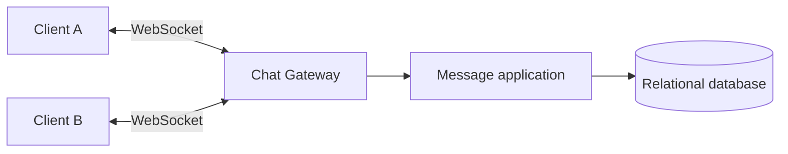
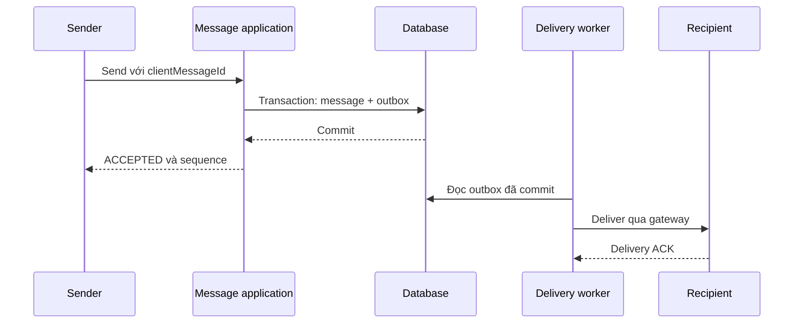
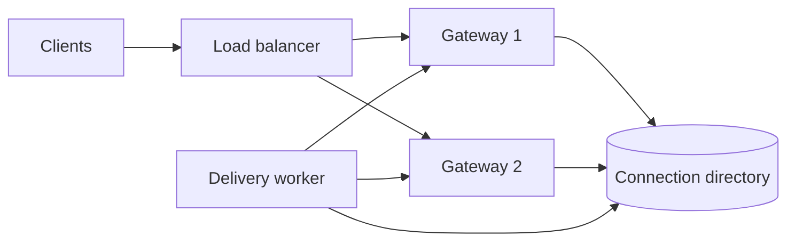

# Messaging App: gửi tin nhắn và đồng bộ đa thiết bị

Một ứng dụng nhắn tin cho phép người dùng trao đổi nội dung trong hội thoại riêng hoặc nhóm. Khi cả hai đang online, tin nhắn cần xuất hiện nhanh. Khi một người mất mạng, nội dung phải được giữ lại để thiết bị tải về sau. Khi người gửi thử lại vì không nhận được phản hồi, người nhận vẫn chỉ thấy một tin nhắn.

**Messaging app** trong tài liệu này là hệ thống chat có lịch sử lưu trên server và hỗ trợ nhiều thiết bị. Ví dụ xuyên suốt là ứng dụng chat nội bộ cho doanh nghiệp, bắt đầu từ vài trăm kết nối và tăng lên vài chục nghìn kết nối đồng thời. Đây là một thiết kế tham khảo, không mô tả kiến trúc nội bộ của WhatsApp hay WeChat.

Người đọc cần biết HTTP, database transaction và index. Các cơ chế WebSocket, delivery receipt, fan-out và presence được giới thiệu tại nơi chúng giải quyết vấn đề cụ thể.

## 1. Requirements và load parameter

Phạm vi ban đầu gồm chat 1–1, nhóm tối đa 150 thành viên, lịch sử tin nhắn, gửi file, trạng thái đã nhận và đã đọc. Một người có thể đăng nhập trên điện thoại và laptop. Cuộc gọi, chỉnh sửa tài liệu cộng tác và nhóm công khai hàng triệu thành viên nằm ngoài phạm vi.

Các invariant cần được bảo vệ ngay từ phiên bản đầu:

- Server chỉ xác nhận chấp nhận sau khi tin nhắn được lưu bền vững theo chính sách durability đã chọn.
- Gửi lại cùng một thao tác không tạo thêm tin nhắn.
- Trong một hội thoại, mỗi tin nhắn có vị trí duy nhất để các thiết bị hiển thị cùng thứ tự.
- Chỉ thành viên hợp lệ được gửi và đọc nội dung trong phạm vi được cấp quyền.
- Thiết bị reconnect có thể lấy phần thiếu từ dữ liệu bền vững.

Tải cần tách thành số kết nối, message write và recipient delivery:

| Tham số | Ban đầu | Khi sản phẩm tăng trưởng |
|---|---:|---:|
| Kết nối đồng thời | 500 | 20.000 |
| Message gửi tại peak | 10/giây | 300/giây |
| Recipient trung bình/message | 3 | 8 |
| Delivery dự kiến | 30/giây | 2.400/giây |
| Heartbeat mỗi 30 giây | khoảng 17/giây | khoảng 667/giây |

Đây là số liệu giả định để minh họa cách ra quyết định, không phải benchmark. Một message gửi vào nhóm 150 người có thể tạo tới 149 recipient delivery, chưa tính các thiết bị và receipt.

```text
deliveryRate ≈ messageRate × averageRecipientCount
heartbeatRate ≈ activeConnectionCount / heartbeatInterval
```

SLO cũng phải có phạm vi rõ ràng. Ví dụ, p95 từ lúc server chấp nhận đến khi thiết bị online nhận được dưới một giây trong điều kiện mạng bình thường. Người nhận offline không nằm trong SLO này.

## 2. HTTP polling và relational database

Phiên bản nhỏ nhất có thể dùng một application và relational database. Client gửi message qua HTTP rồi định kỳ hỏi có message mới hay không.

```text
POST /conversations/{id}/messages
GET  /conversations/{id}/messages?afterSequence=105&limit=100
```

Database lưu hội thoại, thành viên và tin nhắn. Các field sau là schema khái niệm, chưa bao gồm đầy đủ foreign key và index:

```text
hoi_thoai
  id, loai, thuTuCuoi

thanh_vien
  hoiThoaiId, nguoiDungId, vaiTro, thamGiaTuThuTu, roiTaiThuTu

tin_nhan
  id, hoiThoaiId, nguoiGuiId, clientMessageId,
  thuTu, noiDung, createdAt
```

Index `(hoiThoaiId, thuTu)` phục vụ phân trang theo vị trí. Unique constraint `(nguoiGuiId, clientMessageId)` phục vụ chống gửi trùng. Unique constraint `(hoiThoaiId, thuTu)` bảo vệ thứ tự.

Nếu 500 client polling mỗi 5 giây, server nhận khoảng 100 request/giây dù phần lớn không có tin mới. Giảm chu kỳ xuống một giây tăng tải lên khoảng 500 request/giây. Đây là lúc cần thay đổi transport để giảm latency và request rỗng.

## 3. WebSocket và connection gateway

**WebSocket** duy trì một kết nối hai chiều để client và server chủ động gửi dữ liệu. WebSocket truyền thống thiết lập kết nối bằng HTTP upgrade và chạy trên TCP. Transport này giúp nhận tin nhanh, nhưng không tự cung cấp lưu trữ, retry hoặc đồng bộ sau reconnect.



Ở phiên bản một instance, gateway và message application có thể nằm trong cùng process. Gateway giữ connection map trong memory. Database vẫn là nguồn sự thật cho lịch sử.

Mỗi connection cần authentication, kiểm tra kích thước frame, giới hạn tần suất và timeout. Authorization phải được kiểm tra cho từng thao tác trên hội thoại. Một WebSocket đã đăng nhập không cho phép gửi vào mọi group.

## 4. Idempotency và trạng thái gửi

Giả sử server lưu message thành công nhưng connection đứt trước khi sender nhận ACK. Sender không biết thao tác đã thành công và phải retry.

Client tạo `clientMessageId` trước lần gửi đầu, lưu cùng message đang chờ trong local outbox và giữ nguyên ID khi retry:

```json
{
  "clientMessageId": "device-7-operation-92",
  "hoiThoaiId": "chat-42",
  "noiDung": "Mình đã gửi báo cáo"
}
```

Server tra hoặc insert theo unique key `(nguoiGuiId, clientMessageId)`. Nếu thao tác đã tồn tại, server trả lại message ID và thứ tự cũ. Nếu cùng key được dùng với payload khác, server từ chối thay vì âm thầm thay nội dung.

| Trạng thái | Ý nghĩa |
|---|---|
| `SENDING` | Client còn chờ xác nhận |
| `ACCEPTED` | Server đã lưu message |
| `DELIVERED` | Thiết bị recipient đã xác nhận nhận |
| `READ` | Recipient đã gửi read receipt |

`ACCEPTED` không bảo đảm recipient đã nhận. `READ` chỉ biểu diễn hành vi client báo cáo, không chứng minh người dùng đã hiểu nội dung.

## 5. Ordering theo hội thoại

Một ID duy nhất và một thứ tự hội thoại giải quyết hai bài toán khác nhau. UUID hoặc Snowflake có thể làm định danh. ID gần theo thời gian không đủ bảo đảm thứ tự khi nhiều server ghi đồng thời.

Mỗi hội thoại cần một `thuTu` do server cấp:

```text
chat-42: message A → 105
chat-42: message B → 106
chat-42: message C → 107
```

Ở tải nhỏ, transaction khóa row hội thoại, kiểm tra membership, tăng `thuTuCuoi` rồi insert message. Khóa được giữ đến commit để các writer của cùng hội thoại tuần tự hóa. Một transaction rollback có thể khiến một số chiến lược cấp số để lại gap. Client phải tuân theo contract phân trang, không mặc định mọi gap là message bị mất.

Phạm vi ordering là một hội thoại. Các hội thoại khác nhau không cần dùng chung một counter. Khi một hội thoại trở thành hot row, có thể chuyển write của hội thoại đó vào một partition có owner xử lý tuần tự. Cơ chế đổi owner phải có fencing để owner cũ không tiếp tục ghi sau khi mất quyền.

## 6. Durable delivery và Transactional Outbox

Nếu lưu message rồi gửi socket trực tiếp, application có thể dừng giữa hai bước. Message đã có trong lịch sử nhưng recipient online chưa nhận notification.

**Transactional Outbox** lưu một event cùng transaction với message. Publisher đọc event đã commit rồi đưa vào delivery pipeline:



Delivery có thể lặp khi worker gửi thành công rồi dừng trước khi lưu trạng thái. Recipient deduplicate theo message ID. Toàn luồng dùng at-least-once delivery cùng idempotency, không giả định exactly-once transport.

Queue giúp tách tốc độ xử lý và retry. Ở tải nhỏ, một background worker đọc outbox đã đủ. Broker xuất hiện khi cần phân phối worker, buffering hoặc cô lập failure rõ hơn. Xem [RabbitMQ và Reliable Messaging](/dotnet-core/rabbitmq-reliable-messaging) để triển khai outbox, retry và acknowledgement.

## 7. Offline delivery và đồng bộ nhiều thiết bị

Socket và push notification đều có thể mất. Thiết bị phải lấy được dữ liệu thiếu từ message store khi reconnect.

Một cursor riêng cho mỗi hội thoại cho biết vị trí thiết bị đã áp dụng. Đồng thời, một inbox/change feed theo người dùng giúp client biết những hội thoại nào thay đổi mà không polling mọi hội thoại.

```text
GET /sync?cursor=<opaqueToken>&limit=200

Response:
- danh sách conversation/message thay đổi
- nextCursor
- hasMore
```

**Opaque cursor** là token do server cấp, client chỉ lưu và gửi lại. Nó không được suy ra từ ID lớn nhất đang có trên thiết bị. Đọc theo `messageId > lastSeenId` có thể bỏ sót event được ghi hoặc fan-out muộn.

Sync feed cần thứ tự publication ổn định. Nếu transaction A lấy số 10 nhưng chưa commit, transaction B lấy số 11 và commit trước, trả cursor 11 có thể làm client bỏ qua số 10 khi A commit muộn. Có thể serialize việc append trong từng inbox hoặc dùng committed watermark. Một auto-increment ID đơn thuần chưa bảo vệ invariant này.

Client áp dụng batch vào local database rồi lưu cursor trong cùng local transaction. Nếu ứng dụng dừng trước commit, batch được tải lại và deduplicate. Nếu lưu cursor trước dữ liệu, client có thể bỏ qua nội dung chưa lưu.

Mỗi thiết bị có cursor riêng. Read state của người dùng có thể được đồng bộ giữa các thiết bị, nhưng không được dùng read state đó làm vị trí download của thiết bị khác.

Khi cursor quá retention, server yêu cầu snapshot và incremental catch-up. Việc tạo snapshot phải gắn với một watermark nhất quán, rồi đọc tiếp thay đổi sau watermark để không bỏ lỡ mutation xảy ra trong lúc tải snapshot.

## 8. Delivery receipt và read receipt

Một field `seenAt` trên message không diễn tả được nhóm nhiều người. Trạng thái nên gắn với recipient hoặc cursor của thành viên.

```text
trang_thai_thanh_vien
  hoiThoaiId, nguoiDungId,
  thuTuDaNhan, thuTuDaDoc
```

Cursor tăng đơn điệu. Server cập nhật bằng phép lấy max để một ACK cũ đến muộn không kéo trạng thái lùi lại. Contract phải quy định ACK tại vị trí X nghĩa là đã nhận liên tục mọi message có quyền xem đến X, không chỉ nhận riêng X.

Nếu cần biết từng thiết bị đã nhận, lưu thêm device-level cursor. Giao diện có thể tổng hợp `DELIVERED` khi ít nhất một thiết bị của recipient đã nhận. Với group, phải định nghĩa rõ icon đã đọc nghĩa là một người, một số người hay tất cả thành viên.

## 9. Nhiều gateway instance

Khi số kết nối vượt năng lực một process hoặc cần rolling deployment, thêm gateway instance sau load balancer.



Connection directory lưu mapping có thời hạn:

```text
userId + deviceId → gatewayId + connectionId + sessionGeneration
```

Redis có thể giữ mapping với TTL. Một người có nhiều thiết bị nên giá trị cần biểu diễn nhiều session. Khi connection cũ đóng, chỉ xóa mapping nếu connection ID hoặc generation còn khớp, tránh xóa nhầm session mới.

Directory là dữ liệu mềm. Mapping stale làm delivery thất bại và kích hoạt retry hoặc sync khi reconnect. Nó không được quyết định message có còn tồn tại hay không.

Client kết nối endpoint công khai. Service discovery thuộc hạ tầng backend và load balancer. Client không cần truy vấn ZooKeeper hoặc biết địa chỉ từng gateway.

## 10. Group fan-out

**Fan-out** là phân phối một message tới nhiều recipient. Với nhóm nhỏ, fan-out-on-write tạo delivery entry cho các thành viên ngay khi message được chấp nhận.

```text
Một message trong nhóm 20 người
→ một message record
→ tối đa 19 recipient delivery entries
→ nhiều device delivery nếu người dùng có nhiều thiết bị
```

Logical inbox của người dùng không nhất thiết là một physical broker queue. Có thể dùng delivery table được partition theo recipient hoặc một tập partition hữu hạn trên broker.

Membership phải có ranh giới nhất quán với message. Transaction xác định membership hợp lệ tại thời điểm gửi hoặc ghi membership version để fan-out worker dựng lại recipient set đúng. Worker không nên đọc danh sách thành viên hiện tại rồi vô tình gửi lịch sử cho người vừa tham gia.

Khi group rất lớn, fan-out-on-write tăng write amplification. Fan-out-on-read lưu một message và để recipient đọc theo cursor. Hybrid áp dụng fan-out-on-write cho nhóm nhỏ, fan-out-on-read cho channel lớn. Ngưỡng chuyển phải dựa trên delivery rate và SLO đã đo.

## 11. Presence và typing indicator

**Presence** mô tả trạng thái online gần đúng. Một heartbeat gia hạn lease có TTL cho từng connection. Người dùng được coi là online khi còn ít nhất một lease hợp lệ.

```text
heartbeatInterval = 30 giây
leaseTimeout      = 90 giây
```

Đây là cấu hình minh họa. Timeout càng ngắn thì phát hiện offline càng nhanh nhưng dễ báo sai khi mạng chập chờn. Chỉ phát event khi trạng thái chuyển online/offline. Không broadcast mọi heartbeat tới mọi contact.

Chỉ subscribe presence của những người cần hiển thị, tuân theo block và privacy setting. Presence không phải căn cứ đủ để bỏ qua durable delivery. Người dùng có thể mất mạng ngay sau heartbeat.

Typing indicator là event tạm thời có TTL ngắn. Có thể bỏ event khi quá tải. Nó không cần được lưu vào message history hoặc retry lâu như message nghiệp vụ.

## 12. Media và push notification

File lớn upload trực tiếp vào object storage. Message tham chiếu media đã được xác minh và có trạng thái đủ điều kiện chia sẻ. Backend kiểm tra quyền ở cả thao tác attach media và cấp download URL.

Chi tiết presigned URL, multipart, checksum và cleanup nằm trong [Cloud Storage và File Sync](/system-design/case-studies/cloud-storage-sync).

Push notification qua APNs hoặc FCM giúp báo có tin mới khi ứng dụng không giữ socket. Push có thể bị gộp, trễ hoặc hết hạn. Client vẫn đọc sync feed để nhận message. Trạng thái delivery của push provider không đồng nghĩa recipient đã nhận message trong ứng dụng.

## 13. Backpressure và reconnect storm

Một recipient chậm có thể khiến gateway tích lũy outbound buffer. Mỗi connection cần giới hạn số byte hoặc số message đang chờ.

Khi chạm giới hạn, gateway có thể bỏ typing/presence event, sau đó ngắt connection với lý do có thể phục hồi và yêu cầu client sync lại. Không giữ buffer vô hạn trong memory.

Sau một outage, nhiều client reconnect cùng lúc. Client cần exponential backoff có jitter. Server giới hạn handshake rate, sync batch size và số request đồng thời. Retry tải lịch sử nên được điều tiết để không cạnh tranh hết năng lực với message mới.

Xem [Worker Backpressure](/dotnet-core/rabbitmq-worker-backpressure) khi delivery worker cần giảm concurrency theo sức khỏe downstream.

## 14. End-to-end encryption

**End-to-end encryption (E2EE)** mã hóa nội dung trên thiết bị gửi và chỉ cho phép thiết bị nhận giải mã. Server lưu và chuyển ciphertext. TLS bảo vệ đường truyền nhưng server vẫn có thể đọc plaintext, vì vậy TLS không tương đương E2EE.

E2EE thay đổi data model và workflow:

- Mỗi thiết bị cần identity key và cơ chế thiết lập session.
- Thêm hoặc thu hồi thiết bị cần cập nhật tập key và chính sách đồng bộ lịch sử.
- Group membership thay đổi có thể yêu cầu rotation key.
- Push payload tránh chứa plaintext mà server không có quyền biết.
- Search, preview, moderation và backup phải được thiết kế theo trust boundary mới.

Đây là một quyết định sản phẩm cần chốt sớm. Nên dùng protocol và thư viện đã được kiểm chứng, không tự thiết kế thuật toán mật mã. Tài liệu này giữ E2EE ở phạm vi kiến trúc, không cung cấp implementation cryptography.

## 15. Storage và partitioning

Ở tải ban đầu, relational database với index phù hợp đáp ứng cả membership transaction và lịch sử theo hội thoại. Trước khi chuyển database, đo write latency, lock wait, index size, disk I/O và retention workload.

Nếu cần tách message store, access pattern chính là append theo hội thoại và đọc range theo thứ tự. Partition key có thể gồm conversation và bucket, clustering/sort key là thứ tự message.

```text
partition = conversationId + bucket
sortKey   = conversationSequence
```

Bucket giới hạn kích thước partition nhưng không tự giải quyết hot conversation đang ghi vào cùng bucket. Hot write cần điều tiết hoặc owner riêng. Cassandra, ScyllaDB và DynamoDB là các lựa chọn có trade-off khác nhau về query, transaction và vận hành. Nhãn write-heavy chưa đủ để chọn một engine.

Storage estimate phải tính cả index, replica, receipt, delivery entries và retention. Ví dụ 300 message/giây là peak, không được nhân thẳng với 86.400 để suy ra daily storage nếu peak chỉ tồn tại vài phút.

## 16. Failure matrix và observability

| Sự cố | Hành vi cần kiểm chứng |
|---|---|
| Commit xong nhưng sender mất ACK | Retry trả lại message cũ |
| Gateway dừng sau ACCEPTED | Recipient lấy được message qua delivery retry hoặc sync |
| Worker gửi trùng | Client deduplicate theo message ID |
| ACK cũ đến sau ACK mới | Receipt cursor không giảm |
| Directory còn session đã chết | Delivery retry và directory hết hạn |
| Recipient quá chậm | Buffer hữu hạn, reconnect và sync |
| Thành viên bị loại trong lúc fan-out | Quyền được áp dụng theo membership boundary đã định nghĩa |
| Thiết bị offline quá retention | Snapshot nhất quán rồi catch-up |

Dashboard cần đo accepted latency, online delivery latency, outbox age, delivery lag, reconnect rate, sync lag, duplicate rate, outbound buffer và hot conversation. Không đưa user ID hoặc conversation ID vào metric label. Các ID này phù hợp cho log/tracing có kiểm soát truy cập.

Kiểm thử bằng cách ngắt connection trước và sau commit, gửi lại cùng thao tác, đảo thứ tự receipt, dừng gateway và tạo recipient chậm. Kết quả phải được đối chiếu với invariant, không chỉ kiểm tra API trả thành công.

## 17. Lộ trình theo tải

| Trigger đã quan sát | Nâng cấp phù hợp |
|---|---|
| Polling tạo nhiều request rỗng hoặc latency cao | WebSocket |
| Một instance không đủ connection hoặc cần HA | Nhiều gateway và connection directory |
| Delivery cạnh tranh với message write | Outbox worker và broker khi cần |
| Offline/multi-device bỏ lỡ event | Durable sync feed và device cursor |
| Fan-out group chiếm phần lớn write | Hybrid fan-out |
| Message store chạm giới hạn đã đo | Retention, partition hoặc tách message store |

Một sản phẩm tải vừa có thể dùng modular application, relational database, WebSocket gateway, Redis cho session/presence và outbox worker. Mỗi thành phần bổ sung cần gắn với một bottleneck hoặc failure boundary cụ thể.

## 18. Tài liệu tham khảo

- [Messaging App — TechPrep](https://www.techprep.app/blog/messaging-app-system-design) — bài tham khảo gốc về chat gateway, delivery và presence.
- [RFC 6455: WebSocket Protocol](https://www.rfc-editor.org/rfc/rfc6455) — handshake, connection và frame protocol.
- [Signal Protocol specifications](https://signal.org/docs/) — tài liệu về các protocol bảo vệ nội dung và quản lý session mã hóa.
- [Firebase Cloud Messaging message types](https://firebase.google.com/docs/cloud-messaging/customize-messages/set-message-type) — phân biệt notification và data message.
