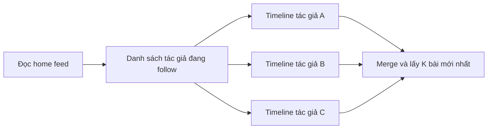
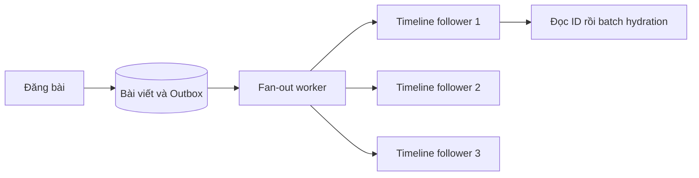

# News Feed và chiến lược fan-out theo tải

Một người dùng theo dõi các tác giả và mở trang chủ để xem bài mới. Khi sản phẩm còn nhỏ, server có thể truy vấn trực tiếp những bài của các tác giả đó. Khi lượng người đọc tăng, cùng một nội dung phải được tổng hợp lặp lại hàng nghìn lần. Nếu một tác giả có nhiều follower, việc chuẩn bị sẵn bảng tin cho từng người lại tạo ra lượng ghi rất lớn.

**News feed** là danh sách bài viết được tổng hợp cho một người đọc. **Fan-out** là quá trình phân phối một bài đăng tới các bảng tin có liên quan. Tài liệu này thiết kế feed theo thời gian mới nhất, từ truy vấn SQL trực tiếp đến mô hình kết hợp chuẩn bị trước và tổng hợp khi đọc.

Ví dụ xuyên suốt là một cộng đồng chia sẻ bài viết. Người đọc cần biết HTTP, relational database và index. Ranking bằng machine learning, quảng cáo và tìm kiếm toàn văn có thể phát triển sau khi luồng feed cơ bản đã ổn định.

## 1. Requirements và access pattern

Hệ thống hỗ trợ đăng bài, follow/unfollow, đọc home feed và xóa bài. Feed hiển thị bài mới trước, phân trang và không lặp một bài trong cùng kết quả.

```text
Write:
- Đăng hoặc xóa bài
- Follow hoặc unfollow tác giả
- Chuyển quyền xem bài hoặc tài khoản
- Block một người dùng

Read:
- Lấy trang đầu của home feed
- Lấy trang tiếp theo
- Đọc bài và thông tin tác giả
- Đọc danh sách người đang follow hoặc follower
```

Độ mới và quyền truy cập cần được tách riêng. Bài mới có thể xuất hiện chậm vài giây theo SLO, nhưng một feed cache cũ không được tự cấp quyền đọc nội dung đã bị thu hồi. Mọi đường đọc phải áp dụng chính sách visibility hiện hành hoặc một cơ chế invalidation có bảo đảm tương đương.

## 2. Load parameter

Ba loại tải quyết định kiến trúc là bài đăng, lượt đọc feed và số timeline entry cần tạo.

```text
postRate       = postsPerDay / 86.400
feedReadRate   = feedRequestsPerDay / 86.400
fanoutRate     = tổng của postRate theo tác giả × eligibleFollowerCount
```

Không suy ra fan-out từ follower trung bình đơn thuần nếu tác giả đông follower cũng đăng bài nhiều hơn. Phân bố lệch và tương quan giữa hai tham số có thể làm estimate thấp hơn tải thật.

Ví dụ giả định ở giai đoạn đầu:

```text
10.000 DAU
2.000 bài/ngày
100.000 lượt đọc feed/ngày
peak 5 bài/giây và 50 lượt đọc/giây
mỗi người theo dõi trung vị 80 tác giả
feed freshness mục tiêu p95 dưới 5 giây
```

Ở mức này, một application cùng database có index phù hợp là điểm khởi đầu cần đo trước.

Ví dụ quy mô lớn trong bài tham khảo TechPrep dùng 20 triệu DAU, mỗi người đăng 5 bài/ngày. Phép tính chi tiết là:

```text
100 triệu bài/ngày / 86.400 ≈ 1.157 bài/giây
read/write = 100:1          ≈ 115.741 request đọc/giây
```

Đây là trung bình ngày. Capacity planning còn cần peak factor, kích thước response, số item mỗi trang và số lần đọc storage để tạo một response. Những con số này minh họa cách tính, không phải yêu cầu mặc định của thiết kế.

## 3. Relational model và feed trực tiếp

Phiên bản nhỏ cần dữ liệu người dùng, bài viết và quan hệ follow. Schema sau chỉ trình bày các field liên quan đến query feed:

```text
nguoi_dung
  id, tenHienThi, anhDaiDien

bai_viet
  id, tacGiaId, noiDung, phamViXem, daXoa, createdAt

theo_doi
  nguoiTheoDoiId, tacGiaId, createdAt
```

Unique key `(nguoiTheoDoiId, tacGiaId)` chống follow trùng. Index ngược `(tacGiaId, nguoiTheoDoiId)` phục vụ liệt kê follower khi cần phân phối bài. Index bài viết bắt đầu bằng `(tacGiaId, createdAt, id)` phục vụ đọc bài theo tác giả và thời gian.

Query khái niệm cho trang sau:

```sql
SELECT b.id, b.tacGiaId, b.noiDung, b.createdAt
FROM bai_viet b
JOIN theo_doi t ON t.tacGiaId = b.tacGiaId
WHERE t.nguoiTheoDoiId = @nguoiDocId
  AND b.daXoa = false
  AND b.phamViXem = 'PUBLIC'
  AND (
      b.createdAt < @mocThoiGian
      OR (b.createdAt = @mocThoiGian AND b.id < @mocId)
  )
ORDER BY b.createdAt DESC, b.id DESC
FETCH FIRST 20 ROWS ONLY;
```

Ví dụ này chỉ xét bài public từ các tác giả đang follow. Bài riêng tư và block cần điều kiện authorization bổ sung. Cú pháp giới hạn số row phụ thuộc database engine.

Database vẫn có thể phải đọc nhiều candidate rồi sort khi người dùng follow nhiều tác giả. Index không tự biến toàn bộ phép join thành một lần đọc 20 row. Đo execution plan, rows examined và latency theo số tác giả đang follow trước khi nâng cấp.

## 4. Cursor pagination

Nếu dùng offset, bài mới chèn vào đầu feed làm vị trí các row dịch chuyển. Người dùng có thể thấy lại bài ở trang trước hoặc bỏ sót bài.

**Keyset pagination** dùng khóa sắp xếp của item cuối làm mốc. Cặp `(createdAt, id)` tạo thứ tự xác định kể cả nhiều bài có cùng timestamp. `createdAt` do server cấp và không đổi khi edit nội dung.

```text
Trang 1: các bài mới nhất
Trang 2: các bài nhỏ hơn khóa cuối trang 1
```

Cursor nên là token opaque chứa mốc, phiên bản thuật toán và phạm vi feed. Server kiểm tra token và giới hạn page size. Khóa này ổn định thứ tự, nhưng không bảo đảm snapshot đầy đủ khi một bài commit muộn hoặc fan-out đến muộn. Với feed eventual consistency, client refresh đầu feed để nhận các bài mới xuất hiện. Nếu sản phẩm yêu cầu duyệt một snapshot chính xác, cần cố định candidate set hoặc snapshot version trong thời gian phân trang.

## 5. Content cache và batch hydration

Khi nhiều người đọc cùng một bài, cache nội dung theo bài có thể giảm database read mà chưa cần thay đổi cách tạo feed.

```text
Query candidate IDs
→ batch load bài viết
→ batch load tác giả
→ kiểm tra visibility
→ trả response
```

**Hydration** là bước biến danh sách ID thành dữ liệu hiển thị. Không gọi storage riêng cho từng bài rồi riêng cho từng tác giả. Một trang 20 bài có thể tạo hàng chục request nếu không batch.

Cache nội dung cần version hoặc invalidation khi edit/delete. Cache miss được đọc từ nguồn bền vững. Quyền xem không được suy ra chỉ từ việc ID còn nằm trong feed.

## 6. Fan-out-on-read

Query trực tiếp là một dạng **fan-out-on-read**: server tổng hợp bài từ các tác giả khi người dùng mở feed.



Lợi ích là không tạo feed cho người không bao giờ mở ứng dụng. Chi phí chuyển sang đường đọc: càng follow nhiều người, mỗi request càng phải tổng hợp nhiều nguồn.

Khi số nguồn lớn, có thể cache timeline từng tác giả và dùng merge các danh sách đã sắp xếp. Tuy nhiên, request vẫn phải có fan-out budget, timeout và giới hạn số nguồn. Thêm cache không loại bỏ chi phí tổng hợp.

## 7. Fan-out-on-write

Khi lượt đọc lặp lại trở thành bottleneck, hệ thống chuẩn bị **home timeline** cho từng người dùng. Timeline là read model chứa ID bài viết cùng khóa sắp xếp.



Một bài chỉ có một bản nội dung chính. Timeline thường chứa reference thay vì copy toàn bộ text và profile tác giả. Database table có unique key `(nguoiDocId, baiVietId)` là một cách triển khai ban đầu. Redis sorted set cũng có thể giữ phần timeline gần nhất, với member là bài ID và score là thời gian phù hợp.

Đây là push vào read model. Client vẫn có thể đọc bằng HTTP, không cần WebSocket để thực hiện fan-out-on-write.

### 7.1 Transactional Outbox

Lưu bài rồi publish event là hai thao tác có thể bị ngắt giữa chừng. **Transactional Outbox** lưu event cùng transaction với bài viết, sau đó publisher gửi event đã commit tới worker.

Worker có thể nhận cùng event nhiều lần. Thêm timeline entry phải idempotent theo người đọc và bài ID. Event hoặc task cần progress checkpoint để retry một batch không buộc làm lại toàn bộ danh sách follower.

Xem [RabbitMQ và Reliable Messaging](/dotnet-core/rabbitmq-reliable-messaging) để triển khai outbox, acknowledgement và retry.

### 7.2 Active-user timeline

Tạo trước feed cho mọi follower làm lãng phí tài nguyên cho tài khoản không hoạt động. Có thể chỉ giữ timeline gần nhất cho người hoạt động trong một khoảng thời gian đã chọn.

Người quay lại sau thời gian dài được rebuild một phần feed từ author timeline. Rebuild có giới hạn thời gian, số bài và concurrency để tránh biến một đợt người dùng quay lại thành read storm.

## 8. Hybrid fan-out

Một tác giả có nhiều follower có thể tạo hàng trăm nghìn timeline write từ một bài đăng. Tăng số worker chỉ giúp đến khi storage write hoặc freshness budget chạm trần.

**Hybrid fan-out** kết hợp timeline đã chuẩn bị với bài từ những tác giả được tổng hợp khi đọc:

```text
Home feed = merge(
    precomputed timeline,
    recent posts của pull authors đang follow
)
```

Quyết định chuyển tác giả sang pull cần xét cả số follower hoạt động và tần suất đăng:

```text
pushCost ≈ postRate × activeFollowerCount × timelineWriteCost
pullCost ≈ followerFeedReadRate × incrementalMergeCost
```

Đây là mô hình so sánh chi phí, không phải công thức benchmark. `incrementalMergeCost` phụ thuộc cache hit, số pull author mỗi người follow và số candidate cần lấy. Tài khoản đông follower nhưng ít đăng có thể vẫn phù hợp với push.

Đặt ngưỡng trên và dưới khác nhau để tránh liên tục chuyển chế độ. Trong migration, giữ dual-read đủ lâu hoặc backfill có checkpoint. Reader deduplicate theo bài ID để một bài không xuất hiện hai lần khi đồng thời nằm ở push timeline và pull source.

## 9. Hybrid merge và phân trang

Các nguồn phải dùng cùng comparator `(createdAt, id)`. Reader lấy candidate trước cursor từ mỗi nguồn, merge, loại trùng, áp dụng visibility rồi chọn page.

Nếu lọc block/delete làm thiếu item, reader có thể lấy thêm candidate trong một ngân sách hữu hạn. Cursor phải phản ánh vị trí đã scan theo contract để không lặp vô hạn những candidate bị loại. Một page ngắn không nhất thiết có nghĩa đã hết lịch sử nếu ngân sách scan đã chạm trần.

Thay đổi follow graph và chuyển chế độ tác giả giữa hai page có thể làm candidate set đổi. MVP có thể chấp nhận best-effort pagination rồi refresh đầu feed. Nếu cần snapshot ổn định, token phải gắn với feed session hoặc read-model generation có retention hữu hạn.

## 10. Visibility và invalidation

Read model có thể stale. Các mutation sau cần policy riêng:

| Mutation | Hành vi |
|---|---|
| Delete bài | Đánh dấu nguồn chính, chặn hydration, dọn timeline bất đồng bộ |
| Unfollow | Lọc quan hệ hiện tại và dọn entry nếu policy yêu cầu |
| Block | Áp dụng quyền trước khi trả nội dung, không chờ fan-out cleanup |
| Public sang private | Thu hồi đường đọc và vô hiệu cache quyền liên quan |
| Follow mới | Backfill giới hạn hoặc chỉ nhận bài tương lai theo product rule |

Để bảo đảm thu hồi quyền nhanh, permission cache phải có invalidation/version phù hợp. TTL đơn thuần tạo một cửa sổ còn đọc được và phải được xem như lựa chọn sản phẩm rõ ràng.

Fan-out worker đến muộn không được làm sống lại bài đã xóa. Entry cũ có thể còn tồn tại nhưng hydration phải tôn trọng trạng thái hiện hành. Nếu worker tạo cả content cache, cần version guard hoặc tombstone để event cũ không ghi đè trạng thái mới.

## 11. Redis và khả năng rebuild

Timeline gần nhất có thể nằm trong Redis để phục vụ đọc nhanh. Mỗi key cần giới hạn số item hoặc retention, tránh tăng vô hạn theo tuổi tài khoản.

Redis sorted set dùng score dạng floating-point. Không ép tùy ý timestamp và ID 64-bit thành một score lớn vì có thể mất độ chính xác. Cần định nghĩa tie-break tương thích comparator, chẳng hạn score thời gian và member encoding có thứ tự rõ ràng.

Khi mất cache, hệ thống rebuild từ bài viết và follow graph. Chỉ backfill một cửa sổ lịch sử hữu hạn và điều tiết rebuild theo người dùng. Cache rebuild phải kết hợp catch-up event hoặc overlap rồi deduplicate để không bỏ bài đăng trong lúc rebuild.

Nguồn sự thật vẫn là bài viết, trạng thái quyền và quan hệ follow. Timeline là dữ liệu dẫn xuất có thể tạo lại.

## 12. REST và GraphQL

Một API REST tối thiểu có thể gồm:

```text
POST   /posts
DELETE /posts/{id}
PUT    /following/{authorId}
DELETE /following/{authorId}
GET    /feed?cursor=...&limit=20
```

Authentication lấy từ credential của request. Không truyền token trong query string vì URL có thể đi vào log và history.

GraphQL hữu ích khi nhiều client cần các field và quan hệ khác nhau. Selection set giảm over-fetching, nhưng không tự giảm query storage. Resolver cần batching, pagination và query-cost limit để tránh N+1 hoặc một request yêu cầu quá nhiều dữ liệu.

Chọn transport dựa trên client contract và vận hành. Chiến lược tạo feed, cache và authorization vẫn phải được giải quyết ở cả hai lựa chọn.

## 13. Failure matrix

| Failure | Cách phục hồi |
|---|---|
| Lưu bài thành công nhưng publisher dừng | Outbox publisher gửi lại event |
| Fan-out task chạy trùng | Unique member hoặc unique constraint chống trùng |
| Worker dừng giữa danh sách follower | Resume theo checkpoint và batch idempotent |
| Một tác giả gây backlog lớn | Cô lập batch, giới hạn throughput hoặc chuyển pull |
| Redis mất timeline | Rebuild có budget và catch-up |
| Delete event đến trước publish event cũ | Version/tombstone ngăn khôi phục dữ liệu cũ |
| Read replica chưa thấy bài vừa đăng | Writer đọc nguồn phù hợp hoặc client overlay bài vừa tạo |
| Pull source timeout | Trả kết quả một phần theo contract và ghi metric thiếu nguồn |

Nếu response trả feed một phần, client cần biết trạng thái đó khi nó ảnh hưởng đến pagination. Không tuyên bố hết dữ liệu khi nguồn chỉ tạm thời không khả dụng.

## 14. Observability và capacity planning

Đo riêng latency của đăng bài, đọc feed và freshness. Feed trả trong 100 ms nhưng thiếu bài mới 10 phút vẫn có thể vi phạm SLO.

Các metric quan trọng gồm:

- Post acceptance latency và lỗi ghi.
- Fan-out queue age, số batch chờ và thời gian hoàn tất theo tác giả.
- p95/p99 feed read latency và số candidate scan mỗi page.
- Cache hit, hydration batch size và storage calls/request.
- Feed freshness, duplicate rate và rebuild rate.
- Số pull author trên mỗi request và thời gian merge.

Ước lượng timeline storage:

```text
timelineStorage ≈ activeUsers × retainedEntriesPerUser × bytesPerEntry
```

Ví dụ 100.000 người hoạt động, mỗi người giữ 500 ID, kích thước logic 24 byte/entry tạo khoảng 1,2 GB dữ liệu logic. RAM thực tế còn có overhead cấu trúc, key, allocator, replica và headroom. Đo memory usage bằng dữ liệu mẫu thay vì dùng kích thước ID làm estimate RAM cuối cùng.

Nội dung bài cũng không chỉ có text. Storage estimate cần metadata, index, media, replica và retention. Tỷ lệ read/write API không phản ánh số storage read/write thực tế.

## 15. Lộ trình nâng cấp

| Bằng chứng đo được | Thay đổi |
|---|---|
| Tải nhỏ, query đáp ứng SLO | SQL join, index và keyset pagination |
| Nội dung bị đọc lặp nhiều | Batch hydration và content cache |
| Tổng hợp feed chiếm read budget | Precomputed timeline cho người hoạt động |
| Fan-out cạnh tranh với post write | Outbox worker, broker khi cần cô lập |
| Tác giả lớn phá freshness budget | Hybrid push/pull |
| Timeline vượt dung lượng hoặc nóng | Retention, partition theo người đọc và phân phối tải |

Một application theo module cùng relational database có thể phục vụ giai đoạn đầu. Redis và broker được thêm theo bottleneck đã đo. Graph database chỉ có giá trị khi access pattern cần traversal phức tạp, chẳng hạn nhiều tầng quan hệ. Liệt kê follower và followee chưa đủ để mặc định chọn graph database.

## 16. Tài liệu tham khảo

- [News Feed — TechPrep](https://www.techprep.app/blog/news-feed-system-design) — mô hình tham khảo push, pull và hybrid.
- [GraphQL performance](https://graphql.org/learn/performance/) — batching, pagination và giới hạn chi phí query.
- [Redis sorted sets](https://redis.io/docs/latest/develop/data-types/sorted-sets/) — member, score và range operation.
- [Messaging App](/system-design/case-studies/messaging-app) — fan-out cho chat, durable delivery và đồng bộ thiết bị.
