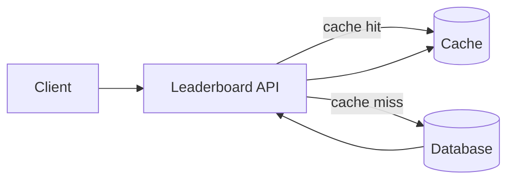
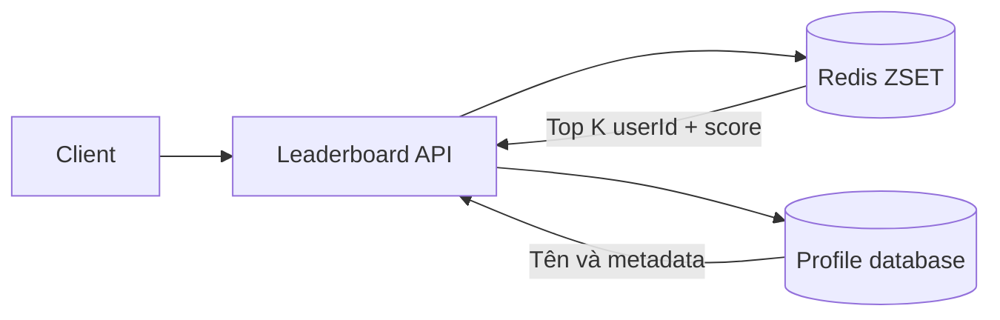
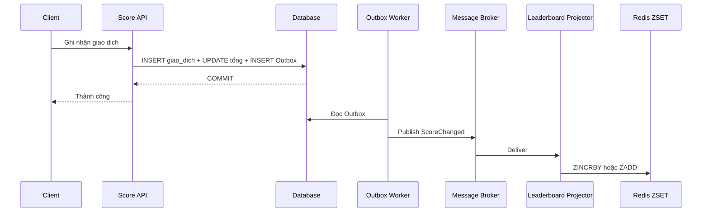

# Top-K Leaderboard và kiến trúc xếp hạng theo tải

Một hệ thống bán hàng cần hiển thị những cửa hàng có doanh thu cao nhất trong ngày. Phiên bản đầu tiên chỉ có vài nghìn giao dịch và vài chục người xem báo cáo. Một truy vấn SQL trực tiếp có thể trả kết quả đúng trong thời gian chấp nhận được.

Khi số cửa hàng, giao dịch và người xem tăng, cùng một truy vấn bắt đầu phải cạnh tranh với luồng ghi. Sau đó yêu cầu nghiệp vụ tiếp tục mở rộng: bảng xếp hạng phải cập nhật trong vài giây, hỗ trợ thứ hạng của từng cửa hàng, hiển thị theo ngày hoặc tuần, và vẫn đọc được khi một thành phần tạm thời gặp sự cố.

**Top-K** là phép lấy `K` phần tử có giá trị cao nhất theo một thước đo. **Leaderboard** là read model duy trì thứ tự đó để trả lời nhanh các truy vấn như Top 10, thứ hạng của một cửa hàng, hoặc các cửa hàng đứng gần nó.

Tài liệu này không bắt đầu bằng Redis hay message broker. Mỗi kiến trúc chỉ xuất hiện khi load parameter mới làm giải pháp trước đó không còn đáp ứng. Business case xuyên suốt là bảng xếp hạng doanh thu cửa hàng.

---

## 1. Access pattern và load parameter

Thiết kế leaderboard bắt đầu từ các thao tác hệ thống phải phục vụ, không bắt đầu từ tên công nghệ.

```text
Write:
- Ghi nhận một giao dịch bán hàng
- Cộng doanh thu vào tổng của cửa hàng
- Điều chỉnh hoặc hoàn tiền một giao dịch

Read:
- Lấy Top K cửa hàng
- Lấy thứ hạng của một cửa hàng
- Lấy các cửa hàng đứng gần một cửa hàng
- Lấy bảng xếp hạng theo ngày, tuần hoặc tháng
```

Các câu hỏi đầu vào cần được trả lời trước khi chọn giải pháp:

```text
1. Có bao nhiêu cửa hàng tham gia xếp hạng?
2. Trung bình và peak có bao nhiêu giao dịch mỗi giây?
3. Có bao nhiêu request đọc bảng xếp hạng mỗi giây?
4. K thường bằng 10, 100 hay lớn hơn?
5. Kết quả phải chính xác tuyệt đối hay được phép xấp xỉ?
6. Giao dịch mới phải xuất hiện sau bao lâu?
7. Điểm là giá trị tuyệt đối hay số gia cần cộng thêm?
8. Khi bằng điểm, quy tắc xếp hạng là gì?
9. Có cần thứ hạng của mọi cửa hàng hay chỉ Top K?
10. Cần all-time, calendar window hay sliding window?
11. Có multi-tenant, nhiều chi nhánh hoặc nhiều khu vực không?
12. Khi Redis hoặc consumer lỗi, hệ thống được phép cũ bao lâu?
```

### 1.1 Tách write load và read load

Nếu mỗi giao dịch tạo một score update:

```text
write_qps = transactions_per_second
```

Nếu dashboard tự refresh:

```text
read_qps = active_clients / refresh_interval_seconds
```

Ví dụ ban đầu:

```text
2.000 cửa hàng
100.000 giao dịch/ngày
peak 20 giao dịch/giây
50 dashboard refresh mỗi 30 giây

read_qps = 50 / 30 ≈ 1,7 request/giây
```

Đây là tải nhỏ. Một database quan hệ có index phù hợp thường đã đủ. Redis và message queue chưa giải quyết vấn đề nào tồn tại ở giai đoạn này.

### 1.2 Correctness và freshness

Hai yêu cầu này cần được tách riêng:

- **Correctness** xác định doanh thu đã được ghi nhận đúng, không cộng trùng và không mất hoàn tiền.
- **Freshness** xác định read model chậm hơn nguồn dữ liệu thật bao lâu.

Database giao dịch thường bảo vệ correctness. Cache hoặc Redis leaderboard có thể chậm hơn vài giây nhưng phải có khả năng khôi phục từ nguồn dữ liệu đúng.

---

## 2. Mức tải nhỏ: truy vấn SQL trực tiếp

Phiên bản nhỏ nhất cần hai nhóm dữ liệu:

```sql
CREATE TABLE giao_dich (
    id BIGINT PRIMARY KEY,
    cuaHangId BIGINT NOT NULL,
    soTien DECIMAL(18, 2) NOT NULL,
    trangThai VARCHAR(30) NOT NULL,
    occurredAt DATETIME NOT NULL
);

CREATE TABLE doanh_thu_cua_hang (
    cuaHangId BIGINT NOT NULL,
    ngay DATE NOT NULL,
    tongDoanhThu DECIMAL(18, 2) NOT NULL,
    updatedAt DATETIME NOT NULL,
    PRIMARY KEY (cuaHangId, ngay)
);
```

`giao_dich` giữ lịch sử chi tiết. `doanh_thu_cua_hang` là bảng tổng hợp để mỗi lần đọc không phải cộng lại toàn bộ giao dịch trong ngày.

Top 10 được đọc trực tiếp:

```sql
SELECT cuaHangId, tongDoanhThu
FROM doanh_thu_cua_hang
WHERE ngay = @ngay
ORDER BY tongDoanhThu DESC, cuaHangId ASC
LIMIT 10;
```

Thứ hạng của một cửa hàng có thể tính bằng số cửa hàng đứng trước:

```sql
SELECT COUNT(*) + 1 AS xepHang
FROM doanh_thu_cua_hang
WHERE ngay = @ngay
  AND (
      tongDoanhThu > @tongDoanhThu
      OR (tongDoanhThu = @tongDoanhThu AND cuaHangId < @cuaHangId)
  );
```

Giải pháp này có ưu điểm quan trọng: ít thành phần, dễ transaction, dễ backup và dễ debug. Không nên thay nó chỉ vì Redis thường xuất hiện trong các bài leaderboard.

### 2.1 Transaction cập nhật doanh thu

Giao dịch bán hàng và tổng doanh thu phải cùng phản ánh một kết quả nghiệp vụ. Một transaction có thể ghi lịch sử rồi cập nhật bảng tổng hợp:

```text
BEGIN
  INSERT giao_dich
  UPSERT doanh_thu_cua_hang += soTien
COMMIT
```

Request retry cần một `id` hoặc idempotency key ổn định. Nếu cùng một giao dịch được gửi lại, hệ thống nhận ra bản ghi đã tồn tại thay vì cộng doanh thu lần thứ hai.

---

## 3. Dữ liệu tăng: index theo thứ tự xếp hạng

Khi bảng tổng hợp tăng, database có thể phải sort nhiều row cho mỗi request. Index ghép theo điều kiện lọc và thứ tự xếp hạng cho phép database đọc phần đầu của index thay vì sort toàn bộ tập kết quả.

```sql
CREATE INDEX ix_doanh_thu_ngay_xep_hang
ON doanh_thu_cua_hang (ngay, tongDoanhThu DESC, cuaHangId ASC);
```

Index này phục vụ đúng access pattern:

```text
lọc theo ngay
→ đọc theo tongDoanhThu giảm dần
→ dùng cuaHangId để phá hòa
→ dừng sau K row
```

Index không miễn phí. Mỗi score update phải cập nhật cả row và vị trí tương ứng trong index. Khi write load tăng mạnh, index giúp read nhanh hơn nhưng làm đường ghi tốn thêm I/O và contention.

### 3.1 Top K và user rank là hai truy vấn khác nhau

Top K chỉ đọc một phần nhỏ ở đầu index. Rank của một cửa hàng có thể phải đếm rất nhiều phần tử đứng trước nó. Một hệ thống đáp ứng Top 10 nhanh chưa chắc trả rank của cửa hàng thứ 900.000 nhanh như vậy.

Yêu cầu `Get Top K` và `Get user rank` phải được ước lượng riêng. Không nên kết luận toàn bộ leaderboard đã được tối ưu chỉ từ latency của Top K.

### 3.2 Ngưỡng chuyển tiếp

Giữ SQL + index khi:

- Số entity còn nằm trong khả năng của một database instance.
- Write throughput chưa làm index trở thành bottleneck.
- Latency Top K và rank vẫn đạt SLO.
- Freshness đồng bộ là lợi thế đáng giữ.

Chuyển sang cache trước khi chuyển sang một hệ thống ranking riêng nếu vấn đề chủ yếu đến từ nhiều request đọc cùng một Top K.

---

## 4. Read load tăng: cache kết quả Top K

Giả sử tải thay đổi:

```text
20.000 cửa hàng
peak 50 score update/giây
500 dashboard đang mở
dashboard refresh mỗi 10 giây

read_qps = 500 / 10 = 50 request/giây
```

Các client chủ yếu hỏi cùng một kết quả Top 10. Chạy lại cùng truy vấn 50 lần mỗi giây không tạo thêm giá trị nghiệp vụ. Một cache theo `leaderboardId`, time window và `K` có thể hấp thụ phần lớn read load.

```text
leaderboard:doanh-thu:2026-10-11:top:10
```

Luồng đọc trở thành:



Hai chiến lược phổ biến:

- **TTL ngắn**: cache trong 5–30 giây. Đơn giản và chấp nhận một khoảng stale rõ ràng.
- **Invalidation theo update**: xóa hoặc cập nhật cache khi score đổi. Fresh hơn nhưng thêm coordination vào write path.

Với Top K được đọc nhiều và cho phép trễ vài giây, TTL ngắn thường là thay đổi nhỏ nhất đáp ứng tải mới.

### 4.1 Giới hạn của cache danh sách

Cache một mảng Top 10 không trả lời hiệu quả rank của mọi cửa hàng. Khi nghiệp vụ cần cập nhật gần thời gian thực và đọc thứ hạng tùy ý, hệ thống cần một read model duy trì thứ tự thay vì chỉ cache một response.

---

## 5. Freshness và write load tăng: Redis Sorted Set

Giả sử yêu cầu tiếp tục tăng:

```text
50.000 cửa hàng hoặc người chơi
peak 100 score update/giây
peak 500 read/giây
Top K p99 < 100 ms
score mới hiển thị sau 5-10 giây
```

**Redis Sorted Set**, viết tắt là ZSET, lưu mỗi member kèm một score và duy trì thứ tự theo score. Trong business case này:

```text
member = cuaHangId
score  = tongDoanhThu
```

Các thao tác chính:

```redis
ZINCRBY leaderboard:doanh-thu:2026-10-11 250000 store-123
ZREVRANGE leaderboard:doanh-thu:2026-10-11 0 9 WITHSCORES
ZREVRANK leaderboard:doanh-thu:2026-10-11 store-123
ZSCORE leaderboard:doanh-thu:2026-10-11 store-123
```

`ZINCRBY` cập nhật score theo `O(log N)`. `ZREVRANK` lấy vị trí theo `O(log N)`. Đọc `K` phần tử bằng range query có độ phức tạp `O(log N + K)`. Khi `K` nhỏ và cố định, chi phí chủ yếu tăng theo logarithm của số member.



Redis chỉ nên giữ dữ liệu cần cho ranking. Tên, avatar và metadata của cửa hàng vẫn được đọc từ database hoặc một profile cache riêng. Nhét toàn bộ object vào member làm tăng memory và khiến cập nhật metadata ảnh hưởng không cần thiết đến ranking index.

### 5.1 Source of truth và read model

Redis nhanh nhưng không tự động trở thành nguồn dữ liệu đúng. Phân vai rõ ràng:

```text
Database / event log = source of truth
Redis ZSET           = read model có thể dựng lại
```

Nếu Redis mất key, hệ thống phải có quy trình rebuild từ lịch sử giao dịch hoặc bảng tổng hợp. Nếu không thể rebuild, Redis đang giữ business state quan trọng hơn tên gọi "cache" của nó.

### 5.2 Tie-breaking

Leaderboard phải định nghĩa quy tắc khi hai cửa hàng có cùng doanh thu:

```text
1. Cùng rank
2. Cửa hàng đạt score trước đứng trên
3. cuaHangId nhỏ hơn đứng trên
```

Không nên để thứ tự từ điển mặc định của member vô tình trở thành business rule. Nếu cần thứ tự đạt điểm, có thể lưu metadata riêng hoặc mã hóa một score tổng hợp khi precision và giới hạn số học đã được chứng minh an toàn.

---

## 6. Dual write và cửa sổ lỗi

Một service ghi trực tiếp cả database lẫn Redis tạo ra hai cửa sổ lỗi:

```text
Database thành công → Redis thất bại
Redis thành công    → Database thất bại
```

Không có transaction phân tán tự nhiên giữa hai hệ thống. Đổi thứ tự ghi chỉ đổi loại inconsistency, không loại bỏ nó.

Một thiết kế an toàn hơn ghi business state và Outbox trong cùng transaction:



Read model trở thành eventually consistent. Đổi lại, giao dịch đã commit không mất chỉ vì Redis hoặc broker tạm thời không hoạt động.

---

## 7. Write burst tăng: durable event stream

Khi score update xuất hiện theo burst, API không nên giữ request để chờ toàn bộ pipeline ranking hoàn tất. Một durable broker hoặc event stream hấp thụ burst và cho phép consumer xử lý theo tốc độ ổn định.

Event cần mang đủ thông tin để xử lý an toàn:

```json
{
  "eventId": "evt-20261011-000123",
  "leaderboardId": "doanh-thu-ngay",
  "cuaHangId": 123,
  "ngay": "2026-10-11",
  "soTienThayDoi": 250000,
  "occurredAt": "2026-10-11T09:30:00+07:00"
}
```

Consumer phải idempotent vì message có thể được giao lại:

```text
Nếu eventId đã xử lý → ACK và bỏ qua
Nếu chưa xử lý       → cập nhật projection → ghi eventId → ACK
```

Nếu `ZINCRBY` chạy hai lần cho cùng một event, doanh thu bị cộng trùng. Inbox hoặc processed-event store phải nằm trong cùng consistency boundary với logic cập nhật, hoặc projection phải dùng version/giá trị tuyệt đối để update có điều kiện.

### 7.1 Latency trở thành correctness constraint

Freshness SLO là:

```text
projection_lag = redis_updated_at - event_committed_at
```

Nếu nghiệp vụ yêu cầu score hiển thị trong hai giây, consumer lag lớn hơn hai giây là một vi phạm SLO dù dữ liệu cuối cùng vẫn hội tụ. Queue depth, consumer lag và thời gian rebuild cần được đo như metric chính.

---

## 8. Time window và dữ liệu lịch sử

All-time, ngày, tuần và sliding 24 giờ có semantics khác nhau.

Calendar window có thể dùng key riêng:

```text
leaderboard:doanh-thu:all-time
leaderboard:doanh-thu:day:2026-10-11
leaderboard:doanh-thu:week:2026-W41
leaderboard:doanh-thu:month:2026-10
```

Mỗi event cập nhật các window cần thiết. Key cũ được đặt TTL theo retention policy sau khi window đóng.

Sliding window như "24 giờ gần nhất" khó hơn vì đóng góp của từng event phải được loại bỏ đúng lúc. Một ZSET chỉ giữ tổng score theo cửa hàng không biết phần nào của tổng đã hết hạn.

Các hướng xử lý:

- Lưu tổng theo time bucket nhỏ rồi cộng các bucket còn hiệu lực.
- Dùng stream processor duy trì rolling aggregation.
- Recompute định kỳ nếu freshness cho phép.
Window semantics phải được định nghĩa trước khi chọn key schema.

---

## 9. Failure handling và recovery

### Database thành công nhưng Redis chưa cập nhật

Outbox tiếp tục retry. API có thể trả dữ liệu cũ trong freshness budget. Nếu lag vượt SLO, hệ thống cảnh báo thay vì âm thầm coi read model là đúng.

### Redis mất dữ liệu

Tạm thời fallback về snapshot hoặc database nếu tải cho phép. Chạy rebuild từ bảng tổng hợp hay event log, sau đó chuyển read traffic trở lại Redis.

### Consumer xử lý trùng

Dùng `eventId`, Inbox hoặc version để update idempotent. Không dựa vào giả định broker chỉ giao đúng một lần.

### Consumer xử lý sai thứ tự

Nếu event chứa số gia, reorder có thể không ảnh hưởng phép cộng nhưng vẫn ảnh hưởng hoàn tiền hoặc reset. Nếu event chứa giá trị tuyệt đối, dùng version và chỉ áp dụng version mới hơn.

### API instance giữ buffer rồi bị dừng

Không ACK client trước khi update đã được ghi vào durable storage. Buffer trong memory chỉ được dùng để tối ưu sau khi event đã durable, không được là bản sao duy nhất của update.

### Reconciliation

Một job định kỳ so sánh database aggregate với Redis score theo mẫu hoặc theo nhóm cửa hàng:

```text
expectedScore != redisScore
→ ghi metric
→ sửa projection
→ lưu nguyên nhân và version
```

Reconciliation biến inconsistency từ lỗi không quan sát được thành trạng thái có thể phát hiện và phục hồi.

---

## 10. API shape

Ghi score nên thể hiện rõ semantics:

```http
POST /api/leaderboards/doanh-thu-ngay/events
Idempotency-Key: txn-789
```

```json
{
  "cuaHangId": 123,
  "soTienThayDoi": 250000,
  "occurredAt": "2026-10-11T09:30:00+07:00"
}
```

Lấy Top K:

```http
GET /api/leaderboards/doanh-thu-ngay/top?k=10&window=2026-10-11
```

Lấy rank và các phần tử lân cận:

```http
GET /api/leaderboards/doanh-thu-ngay/members/123/context?range=5&window=2026-10-11
```

Response nên cho biết freshness:

```json
{
  "cuaHangId": 123,
  "xepHang": 42,
  "tongDoanhThu": 12500000,
  "updatedAt": "2026-10-11T09:30:01+07:00",
  "isApproximate": false
}
```

---

## 11. Observability

Dashboard vận hành nên có:

```text
score_update_qps
leaderboard_read_qps
top_k_latency_p50 / p95 / p99
rank_lookup_latency_p50 / p95 / p99
cache_hit_ratio
projection_lag_seconds
consumer_queue_depth
duplicate_event_count
redis_memory_used
redis_eviction_count
redis_replication_lag
rebuild_duration_seconds
reconciliation_mismatch_count
```

Không chỉ đo API latency. Một response Redis trả trong 5 ms nhưng dữ liệu chậm 10 phút vẫn là lỗi nếu freshness SLO là hai giây.

---

## 12. Ngưỡng nâng cấp kiến trúc

| Áp lực mới | Dấu hiệu đo được | Thay đổi nhỏ nhất |
|---|---|---|
| Dữ liệu tăng | Top K bắt đầu sort hoặc scan nhiều | Thêm bảng tổng hợp và index phù hợp |
| Read tăng | Nhiều client hỏi cùng một kết quả | Cache Top K với TTL |
| Cần rank và freshness thấp | Cache response không đủ truy vấn | Redis ZSET làm read model |
| Write burst | API hoặc Redis update không hấp thụ peak | Durable event stream và consumer |
| Dual write gây lệch | DB đúng nhưng Redis thiếu update | Outbox, idempotent projector, reconciliation |
| Nhiều time window | Recompute gây tải hoặc sliding window sai | Time bucket hoặc stream processing |

Lộ trình tổng quát:

```text
SQL trực tiếp
→ bảng tổng hợp + index
→ cache Top K
→ Redis ZSET read model
→ Outbox + durable event stream
```

Mỗi mũi tên phải được biện minh bằng metric hoặc yêu cầu mới. Không triển khai toàn bộ chuỗi ngay từ phase đầu.

---

## 13. Những lỗi thiết kế thường gặp

1. **Chọn Redis trước khi tính tải**  
   Hệ thống có thêm failure mode nhưng chưa giải quyết bottleneck thật.

2. **Đồng nhất cache với source of truth**  
   Redis mất dữ liệu nhưng không có quy trình rebuild.

3. **Dual write không có recovery**  
   Database và leaderboard lệch mà không có Outbox hoặc reconciliation.

4. **Không định nghĩa score update**  
   Giá trị tuyệt đối, số gia và reset có semantics retry khác nhau.

5. **Không có idempotency**  
   Client retry hoặc broker redelivery làm cộng điểm nhiều lần.

6. **Không định nghĩa tie-breaking**  
   Thứ tự kỹ thuật vô tình trở thành luật nghiệp vụ.

7. **Chỉ giải quyết Top K nhưng tuyên bố đã giải quyết rank**  
   Rank của một member có access pattern và chi phí riêng.

8. **Dùng local memory buffer trước durable write**  
   Instance crash sau khi ACK làm mất score update.

9. **Dùng một tổng score cho sliding window**  
    Hệ thống không biết phần đóng góp nào đã hết hạn.

---

## 14. Checklist review

```text
[ ] Đã tính write QPS, read QPS, K và số member chưa?
[ ] Đã định nghĩa freshness và exact/approximate chưa?
[ ] Score là giá trị tuyệt đối hay số gia?
[ ] Có idempotency key hoặc eventId không?
[ ] Tie-breaking được định nghĩa bằng business rule chưa?
[ ] SQL + index có còn đáp ứng không?
[ ] Cache có TTL/invalidation và freshness budget không?
[ ] Database hoặc event log có phải source of truth không?
[ ] Redis có thể rebuild không?
[ ] Dual write có Outbox/recovery không?
[ ] Consumer có idempotency và xử lý reorder không?
[ ] Top K và user rank được benchmark riêng chưa?
[ ] Time window là calendar hay sliding?
[ ] Có đo projection lag và reconciliation mismatch không?
[ ] Mỗi bước nâng cấp có metric chứng minh nhu cầu không?
```

---

## 15. Tổng kết

Top-K Leaderboard không mặc định đồng nghĩa với Redis. Ở tải nhỏ, bảng tổng hợp và index trong database thường là giải pháp đúng, dễ vận hành và nhất quán nhất. Khi read load tăng, cache Top K giải quyết việc nhiều client đọc cùng kết quả. Khi hệ thống cần cập nhật thứ hạng gần thời gian thực cho nhiều member, Redis ZSET trở thành read model phù hợp.

Write burst và dual write chỉ nên kéo theo Outbox, durable event stream và idempotent consumer khi metric hoặc yêu cầu reliability chứng minh nhu cầu. Kiến trúc tốt không phải kiến trúc dùng nhiều thành phần nhất. Nó là chuỗi nâng cấp nhỏ nhất giữ được correctness khi load parameter thay đổi trong quy mô hệ thống thực tế.

## Tài liệu tham khảo

- [Redis Sorted Sets](https://redis.io/docs/latest/develop/data-types/sorted-sets/)
- [TechPrep: Top-K Leaderboard](https://www.techprep.app/blog/top-k-leaderboard-system-design)
- [Video: Top-K Leaderboard System Design](https://www.youtube.com/watch?v=D6FKzYYm0eo)
